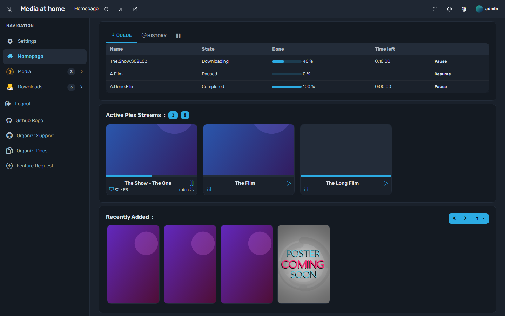

# 🏠 Organizr (Rust)

[](https://github.com/tronyx/organizr-rust/actions/workflows/build.yml)
[](https://github.com/tronyx/organizr-rust/pkgs/container/organizr-rust)
[](LICENSE)

[Organizr](https://github.com/causefx/Organizr) is one start page for your home server: Plex, Sonarr, your downloaders and the rest as tabs, behind one login that decides who sees what. This is a rewrite of PHP Organizr 2.1.5000 in Rust, in one small container, and it keeps the PHP API, so your scripts and reverse proxy rules keep working.

> [!NOTE]
> Not released yet. The image tag `develop` holds the newest state, and it can change at any time. Try it, and keep your PHP install until you're happy with it.



## ✨ Features

- 🗂 **Tabs, categories, users and groups**: each application in your menu, opened inside Organizr or in a new window, shown only to the groups you pick.
- 🏠 **A homepage with about 40 items**: Plex, Emby, Jellyfin, Tautulli, Overseerr, Ombi, the Sonarr/Radarr/Lidarr calendar, SABnzbd, qBittorrent, NZBGet, Transmission, Deluge, Pi-hole, AdGuard Home, Uptime Kuma, weather, custom HTML and more. See [Homepage](docs/homepage.md).
- 🔐 **Log in your way**: Organizr passwords, Plex, LDAP, FTP, Emby, Jellyfin, or OpenID Connect (Authentik, Keycloak, PocketID, Zitadel), with an optional second factor and a lock screen.
- 🔗 **Single sign-on** to Plex, Jellyfin, Ombi, Overseerr, Petio, Tautulli and Komga, and **forward auth**, so your reverse proxy can guard your other applications with Organizr's login.
- 🧩 **Seven built-in plugins**: bookmarks, chat, health checks, invites, e-mail (PHP Mailer), Plex Libraries and speed test. Plus **extensions** by other authors, which run in a sandbox and reach only the sites you approve. Approve only extensions whose author you trust.
- 🎨 **Two layouts**: the classic OG Organizr layout with its 13 themes, and a modern layout with 10 themes. Each person can pick their own look, and their language from more than 30.
- 💾 **Backups and restore**, also on a schedule, with no cron table: the scheduler runs inside the server.
- 🧳 **Import from PHP Organizr**: users with their passwords and second factors, tabs, settings, pictures and plugin data, in one command that never changes the old install.
- 🗄 **SQLite or PostgreSQL**, with a one-way move from SQLite to PostgreSQL when you outgrow it.
- 🧰 **Handy commands**: `import`, `move-to-postgres`, `check` (ask all your services at once), `restore` and `healthcheck`. See [Configuration](docs/configuration.md#-commands).
- 🔒 **Safe by default**: no shell in the image, runs as a non-root user, encrypts the secrets it stores, and trusts no proxy headers until you say so.

## 🚀 Quick start

You need Docker with Docker Compose, on an `amd64` or `arm64` machine.

> [!IMPORTANT]
> Coming from PHP Organizr? Stop after step 1 and follow [Moving from PHP Organizr](docs/moving-from-php.md): the import must run before the first start.

1. Make a folder, and save [docker/examples/compose.sqlite.yaml](docker/examples/compose.sqlite.yaml) in it as `compose.yaml`:

   ```bash
   mkdir organizr && cd organizr
   ```

2. Start Organizr:

   ```bash
   docker compose up -d
   ```

3. Get the set-up code from the log:

   ```bash
   docker compose logs organizr | grep "set-up code"
   ```

   It's on a line like `... the set-up wizard asks for the set-up code K7QM-2XWD-9RTB`.

4. Open `http://<your server>:8080`, where `<your server>` is the address of the machine that runs Docker (for example `http://192.168.1.10:8080`).
5. Fill in the set-up wizard with the code and your Admin account. [Installation](docs/installation.md#-the-set-up-wizard) explains each field, and how to add your first tab.

Your data lives in the volume `<folder>_organizr-data` (`organizr_organizr-data` here). A named volume needs nothing; a host folder must belong to the user `65532`. Want PostgreSQL instead? Start from [compose.postgres.yaml](docker/examples/compose.postgres.yaml), and see [Choosing a database](docs/choosing-a-database.md).

> [!WARNING]
> Port 8080 speaks plain HTTP. Never forward it from your router. To reach Organizr from outside, put a [reverse proxy](docs/reverse-proxy.md) with HTTPS in front, set `ORGANIZR_TRUSTED_PROXIES` to the proxy's address, then remove the `ports:` lines. Docker opens published ports past firewalls such as ufw and firewalld.

[Installation](docs/installation.md) covers `docker run`, the data folder, updates and rollbacks; [Configuration](docs/configuration.md) lists every setting of the container.

## 💻 What's different from PHP Organizr

- 🐳 One container with no PHP, web server or cron. The database is chosen with an environment variable, not in the wizard.
- 🔒 Stricter security: a set-up code for the wizard, proxy headers believed only from trusted proxies, a server-side login lockout, and sandboxed custom HTML and extensions.
- 🎨 The pages are new, so custom CSS from PHP needs new names: see [Custom CSS](docs/custom-css.md). Custom JavaScript runs only when you switch it on.
- 🧩 Plugins by other authors are WebAssembly extensions, not PHP files.

[Deviations](docs/deviations.md) lists every difference, with its reason. [Release notes](docs/release-notes.md) has the ones you're most likely to notice.

## 📖 Documentation

| Section | What you'll find |
| --- | --- |
| [🚀 Getting started](docs/README.md#-getting-started) | Installation, moving from PHP, databases, troubleshooting and recovery |
| [🧭 Using Organizr](docs/README.md#-using-organizr) | The homepage, appearance, e-mail and backups |
| [🔐 Logging in](docs/README.md#-logging-in) | Plex, LDAP, OpenID Connect, second factor, single sign-on |
| [🌐 Proxies and the API](docs/README.md#-proxies-and-the-api) | Reverse proxy, forward auth, API SOCKS |
| [🧩 Plugins and extensions](docs/README.md#-plugins-and-extensions) | The built-in plugins and sandboxed extensions |
| [🔩 Running the server](docs/README.md#-running-the-server) | Secrets and their key, scheduled jobs, the log, releases and the security policy |
| [📚 Reference](docs/README.md#-reference) | Every environment variable and command, and every deviation from PHP |

[All documentation](docs/README.md) lists every page.

## 🤝 Contributing

Bug reports, ideas and pull requests are welcome. The [contributing guide](CONTRIBUTING.md) tells you how to build, test and check a change.

## 🔒 Security

Don't open a public issue for a security vulnerability. Follow the [security policy](SECURITY.md) to report it privately.

## 📄 License

GPL-3.0, as Organizr. See [LICENSE](LICENSE). [Third-party assets](docs/third-party-assets.md) lists the pictures and icons of other projects that the image holds.
