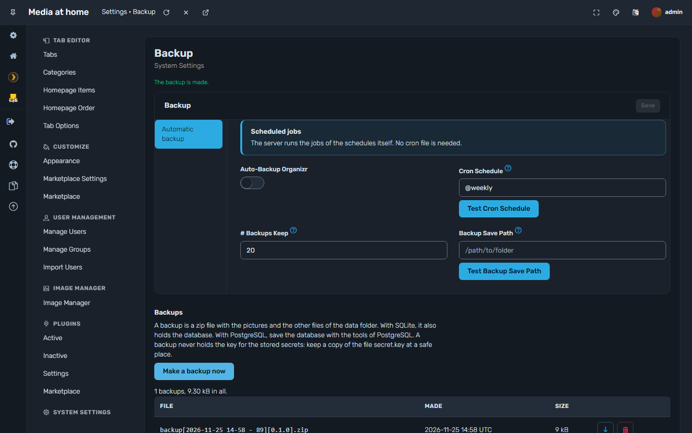

# 💾 Backups

[← All documentation](README.md)

Organizr can back up your install to one zip file, on demand or on a schedule, and put it back with one command. Read this before your first update, and again on the day something breaks.

## 📦 What a backup holds

| Part of the install | In the backup? |
|---|---|
| The files of the data folder: uploaded pictures, favicon files, the log files (`logs`), your extensions (`plugins`) and other files | ✅ Yes |
| The SQLite database | ✅ Yes, as a copy that is whole even while the server runs |
| A PostgreSQL database | ❌ No. Save it with `pg_dump` (see [With PostgreSQL](#-with-postgresql)) |
| The key for stored secrets, the file `secret.key`, or the file that `ORGANIZR_SECRET_KEY_FILE` names when it's in the data folder | ❌ No, never (D-147) |
| The picture cache and older backups | ❌ No |

The passwords and tokens of your other services are sealed in the database with `secret.key`. Because the backup never holds the key, someone who gets a backup can't read them. But neither can a restored install without the key: those secrets are lost, and users with a [second factor](second-factor.md) can't log in. [Secrets](secrets.md#-if-the-key-is-lost-or-wrong) explains what to do then.

> [!IMPORTANT]
> Keep a copy of `secret.key` somewhere other than your backups, for example in your password manager. A backup and its key in one place are as open as a database without encryption. You need to copy the key only once; it doesn't change.

A backup also holds the password hashes of every user, and the log files (with user names and client addresses). That's why only an Admin or a Co-Admin can make, save and delete backups, as in PHP Organizr. Keep this in mind when you make somebody a Co-Admin.

> [!TIP]
> A downloaded backup is sensitive. Keep it where only you can read it.

## 🚀 Make a backup now



1. Log in as an Admin or a Co-Admin.
2. Open **Settings › System Settings › Backup**.
3. Select **Make a backup now**. The list below shows the new backup, with its date and size.
4. To copy it to your computer, select the download button (**Save**) in its row.
5. The first time only: copy `secret.key` from the data folder to a safe place (see above).

A backup's file name looks like `backup[2026-11-20_03-15 - ab][0.1.0].zip`: the time it was made (UTC), two characters that tell backups of the same minute apart, and the version of Organizr that made it.

To delete a backup, select the trash button (**Delete**) in its row.

> [!WARNING]
> **Delete** doesn't ask first. The backup is gone as soon as you select it.

### 📁 Where the backups go

The backups are in the folder `backups` of the data folder (`/config/backups` in the container). To use another folder, enter it in **Backup Save Path** on the same page.

- The folder must exist, and the user that runs the server must be able to write to it. In the container image that's user `65532`.
- Select **Test Backup Save Path** to check that the folder exists. The test makes no folder.

## ⏰ Automatic backups

These settings are in the section **Automatic backup** of **Settings › System Settings › Backup**, above the list of backups.

| Setting | Key | Default |
|---|---|---|
| Auto-Backup Organizr | `autoBackupCronEnabled` | Off |
| Cron Schedule | `autoBackupCronSchedule` | `@weekly` |
| # Backups Keep | `keepBackupsCountCron` | 20 |
| Backup Save Path | `backupLocation` | Empty: the folder `backups` in the data folder |

- After each new backup, Organizr deletes the oldest backups over the number to keep. `0` keeps every backup.
- The server runs the schedule itself; no cron file is needed. [Scheduled jobs](scheduled-jobs.md) shows how to write a schedule.
- Select **Test Cron Schedule** to check that the scheduler can read your schedule. [Tests of the settings](settings-tests.md) shows how a script checks that the scheduler runs.

### 🤖 From a script

A script can make a backup with the [API key](#-the-routes-for-scripts) in the `token` header:

```bash
curl -fsS -X POST -H "token: <api-key>" https://organizr.example.com/api/v2/backup
```

- `<api-key>`: the API key of your install, in the field **Organizr API** on **Settings › System Settings › General** (Admin only).

## 🔄 Restore a backup

The command `organizr restore` puts a backup back. It writes the files into the data folder, and with SQLite it also writes the database.

> [!WARNING]
> A restore replaces what's there. `--overwrite` replaces the database in the data folder, and `pg_restore --clean` (for PostgreSQL) replaces the tables. Anything changed since the backup is gone. If the current state might still matter, make a backup of it first.

### 🐳 With Docker Compose

These steps fit the [example Compose files](../docker/examples/). Run them in the folder that holds your Compose file. If your file isn't called `compose.yaml`, add `-f <your-file>` after `docker compose`, for example `docker compose -f compose.sqlite.yaml stop organizr`.

1. **Get the backup's file name.** If the web page still works, it's in the list on **Settings › System Settings › Backup**. If it doesn't, copy the backups folder out of the container and look:

   ```bash
   docker compose cp organizr:/config/backups ./organizr-backups
   ls ./organizr-backups
   ```

2. **Stop the server:**

   ```bash
   docker compose stop organizr
   ```

3. **Check the key.** The `secret.key` of the install that made the backup must be in the data folder. On the same install it already is. On a new install, put your saved copy back first (see [Secrets](secrets.md)).

4. **Run the restore** from the backups folder inside the data volume:

   ```bash
   docker compose run --rm organizr restore \
     --from "/config/backups/<backup-file>" --overwrite
   ```

   - `<backup-file>`: the file name from step 1, for example `backup[2026-11-20_03-15 - ab][0.1.0].zip`. Keep the double quotes: the name has spaces and brackets.

   The command prints what it restored, ending with a note about the key.

5. **Start the server:**

   ```bash
   docker compose up -d
   ```

6. **Check it.** The log should show `the database is ready`. Then log in.

   ```bash
   docker compose logs organizr | grep "the database is ready"
   ```

**Your backup is on your computer, not in the volume?** Mount its folder for step 4 instead:

```bash
docker compose run --rm -v <host-folder>:/backups:ro organizr restore \
  --from "/backups/<backup-file>" --overwrite
```

- `<host-folder>`: the folder on your computer that holds the zip, for example `/home/me/organizr-backups`.

### 🐋 With docker run

If you started Organizr with `docker run` and a volume named `organizr-data`:

```bash
docker stop organizr
docker run --rm \
  -v organizr-data:/config \
  -v <host-folder>:/backups:ro \
  ghcr.io/tronyx/organizr-rust:develop \
  restore --from "/backups/<backup-file>" --overwrite
docker start organizr
```

- `<host-folder>`: the folder on your computer that holds the zip.
- `<backup-file>`: the backup's file name, in double quotes as shown.
- `organizr`: the container name you gave `docker run --name`.

> [!NOTE]
> With Compose, the volume isn't called `organizr-data`: Compose puts your project's name in front, as in `<project>_organizr-data`. A `docker run -v organizr-data:/config` restore on a Compose install writes into a new, empty volume, and nothing changes. Use the Compose steps above.

### 🚢 Elsewhere (Kubernetes and friends)

Scale the server down to zero, then run `organizr restore --from <file> --overwrite` once as a one-off job or pod with the same data volume mounted, and scale back up.

### 🐘 With PostgreSQL

A backup of a PostgreSQL install holds the files only, and `organizr restore` says so ("The backup holds no database"). Save and restore the database with the tools of PostgreSQL. The commands below fit the example `compose.postgres.yaml` (service `database`, user and database `organizr`).

**Save the database**, right after you make the Organizr backup:

```bash
docker compose exec database pg_dump --username organizr --format custom --file /tmp/organizr.dump organizr
docker compose cp database:/tmp/organizr.dump ./organizr.dump
docker compose exec database rm /tmp/organizr.dump
```

These commands work the same in Bash, PowerShell and the Windows command prompt, because the dump is written inside the container and then copied out.

> [!CAUTION]
> `organizr.dump` is as private as a backup: it holds every user's password hash and the sealed secrets. The secrets are useless without `secret.key`, but the hashes aren't. Keep the dump where only you can read it.

**Restore** (files first, then the database):

1. Stop Organizr: `docker compose stop organizr`. Leave `database` running.
2. Restore the files with `organizr restore`, as in the Compose steps above.
3. Copy the dump into the database container, restore it, and remove the copy:

   ```bash
   docker compose cp ./organizr.dump database:/tmp/organizr.dump
   docker compose exec database pg_restore --username organizr --dbname organizr --clean --if-exists /tmp/organizr.dump
   docker compose exec database rm /tmp/organizr.dump
   ```

4. Start Organizr: `docker compose up -d`, and check the log for `the database is ready`.

> [!NOTE]
> The file backup and the database dump are two separate snapshots. Make them one right after the other, at a quiet moment, so they match. A change made between the two (a new tab, a new user) ends up in only one of them.

## 🔍 Details

### 🧰 Options of `organizr restore`

| Option | Meaning |
|---|---|
| `--from` | The backup zip |
| `--overwrite` | Replace the database in the data folder. Without it, the command stops when a database exists, and changes nothing |
| `--data-dir` | The data folder, when it isn't the default (`/config` in the image) |

The restore also takes the same database options as `organizr serve` (for example `--database-url`).

- A file of the data folder that's also in the backup is replaced. A file that's only in the data folder stays.
- A SQLite backup restored on a PostgreSQL install puts back the files only. The command skips the database and says so ("this install does not keep its database in a file").
- A backup from an older version of Organizr works with a newer version: the server brings the database up to date when it starts.
- A backup from a newer version does **not** work with an older version. So to go back to an older image after an update, you need the backup you made **before** the update.

### 🔌 The routes for scripts

| Route | Purpose |
|---|---|
| `GET /api/v2/backup` | The list of backups, newest first |
| `POST /api/v2/backup` | Make a backup |
| `GET /api/v2/backup/{name}` | Send a backup as a file |
| `DELETE /api/v2/backup/{name}` | Delete a backup |

All four are for an Admin or a Co-Admin, or for a script with the API key (in the `token` header, or the `apikey` query field).
