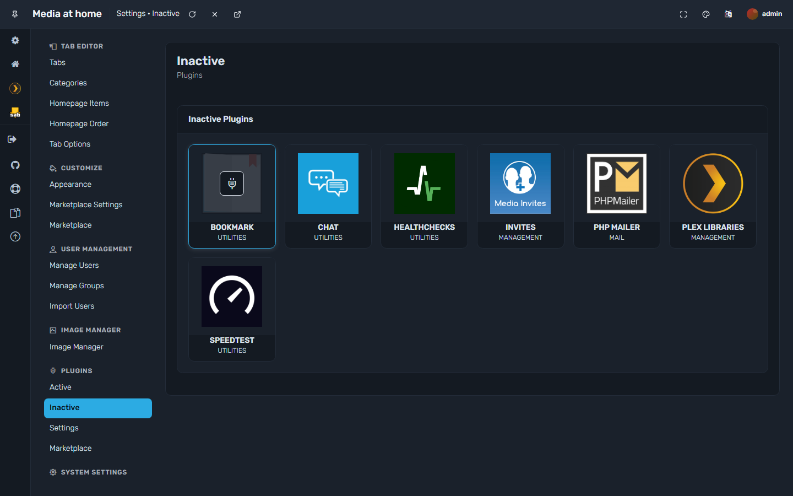

# 🔖 The bookmark plugin

[← All documentation](README.md)

The bookmark plugin gives Organizr a page of links: colored tiles, sorted into categories. Use it for the sites you open often that don't need a tab of their own.

Bookmarks are different from tabs. A tab opens an application inside Organizr. A bookmark opens its address in a new window.

## 🔌 Switch it on

Every built-in plugin starts switched off. You switch one on from its card:

1. Log in as an Admin or a Co-Admin.
2. Open **Settings › Plugins › Inactive**. Each plugin has a card with its picture and name.
3. Point at the card **Bookmark**, and select the plug button. The card moves to **Active**.
4. Open **Settings › Plugins › Active**, point at the card **Bookmark**, and select the panel button. The window **Bookmark Settings** opens.

| Button | Where | What it does |
|---|---|---|
| 🔌 Plug | On a card on **Inactive** | Switches the plugin on |
| 🎛️ Panel | On a card on **Active** | Opens the plugin's settings |
| ⏻ Power | On a card on **Active** | Switches the plugin off |

The other plugin pages link back here for these steps.

## ⚙️ Settings

The bookmark plugin has no settings form. Its window, **Bookmark Settings**, is the editor for your categories and bookmarks.

| Field of a bookmark | What it means |
|---|---|
| Name | The text on the tile. Two bookmarks can't share a name |
| Address | The address that the tile opens |
| Picture | A picture or an icon, as for a tab |
| Category | The heading the tile sits under |
| For the group, and groups with more access | The group with the least access that sees the bookmark |
| Color of the tile | The page draws the tile in shades of this color |
| Color of the name | The color of the text on the tile |
| Show the bookmark on the page | Switched off, the bookmark stays in the editor only |

## 🚀 Use it

1. Open the window **Bookmark Settings** (see [Switch it on](#-switch-it-on)).
2. Type the name of a category, and select **Add a category**. You need at least one category: **Add a bookmark** stays grayed out until you have one.
3. Select **Add a bookmark**, fill in the form, and select **Save**.
4. Select **Make the tab Bookmarks**. Your menu now has a tab **Bookmarks** that shows the page.

The homepage can show your bookmarks too: switch on the homepage item **Bookmarks** (see [Bookmarks on the homepage](homepage.md#-bookmarks)).

### 🗂️ Categories

- One category is always the default. A new bookmark joins it when you pick no other category.
- Your first category is the default. To change it, select **default** next to another category.
- When you delete the default category, the category with the lowest number becomes the default.
- When you delete a category, its bookmarks stay, but the page hides them until you give them another category.

## 👤 Who can use it

| Who | Can do |
|---|---|
| Admin, Co-Admin | Add, change, sort and delete bookmarks and categories |
| Anyone who sees the **Bookmarks** tab | Open the page. Set who sees the tab in **Settings › Tab Editor › Tabs**, as for any tab |

On the page, each user sees the bookmarks of their own group and of groups with less access. A category with no bookmark for that user doesn't show.

## 🩺 Troubleshooting

| Problem | Why, and what to do |
|---|---|
| **Add a bookmark** is grayed out | You have no category yet. Add one first |
| A bookmark is missing from the page | Check **Show the bookmark on the page**, its group, and that its category still exists |
| The menu has no **Bookmarks** tab | Select **Make the tab Bookmarks** in **Bookmark Settings** |
| No panel button on the card | The plugin is still on **Inactive**. Switch it on first |

## 📚 Details

### 🔗 The routes

The plugin's routes live under `/api/v2/plugins/bookmark`. All but the first need an Admin or a Co-Admin.

| Route | What it does |
|---|---|
| `GET page` | The bookmarks the caller sees, in their categories |
| `GET tabs`, `GET categories` | Every bookmark, every category, and the groups |
| `GET tabs/{id}` | One bookmark, for a caller of its group |
| `POST tabs`, `PUT tabs/{id}`, `DELETE tabs/{id}` | Add, change and delete a bookmark |
| `PUT tabs` | New order for bookmarks: a list of `id` and `order` |
| `POST categories`, `PUT categories/{id}`, `DELETE categories/{id}` | Add, change and delete a category |
| `PUT categories` | New order for categories |
| `GET setup/tab` | Make the **Bookmarks** tab of the menu |
| `GET setup/category` | Make the category "Unsorted" when there is no category |

### 🐘 Bookmarks from PHP Organizr

An import brings your bookmarks and categories along with their ids. [Importing](importing.md) says what the import repairs on the way, for example two bookmarks with the same name.

After the import, the tab that showed the bookmark page in PHP Organizr shows it here too.
