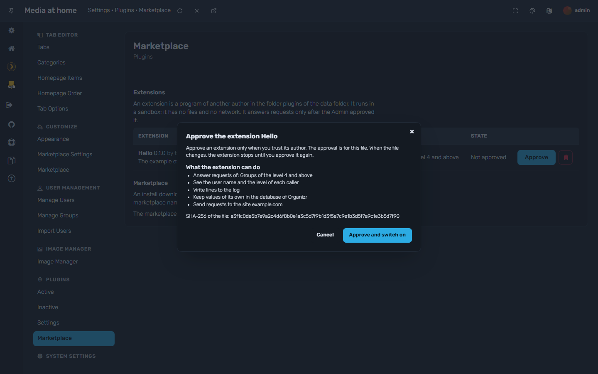

# 🧩 Extensions

[← All documentation](README.md)

Extensions add new features to Organizr: small programs by other authors that answer on routes of their own. This page shows how to install one, what the approval dialog asks you, and how to write your own.

## 🤔 What an extension is

An extension is a **WebAssembly component** that runs in a **sandbox**. WebAssembly is a format for small programs; a sandbox is a closed box in which a program can reach only what Organizr hands it. So an extension can't touch your files, your database or your network on its own.

That's a big change from PHP Organizr, which runs other people's PHP plugins with all the rights of the whole application.

| An extension can | An extension can't |
|---|---|
| Answer requests to its own routes | Read or write files |
| See the user name and access level of whoever calls it | Open network connections of its own |
| Send requests to the sites it names, once you approved them (see [Network permissions](#-network-permissions)) | Reach a site you didn't approve |
| Write lines to Organizr's log | Read Organizr's database, settings or secrets |
| Keep values of its own, when you gave it the permission `storage` | See the caller's cookies or API key |
| Read the time and get random numbers | Read the server's environment |

> [!IMPORTANT]
> The sandbox keeps an extension away from your files and network, but not away from its callers. It sees who calls it and what they send, and it decides what its routes answer. Approve only extensions whose author you trust.

## 🛒 Install from the marketplace

The container image comes with the project's marketplace: a list of extensions you can install with one click.

1. Log in as the Admin.
2. Open **Settings › Plugins › Marketplace**. The section **Extensions** lists what's installed; below it, the heading **Marketplace** lists what you can install.
3. Select **Install** next to an extension. Organizr downloads its file into the `plugins` folder of your data folder, and checks it against the SHA-256 in the list.
4. The extension now shows in the **Extensions** list above, as **Not approved**. Select **Approve**.
5. Read the approval dialog (see [The approval dialog](#-the-approval-dialog)), then select **Approve and switch on**.

An install never approves an extension by itself: step 5 is always yours.

When the list names a newer file than the one you have, the marketplace shows **Another file is installed** and offers **Install** again. The new file then waits for a new approval.

## 📂 Install by hand

An extension is a folder inside the `plugins` folder of your data folder. The folder's name is the extension's id: lowercase letters, digits and hyphens.

```text
<data folder>/plugins/hello/plugin.wasm
<data folder>/plugins/hello/plugin.json
```

1. Copy the extension's folder into `<data folder>/plugins/`.
2. Log in as the Admin, and open **Settings › Plugins › Marketplace**. The section **Extensions** lists the folder.
3. Select **Approve**, read the dialog, and select **Approve and switch on**.

`<data folder>` is the folder you mount at `/config` in the container (see [Installation](installation.md)).

## ✅ The approval dialog

Before an extension runs, the Admin approves it. The dialog **Approve the extension <name>** lists everything the extension will be able to do:



| Line in the dialog | What it means in plain words |
|---|---|
| Answer requests of: … | Who can call it: **The Admin**, **Groups of the level N and above**, or **Everybody, also without a login** |
| See the user name and the level of each caller | It knows who's using it. Every extension gets this |
| Write lines to the log | It can write to Organizr's log. Every extension gets this |
| Keep values of its own in the database of Organizr (`storage`) | It can save its own data (up to 1 MiB). It still can't read Organizr's data |
| Send requests to the site `<host>` (`http:<host>`) | It can talk to that one site on the internet. See the warning below |
| Reach the sites that it names also when they are on your local network (`http-local`) | Its approved sites may be on your home network: this computer, a private network or a link-local network |
| SHA-256 of the file | A fingerprint of the exact file you approve |

The approval covers **this one file**. Organizr stores its SHA-256. If the file changes, the extension stops and shows "The file changed after the approval. The extension does not run." until you approve it again.

> [!NOTE]
> The SHA-256 proves that the file is the one the marketplace list names, so nobody swapped it on the way. It doesn't prove that the file is safe. Read what an extension asks for before you approve it.

### 🌐 Network permissions

> [!WARNING]
> An approved site can receive everything the extension sees: your users' names and access levels, and whatever they send to the extension. Approve a site only when you're happy for the extension to send it that. Be extra careful with `http-local`: it lets the extension reach services on your home network, such as your router or NAS, if it names them.

| Permission | What it allows |
|---|---|
| `http:<host>` | Requests to this one host, over `http` or `https`, on any port. Each site needs its own permission: `http:github.com` doesn't allow `api.github.com` |
| `http-local` | Requests to the approved sites even when they resolve to a local address. Without it, such a request is refused |

## 🚀 Use an extension

- **Open** next to a switched-on extension calls the extension's root route in a new window.
- To put an extension's page in your menu, make a tab with the address of that page, for example `api/v2/extension/hello/page`.
- Scripts call its routes under `/api/v2/extension/<id>/`:

```bash
curl -H "token: <API key>" https://organizr.example.com/api/v2/extension/hello/hello
```

`<API key>` is the key from **Settings › System Settings › General**, section **API key**. `hello` is the extension's id.

The browser keeps an extension's page apart from Organizr, the same way as custom HTML on the homepage, so its scripts can't read Organizr's cookies. After you click a link in it, though, the page *can* replace the whole Organizr window, for example with a fake login page. Treat a login form that suddenly appears after a click with suspicion.

## 👤 Who can use it

| Who | Can do |
|---|---|
| Admin | Install, approve, switch off and delete extensions |
| Co-Admin | See the list |
| Callers of the extension's group and above (its `least_access`) | Call its routes. Anyone below gets `401` |

> [!CAUTION]
> The trash button deletes at once, with no undo: the extension's folder, its approval and its stored values.

## 🩺 Troubleshooting

| Problem | Why, and what to do |
|---|---|
| **Settings › Plugins › Marketplace** shows no **Extensions** section | The server was built without the `wasm-plugins` feature. The container image has it |
| No **Marketplace** heading | `ORGANIZR_EXTENSION_MARKETPLACE` is empty or not set (see [The marketplace list](#-the-marketplace-list)) |
| The extension shows "The file changed after the approval…" | Its file changed. Select **Approve** again, if you trust the new file |
| A call answers `502` | The call passed one of the [limits](#-limits), or the extension failed. Check the [log](log.md) |
| A call answers `401` | The caller's group is below the extension's `least_access` |
| A request of the extension to a site fails | The site isn't approved, or it is on your local network and `http-local` isn't approved |
| The marketplace won't install a file | The file's SHA-256 doesn't match the list. Organizr refuses changed files |

## 📚 Details

### 📏 Limits

Each call of an extension has limits. A call that passes one is stopped, and the caller gets `502`. One extension handles one request at a time.

| Limit | Value |
|---|---|
| Memory of one call | 64 MiB, for all its memories and tables together (D-143) |
| Work of one call | About two billion WebAssembly steps, a few seconds |
| Time of one call | 30 seconds, also while the extension waits or sends requests to other sites. A request to another site that runs at the deadline ends first |
| Body of a request | 1 MiB |
| Body of an answer | 8 MiB |
| Stored values, keys and values together | 1 MiB |
| Size of the component file | 32 MiB |
| Requests to other sites in one call | 20 |
| Body of one request to another site | 1 MiB |
| Body of the answer of another site | 4 MiB |
| Time of one request to another site | 10 seconds |

An extension gets these request headers: `accept`, `accept-language`, `content-type` and `user-agent`. It can set these answer headers: `content-type`, `cache-control` and `content-disposition`.

### 🔍 How Organizr checks a request to another site

An extension sends a request with the function `send-request` of `host`. It reaches only the sites its `plugin.json` names, and only after the Admin approved them (D-122). Before each request, the server:

1. Checks that the address uses `http` or `https`, and that its host is an approved site.
2. Resolves the host name. When one of its addresses is on a local network, the request needs `http-local`.
3. Sends the request to the address it checked, and no other. It follows no redirect: the extension gets the redirect answer and decides itself. Over `https`, the certificate is checked.

A request that is refused or fails gives the extension an error with the reason. The extension decides what its caller sees.

### 🛒 The marketplace list

Organizr reads the address of the list from the environment variable `ORGANIZR_EXTENSION_MARKETPLACE`. The container image sets it to the project's own list, in the project's repository `tronyx/organizr-rust-marketplace`:

```text
https://raw.githubusercontent.com/tronyx/organizr-rust-marketplace/main/extensions.json
```

The image trusts that list by default. Whoever controls a list decides which files it offers, so set the variable to another list only when you trust its owner.

To switch the marketplace off, set the variable to an empty value. The page then shows no marketplace:

```yaml
environment:
  ORGANIZR_EXTENSION_MARKETPLACE: ""
```

A server you start without the container image has no marketplace until you set the variable.

The list is a JSON file:

```json
{
  "extensions": [
    {
      "id": "hello",
      "name": "Hello",
      "version": "1.0.0",
      "description": "Greets the caller.",
      "author": "Your name",
      "permissions": ["storage"],
      "least_access": 4,
      "download": "https://example.com/hello/plugin.wasm",
      "sha256": "the SHA-256 of the file, as 64 lowercase hex characters"
    }
  ]
}
```

`id`, `name`, `version`, `download` and `sha256` are required. The other fields mean what they mean in `plugin.json`, and an install writes them into the extension's `plugin.json`.

When the list's address uses `https`, every `download` must use `https` too. A `download` on another host than the list must be on the internet: an install from this computer or a private network address is refused, unless the list is on that same host.

### 🔗 The routes

| Route | For | What it does |
|---|---|---|
| `GET /api/v2/extensions` | Admin, Co-Admin | The extensions in the folder, with their state |
| `POST /api/v2/extensions/{id}/enable` | Admin | Approves the file with the fields `sha256`, `permissions` and `least_access`, and switches the extension on. When one of them is not what the folder holds now, nothing is approved |
| `POST /api/v2/extensions/{id}/disable` | Admin | Switches the extension off. Its stored values stay |
| `DELETE /api/v2/extensions/{id}` | Admin | Deletes the folder, the approval and the stored values |
| `GET /api/v2/extensions/marketplace` | Admin, Co-Admin | The extensions of the list, with what's installed |
| `POST /api/v2/extensions/marketplace/{id}` | Admin | Downloads and installs one extension |

### 🏗️ A server without extensions

The extension runtime is a build feature named `wasm-plugins`. The container image has it. A server built without it has none of these routes, and the settings show no **Extensions** section.

### 🛠️ Write an extension

The folder `examples/extension-template` of the repository holds a small extension in Rust. The file `crates/plugins/wit/extension.wit` describes the interface: the function `handle` that an extension exports, and the functions of `host` it can call. Any language that compiles to WebAssembly components works too.

1. Install the Rust target for WebAssembly components:

   ```bash
   rustup target add wasm32-wasip2
   ```

2. Copy the folder `examples/extension-template`, along with the folder `crates/plugins/wit`. If you move the folders, fix the path of the interface in `src/lib.rs`.
3. Build the component:

   ```bash
   cargo build --release --target wasm32-wasip2
   ```

4. Copy `target/wasm32-wasip2/release/extension_template.wasm` as `plugin.wasm` into your extension's folder.
5. Write `plugin.json` next to it:

   ```json
   {
     "name": "Hello",
     "version": "1.0.0",
     "description": "Greets the caller.",
     "author": "Your name",
     "permissions": ["storage"],
     "least_access": 4
   }
   ```

| Field of `plugin.json` | What it means |
|---|---|
| `name`, `version` | Shown in the list. Both are required |
| `description`, `author` | Shown in the list |
| `permissions` | What the extension asks for: `storage`, `http:<host>` for each site, and `http-local`. Write hosts in lowercase, for example `http:api.github.com` |
| `least_access` | The group level with the least access that may call it: `0` the Admin, `1` Co-Admin, `999` everybody. Without it, `1` |

To debug, write lines with the `log` function of `host`. They land in Organizr's log with the field `extension` set to your extension's id. Debug lines show only at the debug level: **Log Level** in **Settings › System Settings › Logs** for the log file, and `ORGANIZR_LOG=debug` for the container output (see [Log](log.md)).

### 🐘 What PHP Organizr had

The marketplace routes of PHP Organizr, `/plugins/marketplace` and `/plugins/manage/{plugin}`, install nothing here: PHP's marketplace lists PHP plugins, which this application can't run (D-94).
