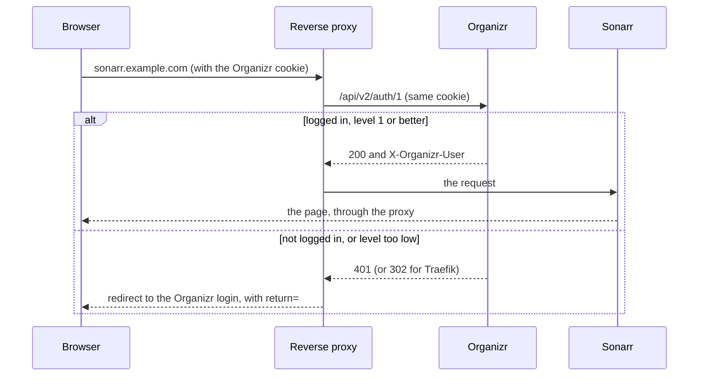

# 🚪 Forward auth

[← All documentation](README.md)

Use the Organizr login as the bouncer for your other applications. Your reverse proxy asks Organizr about every request for, say, Sonarr, and Organizr answers "yes" or "no" based on the browser's session cookie. You need this page if you want Sonarr, Radarr and friends reachable from outside, but only for people logged in to Organizr.

A reverse proxy is the web server in front of your applications, for example nginx, Nginx Proxy Manager, Traefik or Caddy. Set it up first with [Reverse proxy](reverse-proxy.md).

## 🧭 How it works



After the login, Organizr sends the browser back to the address it wanted (see [After the login](#-after-the-login)). Organizr checks every request fresh; it keeps no cache of answers, so a user you lock or remove is stopped at their next request.

## 📋 What you need

> [!WARNING]
> **The application must be reachable only through the proxy.** Forward auth only guards requests that go through the proxy. If Sonarr still publishes its port (`ports: - "8989:8989"`), anyone on your network reaches it directly, and Organizr never hears about it. Docker opens published ports past host firewalls such as ufw and firewalld. Remove the `ports:` of the application's container (the proxy reaches it over the Docker network), or bind them to the host only: `"127.0.0.1:8989:8989"`. Keep the application's own login on if you can, as a second lock.

- **One domain.** The application and Organizr share a domain, for example `sonarr.example.com` and `organizr.example.com`. The Organizr login cookie is set for the whole domain (`.example.com`), so the browser sends it to both.

  > [!CAUTION]
  > Every site under that domain gets the Organizr login cookie. Put only applications you trust under the same domain.
  >
  > With `ORGANIZR_SESSION_COOKIE_HOST_ONLY=1` the cookie is for the Organizr host alone, and forward auth for applications on other hosts can't work. See [Configuration](configuration.md).

- **A trusted proxy.** The proxy is listed in [`ORGANIZR_TRUSTED_PROXIES`](reverse-proxy.md#-organizr_trusted_proxies). Organizr believes the forwarding headers (`X-Forwarded-For`, `X-Forwarded-Proto`) only from a listed proxy. Without the entry, every caller seems to come from the proxy's address. List only your proxy there, not a whole range: allow lists and local-network rules are only as safe as this setting.

## 🎯 Choose the level

Each application needs a level. A user passes when their level is that number **or a smaller one** (smaller means more access):

| Level | Group in a new install | Route to use |
|---|---|---|
| `0` | Admin | `/api/v2/auth/0` |
| `1` | Co-Admin | `/api/v2/auth/1` |
| `2` | Super User | `/api/v2/auth/2` |
| `3` | Power User | `/api/v2/auth/3` |
| `4` | User | `/api/v2/auth/4` |
| `999` | Guest (everybody, also not logged in) | `/api/v2/auth/999` |

So `/api/v2/auth/4` lets in Users, Power Users, Super Users, Co-Admins and Admins. Use the form `/api/v2/auth/<level>` for new setups; the other forms in [All routes](#-all-routes) exist for old proxy files.

## 🟩 nginx

nginx asks with the `auth_request` module. This protects Sonarr for level 1 (Co-Admins and Admins):

```nginx
# In the server block of the application.
location / {
    auth_request /organizr-auth;
    # Not allowed in? Go to the Organizr login page, and come back afterwards.
    error_page 401 =302 https://organizr.example.com/?return=$scheme://$host$request_uri;
    proxy_pass http://sonarr:8989;
}

location = /organizr-auth {
    internal;
    proxy_pass http://organizr:8080/api/v2/auth/1;
    proxy_pass_request_body off;
    proxy_set_header Content-Length "";
    proxy_set_header X-Forwarded-For $proxy_add_x_forwarded_for;
    proxy_set_header X-Forwarded-Proto $scheme;
}
```

- `organizr.example.com` is the address of your Organizr.
- `organizr:8080` and `sonarr:8989` are the container names and ports on the Docker network that nginx shares with them.

## 🟥 Nginx Proxy Manager

Nginx Proxy Manager (NPM) is nginx with a web interface, so the same idea works through its advanced settings, behind the gear icon of a proxy host.

1. Open the proxy host of the application (for example `sonarr.example.com`), and select **Edit**.
2. Select the gear icon to the right of the tabs.
3. Paste this into **Custom Nginx Configuration**, and change the level, the Organizr address and the container name to yours:

   ```nginx
   auth_request /organizr-auth;
   error_page 401 =302 https://organizr.example.com/?return=$scheme://$host$request_uri;

   location = /organizr-auth {
       internal;
       auth_request off;
       proxy_pass http://organizr:8080/api/v2/auth/1;
       proxy_pass_request_body off;
       proxy_set_header Content-Length "";
       proxy_set_header X-Forwarded-For $proxy_add_x_forwarded_for;
       proxy_set_header X-Forwarded-Proto $scheme;
   }
   ```

4. Select **Save**.
5. Open the application in a private browser window. You should land on the Organizr login page.

NPM puts this text inside the `server` block of the host, so `auth_request` applies to the whole host, and `auth_request off` keeps the check itself unguarded. The NPM container must reach Organizr at `organizr:8080`, so put both on the same Docker network.

A certificate from Let's Encrypt keeps renewing: NPM answers the HTTP challenge from its own `location ^~ /.well-known/acme-challenge/`, which switches `auth_request` off, so the challenge never asks Organizr. Tested with NPM 2.16.

## 🟦 Traefik

Traefik asks with the `forwardAuth` middleware. In a file provider:

```yaml
http:
  middlewares:
    organizr-users:
      forwardAuth:
        address: "http://organizr:8080/api/v2/auth/4"
        authResponseHeaders:
          - "X-Organizr-User"
          - "X-Organizr-Email"
          - "X-Organizr-Group"
```

Or as Docker labels, on the Organizr container (the middleware) and on the application (the router):

```yaml
services:
  organizr:
    labels:
      - "traefik.http.middlewares.organizr-users.forwardauth.address=http://organizr:8080/api/v2/auth/4"
      - "traefik.http.middlewares.organizr-users.forwardauth.authResponseHeaders=X-Organizr-User,X-Organizr-Email,X-Organizr-Group"
  sonarr:
    labels:
      - "traefik.http.routers.sonarr.middlewares=organizr-users@docker"
```

With `exposedByDefault: false` in Traefik, each of these containers also needs the label `traefik.enable=true`.

### 🔁 Sending Traefik users to the login page

When the caller doesn't pass, Traefik hands Organizr's answer straight to the browser. So Organizr can answer with a redirect to its own login page (`302`, with the wanted address in `return`). It does that when either is true:

- **Enable Traefik Auth Redirect** (`traefikAuthEnable`) is on, in **Settings › System Settings › Login & Security**, section **Access**.
- The request has the header `X-Forwarded-Server: traefik` and comes from a trusted proxy. Traefik writes its host name into that header, so this applies when the Traefik container's host name is `traefik`.

> [!WARNING]
> Switch on **Enable Traefik Auth Redirect** only when Traefik is your only forward-auth proxy. nginx `auth_request` treats a `302` from Organizr as an error (`500`), so nginx-protected apps would break. And Traefik must be listed in [`ORGANIZR_TRUSTED_PROXIES`](reverse-proxy.md#-organizr_trusted_proxies): otherwise Organizr ignores its `X-Forwarded-*` headers and the redirect has no `return=` address.

**Traefik Domain for Return Override** (`traefikDomainOverride`), in the same section, sets the Organizr address for this redirect, for example `https://organizr.example.com/`. Without it, Organizr uses the address of the request.

## 🟨 Caddy

Caddy asks with the `forward_auth` directive:

```caddyfile
sonarr.example.com {
    forward_auth organizr:8080 {
        uri /api/v2/auth/1
        copy_headers X-Organizr-User X-Organizr-Email X-Organizr-Group
    }
    reverse_proxy sonarr:8989
}
```

## 🪪 Passing the user to the application

A `200` answer for a caller who passed **by their level** has three headers. The proxy can hand them to the application, for example for an app that supports header login:

| Header | Value |
|---|---|
| `X-Organizr-User` | The user name, or `Guest` |
| `X-Organizr-Email` | The user's e-mail address |
| `X-Organizr-Group` | The user's level |

A caller who passed by an [allow list](#-allow-and-deny-lists) gets no such headers.

> [!WARNING]
> **If an application trusts `X-Organizr-User`, the proxy must set that header from Organizr's answer, and never pass on one the browser sent.** Otherwise anyone can send `X-Organizr-User: admin` themselves.
>
> - **nginx:** set it from the answer, inside the `location` that has the `proxy_pass` to the application. `proxy_set_header` replaces whatever the browser sent. In the `server` block they're ignored by every `location` that sets a header of its own:
>   ```nginx
>   auth_request_set $organizr_user $upstream_http_x_organizr_user;
>   auth_request_set $organizr_email $upstream_http_x_organizr_email;
>   auth_request_set $organizr_group $upstream_http_x_organizr_group;
>   proxy_set_header X-Organizr-User $organizr_user;
>   proxy_set_header X-Organizr-Email $organizr_email;
>   proxy_set_header X-Organizr-Group $organizr_group;
>   ```
> - **NPM:** the same six lines, but **not** in the gear's **Custom Nginx Configuration**. NPM's own `location /` sets headers of its own, so nginx ignores `proxy_set_header` lines from there, and the browser's copy reaches the application. Instead, open **Custom Locations**, select **Add Location**, enter `/` as **Location** with the application's **Scheme**, **Forward Hostname / IP** and **Forward Port**, and paste the lines into that location's gear field. The `auth_request` lines stay in the host's gear field. Tested with NPM 2.16.
> - **Traefik:** `authResponseHeaders` overwrites the header when Organizr sends it. To also drop a browser's copy when Organizr sends none, put a `headers` middleware with `customRequestHeaders` that sets `X-Organizr-User`, `X-Organizr-Email` and `X-Organizr-Group` to `""` (an empty value removes the header) **before** `organizr-users` in the router's middlewares.
> - **Caddy:** remove the browser's copy first, inside a `route` so the order is kept:
>   ```caddyfile
>   route {
>       request_header -X-Organizr-*
>       forward_auth organizr:8080 {
>           uri /api/v2/auth/1
>           copy_headers X-Organizr-User X-Organizr-Email X-Organizr-Group
>       }
>       reverse_proxy sonarr:8989
>   }
>   ```

## 📍 Allow and deny lists

You can add a list of addresses to the question:

| Form | Example |
|---|---|
| Long form, in the path | `/api/v2/auth/1/allow/192.168.1.10,192.168.1.11` |
| Short form, in the query (deny lists only) | `/api/v2/auth-1?blacklist=192.168.1.10` |

| Kind | Also spelled | What it does |
|---|---|---|
| `allow` | `whitelist`, `white`, `wl`, `w` | A caller from one of the addresses passes, whatever their level |
| `deny` | `blacklist`, `black`, `bl`, `b` | A caller from one of the addresses doesn't pass |

- Separate entries with commas. Each entry is **one** address or a host name. A network such as `192.168.1.0/24` is not an entry. Only the first 100 entries count.
- **Host names count only in the path, and only when the check comes from one of your trusted proxies.** A list in the query takes addresses only, because a visitor can add one, and its host names would make Organizr look them up. A visitor who reaches Organizr without your proxy writes the path too, so a check that doesn't come from a proxy in `ORGANIZR_TRUSTED_PROXIES` also takes only the addresses of the path. Organizr remembers what a host name stands for for one minute (D-141).
- The short form reads a deny list from the query: `blacklist`, or `type=deny` with `ips`. **An allow list in the query counts, with a group in the path, only when it's clearly the proxy's own query**: a proxy in `ORGANIZR_TRUSTED_PROXIES` sends `X-Forwarded-Uri` (the address the visitor asked for), and that address has another query. Some proxies (Caddy among them) send the visitor's query along with the check, and a visitor could then name their own address. An allow list in the path, in the long form, always counts (D-136, D-157).
- Prefer addresses. A host name lets in every address its DNS answers with (IPv4 and IPv6), so whoever controls that DNS name (a dynamic-DNS name, for example) controls who passes.
- The caller's address is only as reliable as [`ORGANIZR_TRUSTED_PROXIES`](reverse-proxy.md#-organizr_trusted_proxies). List only your proxy there.

## 🔙 After the login

Someone sent to the login page arrives with the address they wanted in `return`. After the login, Organizr sends the browser there.

Organizr follows that address only when it belongs to this site: the Organizr host itself, or a host that shares the login cookie with it. A link with another site in `return` leads nowhere, so nobody can use your login page to bounce people to a look-alike site. PHP Organizr follows every address.

## 🩺 When Organizr is down

The proxy can't get a `200`, so it refuses the request and shows an error page. Nothing gets through unchecked. Every request to a protected app costs one quick call to Organizr, so keep Organizr close to the proxy (same host or Docker network).

## 📖 Reference

### 📚 All routes

Every HTTP method asks the same question.

| Route | Meaning |
|---|---|
| `/api/v2/auth/{group}` | The caller needs the level `{group}`, or more access. **Use this one** |
| `/api/v2/auth-{group}` | The same, in a short form |
| `/api/v2/organizr-auth/{group}` | The same route under another name |
| `/api/v2/auth/{group}/{type}/{ips}` | The same, with an [allow or deny list](#-allow-and-deny-lists) |

- `{group}` can also be the name of a tab. The question is then about the group of that tab. If no tab has that name, the question is about the Admin.
- Without a `{group}`, the question is about the Admin.
- The long form without a `{type}` uses the kind `deny` with the only address `192.0.0.0`.

### 🧾 The group in the query

A query that holds `group=` asks in the short form, and everything after `group=` is the group. So `/api/v2/auth?group=1` and `/api/v2/?group=1` ask the same as `/api/v2/auth-1`. Old proxy configurations use this form.

When the path names a group, as in `/api/v2/auth/1` or `/api/v2/auth-1`, a `group=` in the query doesn't count (D-136).

> [!WARNING]
> **Don't use the query form with Caddy.** Caddy's `forward_auth` sends the visitor's query along with the check, so a visitor could add `?group=999` and pass as a guest. With a group in the path, as in the Caddy example above, the visitor's query can't change the group.

### 🚦 The answer

| Status | Meaning |
|---|---|
| `200` | The caller passes |
| `401` | The caller doesn't pass |
| `302` | The caller doesn't pass, and the browser should go to the login page. See [Traefik](#-sending-traefik-users-to-the-login-page) |

A locked user doesn't pass. A caller who isn't logged in is a guest, with the level `999`.

### 🐘 What differs from PHP Organizr

- PHP Organizr believes the forwarding headers of every sender. This version believes only a proxy in `ORGANIZR_TRUSTED_PROXIES`. So a caller can't claim an address on an allow list, and can't make Organizr write another address into the redirect to the login page.
- In PHP Organizr, `group=` in the query of **any** API route makes the request a forward-auth question. Here it does that only for the forward-auth routes and for `/api/v2/`.
- The name of a tab is compared as plain text. In PHP Organizr, `%` and `_` in the name stand for other characters.
- A host name in a list stands for all its addresses, IPv6 included. In PHP Organizr it stands for its first IPv4 address.

[Deviations](deviations.md) has the full entry, D-59.
