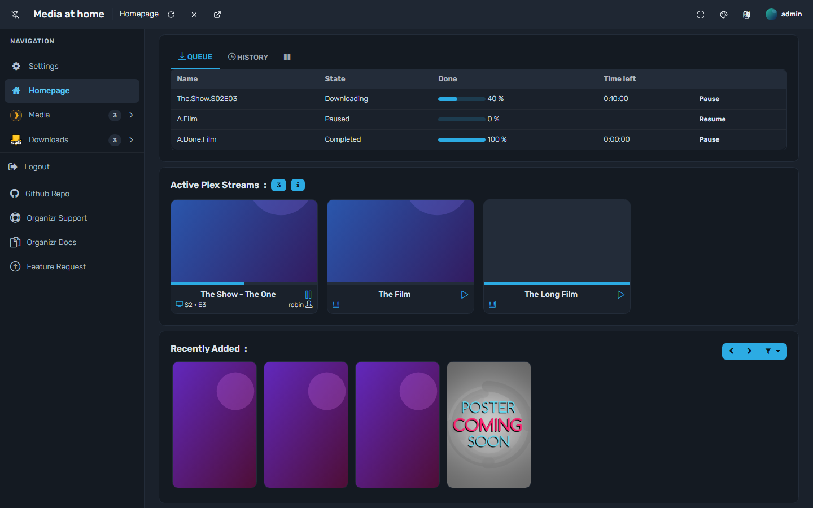
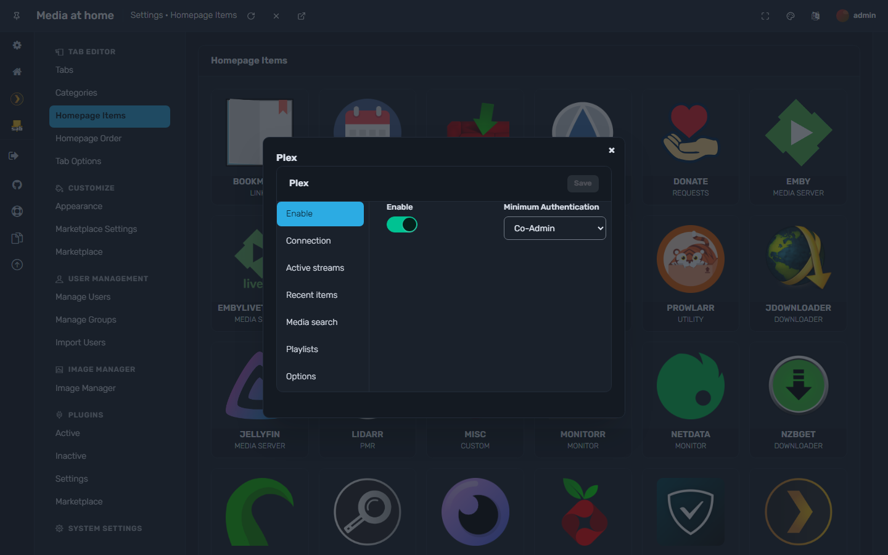
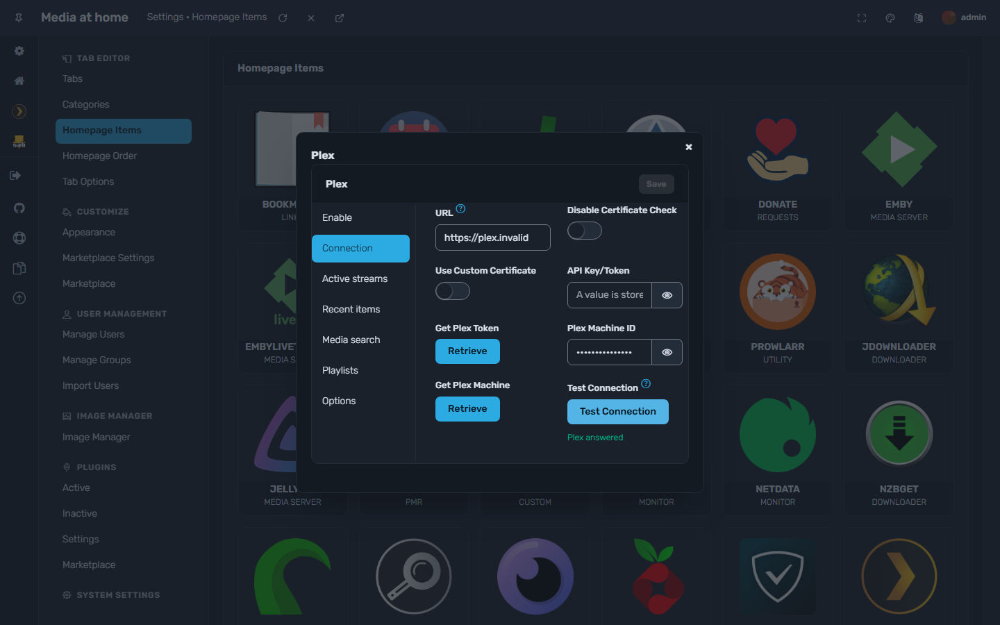
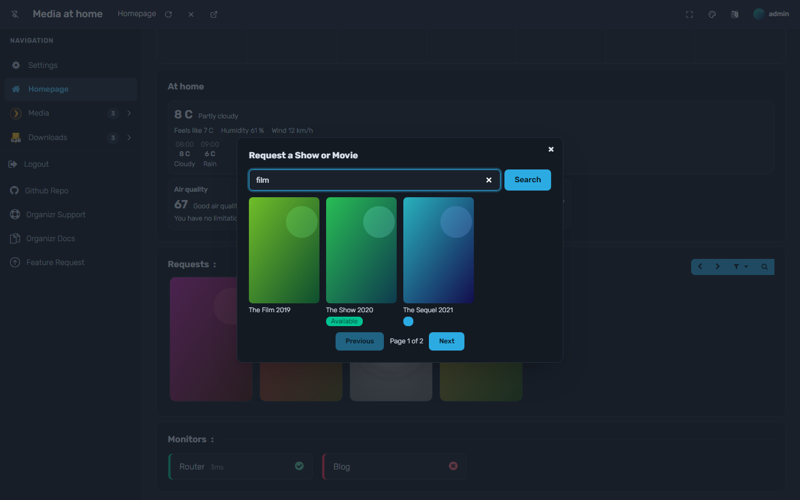
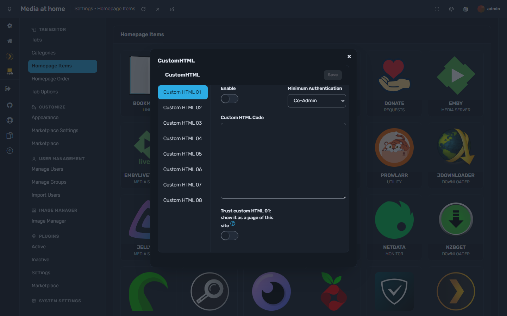

# 🏠 The homepage

[← All documentation](README.md)

The homepage is your dashboard: one page with live boxes ("items") for Plex, Sonarr, your downloaders, your calendars, your monitors and more. This page shows you how to switch it on, set up each item, and what every setting does.



## 🧭 How homepage items work

### 👀 Show the homepage tab

The setup creates a tab named **Homepage**, but leaves it out of the menu. The homepage also stays empty ("The homepage has no items for you.") until you switch on at least one item.

1. Log in as an Admin.
2. Open **Settings › Tab Editor › Tabs**.
3. In the **Homepage** row, switch **Active** on.

The tab starts with the group **User**, so guests don't see it until you change the tab's group.

### ➕ Add and set up an item

1. Open **Settings › Tab Editor › Homepage Items**. You see one card per item, with its picture, name and category.
2. Select the picture on a card. The item's settings open in a dialog.
3. Fill in the **Connection** section: the address (**URL**) and the key or login of the service.
4. In the **Enable** section, switch **Enable** on and pick the **Minimum Authentication** (see below).
5. Select **Save** at the bottom of the dialog.
6. Select **Test Connection**, if the item has one. Green text means the service answered.



Fields named **Multiple URL's** or **Multiple API Key/Token's** take several values: type one, then press Enter or a comma, or click outside the field, and it becomes a chip. Select a chip to edit it again.

> [!NOTE]
> If you picked **Business** as the use of the install in the setup wizard, the cards of the media servers, downloaders, calendars and request services (Plex, Emby, Jellyfin, Tautulli, Sonarr, Radarr, Lidarr, SickRage, CouchPotato, Trakt, iCal, Overseerr, Ombi, Donate, Emby live TV and all download clients) are not listed, as in PHP Organizr. All other items are listed for both.

### 👥 Who sees an item

You see an item only when all of these are true:

- its **Enable** switch is on,
- your group has its **Minimum Authentication** level or more access (the groups from most to least access: Admin, Co-Admin, Super User, Power User, User, Guest),
- the item has the settings it needs (usually an address and a key).

Some items have parts with their own **Enable** and **Minimum Authentication** (for example Plex "Active streams" and "Recent items"). Then you need the level of the item *and* the level of the part. When you don't have a level, the server doesn't send you that data at all; it isn't just hidden in the page.

### 🔢 Put the items in order

1. Open **Settings › Tab Editor › Homepage Order**.
2. Drag the tiles into the order you want. The tile at the top-left shows first. On a touch screen, drag a tile by its handle; from the keyboard, use the up and down arrow buttons on the tile.
3. Select **Save** in the heading. It stays gray until you change something.

Each tile is named after its order setting without `homepageOrder`, for example `PLEXNOWPLAYING`, `SONARRQUEUE` or `CUSTOMHTML01`. A faded tile is an item that is off. Two items with the same number show in the order of their keys. In the settings tables below, the order key of each item is in the row **Homepage Order**.

### 🧪 Test the connection of a service

These items have a **Test Connection** button: Plex, Emby, Jellyfin, Emby live TV, JellyStat, Tautulli, Overseerr, Ombi, Sonarr, Radarr, Lidarr, SickRage, SABnzbd, qBittorrent, NZBGet, Transmission, Deluge, rTorrent, uTorrent, JDownloader, Pi-hole, Jackett, Prowlarr, AdGuard Home and UniFi. UniFi has a second button, **Get Unifi Site**.

1. Enter the address and the key or login.
2. Select **Save**. The test reads the stored settings, so the button is off ("Save the settings before you test.") while you have unsaved changes.
3. Select **Test Connection**. Green text means the service answered; red text says what's wrong.



Only an Admin or a Co-Admin can run a test. A script can run one with `POST /api/v2/test/<name>`. The name is in the test row of each item below, for example `pihole`, `adguard` or `embyLiveTVTracker`; the second UniFi button is `test/unifi/site`.

Items without a test button (Healthchecks, Uptime Kuma, CouchPotato, iCal, Netdata, Monitorr, Speedtest Tracker, Netronome, OctoPrint, PromPage, Weather and air, Trakt, Donate, Bookmarks) show their error on the homepage instead. `organizr check` also tests many services at once: see [Checking your services](checking-your-services.md). [Tests of the settings](settings-tests.md) covers the tests that aren't about homepage items.

### 🔄 How often items refresh

Each item loads its data when the homepage opens, then again after its **Refresh Seconds**. The form shows seconds, but the setting stores milliseconds: the choice **10** is stored as `10000`. The shortest time is five seconds: the choice **2.5** works as 5. Without a stored value, an item reloads every 60 seconds. Emby live TV and JellyStat count in minutes instead (**Auto-refresh Interval (minutes)**).

#### 🛠 Settings without a form field

A few settings have no field in the form: the refresh of Pi-hole, AdGuard Home, Speedtest Tracker and OctoPrint (their defaults are in their sections), and the BreezoMeter key of [Weather and air](#-weather-and-air). Change them with the API and [the API key](installation.md#-the-api-key):

```bash
curl -X PUT "https://organizr.example.com/api/v2/config"   -H "token: <api-key>"   -H "Content-Type: application/json"   -d '{"homepagePiholeRefresh": "30000"}'
```

- `<api-key>`: your API key, from **Settings › System Settings › General**, field **Organizr API**.
- The body holds one or more settings. Refresh values are milliseconds (`30000` = 30 seconds). For the weather key, send `{"breezometerToken": "<your-breezometer-key>"}`.

### 🌐 Use an address Organizr can reach

Organizr asks each service from the server, not from your browser.

> [!TIP]
> In Docker, `localhost` is the Organizr container itself, not your server. Use the service's container name (`http://sonarr:8989`, when both containers share a network) or your server's LAN address (`http://192.168.1.10:8989`). This is the most common reason for a failed test.

An address that starts with `/` is a path on Organizr's own host. Spaces are removed and slashes at the end are cut off.

### 🔒 HTTPS and certificates

Most items have two switches in **Connection**:

| Label | What it does |
|---|---|
| **Disable Certificate Check** | Organizr doesn't check the service's certificate. Use it for a self-signed certificate on a network you trust. |
| **Use Custom Certificate** | Organizr also trusts your own certificate authority (see below), and still checks the name in the certificate. |

> [!WARNING]
> Organizr never checks the certificate of a service that it reaches by an IP address over HTTPS (`https://192.168.1.10:8920`), whatever the switch says, because no public authority signs certificates for addresses. Use a name (`https://emby.example.com`) if the connection crosses a network you don't trust.

#### 🔏 A certificate authority of your own

If your services use certificates from your own certificate authority (CA), upload the CA certificate once:

1. Log in as the Admin (Co-Admins can't).
2. Open **Settings › System Settings › General**, section **Custom certificate**.
3. Choose your `.pem` file and select **Upload the certificate**. The page then says "Custom Certificate Loaded" with the number of certificates.
4. In each item that uses it, switch **Use Custom Certificate** on and select **Save**.

What the file must be, and what it does:

- PEM text, at most 64 KiB, with 1 to 20 certificates of certificate authorities and nothing else. A file with a private key is refused.
- It's added to the system's authorities; it doesn't replace them. A new upload replaces the last one.
- It applies only to items (and their tests) with **Use Custom Certificate** on. It doesn't apply to services reached by IP address over HTTPS, to items with **Disable Certificate Check** on, or to `organizr check`.
- An import from PHP Organizr copies `data/cert/custom.pem`, unless it holds a private key. See D-98 and D-104 in the [deviations](deviations.md).

## 🚀 Quick start: Plex and Sonarr

1. Log in as an Admin.
2. Show the homepage tab: **Settings › Tab Editor › Tabs**, switch **Active** on in the **Homepage** row.
3. Open **Settings › Tab Editor › Homepage Items** and select the **Plex** picture.
4. In **Connection**, enter the **URL** of your Plex server, for example `http://192.168.1.10:32400`.
5. Next to **Get Plex Token**, select **Retrieve**. Log in at Plex in the small window. The token fills in.
6. Select **Save**, then **Retrieve** next to **Get Plex Machine**. With one server, its ID fills in; with more, choose yours. Select **Save** again.
7. In **Enable**, switch **Enable** on. In **Active streams** and **Recent items**, switch **Enable** on too. Select **Save**, then **Test Connection**.
8. Close the dialog and select the **Sonarr** picture.
9. In Sonarr, open **Settings › General** and copy the **API Key** (section **Security**).
10. In Organizr, enter the **Multiple URL's** (`http://192.168.1.10:8989`) and paste the key into **Multiple API Key/Token's**.
11. Switch **Enable** on in **Enable** (the calendar) and in **Queue** (the downloads). Select **Save**, then **Test Connection**.
12. Open the **Homepage** tab. Plex, the calendar and the Sonarr queue are there.

## 📋 All items

| Group | Item | What it shows |
|---|---|---|
| 🎬 Media servers | [🟠 Plex](#-plex) | Playing now, recently added, playlists, and the media search |
| | [🟢 Emby and Jellyfin](#-emby-and-jellyfin) | Playing now and recently added |
| | [📡 Emby live TV](#-emby-live-tv) | Timers and recordings of Emby's live TV |
| | [📊 Tautulli](#-tautulli) | Most watched, top users and players, libraries |
| | [📈 JellyStat](#-jellystat) | Statistics of an Emby or Jellyfin server |
| 📥 Downloaders | [🧺 All downloaders in one box](#-all-downloaders-in-one-box) | Several downloaders as tabs of one item |
| | [🚚 Sonarr and Radarr queues](#-sonarr-and-radarr-queues) | What Sonarr and Radarr download now |
| | [📰 SABnzbd](#-sabnzbd) | Usenet queue and history, with pause and resume |
| | [📨 NZBGet](#-nzbget) | Usenet queue and the last ten downloads |
| | [🌊 qBittorrent](#-qbittorrent) | Torrents and their progress |
| | [🔩 Transmission](#-transmission) | Torrents and their progress |
| | [💧 Deluge](#-deluge) | Torrents and their progress |
| | [🧲 rTorrent](#-rtorrent) | Torrents and their progress |
| | [🌀 uTorrent](#-utorrent) | Torrents and their progress |
| | [☕ JDownloader](#-jdownloader) | Packages that download and wait |
| 📺 Requests | [🍿 Overseerr](#-overseerr) | Requests, with approve, deny and a search to request more |
| | [🎫 Ombi](#-ombi) | Requests, with approve, deny and a search to request more |
| | [🔍 Request a show or movie](#-request-a-show-or-movie) | The search that makes new requests |
| 📅 Calendars | [📆 The calendar](#-the-calendar) | One calendar for all sources below |
| | [📼 Sonarr, Radarr and Lidarr](#-sonarr-radarr-and-lidarr) | Episodes, films and albums |
| | [🤒 SickRage](#-sickrage) | Episodes of SickRage and SickChill |
| | [🥔 CouchPotato](#-couchpotato) | Films |
| | [📇 iCal calendars](#-ical-calendars) | Google Calendar, Nextcloud and other `.ics` addresses |
| | [🎥 Trakt](#-trakt) | Episodes and films of a Trakt account |
| 🩺 Monitors and network | [💓 Health checks](#-health-checks) | Your Healthchecks.io checks, the ones that are down first |
| | [🐻 Uptime Kuma](#-uptime-kuma) | Monitors and whether they're up |
| | [🚦 PromPage](#-prompage) | Services of a PromPage status page |
| | [👀 Monitorr](#-monitorr) | Services that Monitorr watches |
| | [🥧 Pi-hole](#-pi-hole) | Queries and blocked domains |
| | [🚫 AdGuard Home](#-adguard-home) | Queries, blocks and block lists |
| | [📉 Netdata](#-netdata) | Up to seven gauges or rings |
| | [⚡ Speedtest Tracker](#-speedtest-tracker) | The last speed test |
| | [📡 Netronome](#-netronome) | The last speed test, with the average of a time range |
| | [📶 UniFi](#-unifi) | Wi-Fi, LAN, WAN and VPN of a UniFi network |
| | [🐙 OctoPrint](#-octoprint) | Your 3D printer and its webcam |
| | [⛅ Weather and air](#-weather-and-air) | Weather, air quality and pollen |
| 🧰 Other | [🧱 Custom HTML](#-custom-html) | Up to eight boxes of your own HTML |
| | [🔖 Bookmarks](#-bookmarks) | The bookmark plugin's tiles |
| | [🧥 Jackett](#-jackett) | Search your indexers |
| | [🐾 Prowlarr](#-prowlarr) | Search your indexers |
| | [💸 Donate](#-donate) | Let users donate to you through Stripe |
| | [📹 Misc: YouTube](#-misc-youtube) | The YouTube key for trailer searches |

At the end: [💤 Settings that do nothing yet](#-settings-that-do-nothing-yet) and [🔌 Routes without an item](#-routes-without-an-item).

## 🎬 Media servers

### 🟠 Plex

**Shows:** three items: what's playing now, what was added last, and your video playlists. Plex also powers **Search My Media** in the top bar.

**You need:** your Plex server's address (for example `http://192.168.1.10:32400`), a Plex token and the server's machine ID. The **Retrieve** buttons get both for you (see the [quick start](#-quick-start-plex-and-sonarr)). The token and ID are the same settings that [logging in with Plex](plex-login.md) uses (**Settings › System Settings › Sign-in**, section **Sign-in method**, and **SSO**).

| Section › Label | Key | Notes |
|---|---|---|
| Enable › **Enable** | `homepagePlexEnabled` | Plex on the homepage at all |
| Enable › **Minimum Authentication** | `homepagePlexAuth` | Needed for every Plex item and for the pictures |
| Connection › **URL** | `plexURL` | The Plex server itself |
| Connection › **Disable Certificate Check** | `plexDisableCertCheck` | |
| Connection › **Use Custom Certificate** | `plexUseCustomCertificate` | |
| Connection › **API Key/Token** | `plexToken` | **Get Plex Token › Retrieve** logs you in at Plex in a pop-up |
| Connection › **Plex Machine ID** | `plexID` | **Get Plex Machine › Retrieve** lists the servers your token owns (save the token first) |
| Active streams › **Enable** / **Minimum Authentication** | `homepagePlexStreams` / `homepagePlexStreamsAuth` | Playing now |
| Active streams › **User Information** / **Minimum Authentication** | `homepageShowStreamNames` / `homepageShowStreamNamesAuth` | Shows who plays, and from which IP address |
| Active streams › **User Information Without IP** / **Minimum Authentication** | `homepageShowStreamNamesWithoutIp` / `homepageShowStreamNamesWithoutIpAuth` | Shows who plays, without the address |
| Active streams › **Refresh Seconds** | `homepageStreamRefresh` | Shared with Emby and Jellyfin |
| Active streams › **Libraries to Exclude** | `homepagePlexStreamsExclude` | Plex library IDs |
| Recent items › **Enable** / **Minimum Authentication** | `homepagePlexRecent` / `homepagePlexRecentAuth` | Recently added |
| Recent items › **Libraries to Exclude** | `homepagePlexRecentExclude` | |
| Recent items › **Item Limit** | `homepageRecentLimit` | Most items of each kind (films, series, music); shared with Emby and Jellyfin |
| Recent items › **Refresh Seconds** | `homepageRecentRefresh` | Shared with Emby and Jellyfin |
| Media search › **Enable** / **Minimum Authentication** | `mediaSearch` / `mediaSearchAuth` | **Search My Media** in the top bar |
| Media search › **Libraries to Exclude** | `homepagePlexSearchExclude` | Left out of the search |
| Media search › **Media Search Server** | `mediaSearchType` | `plex` (Emby is listed as not available, as in PHP) |
| Playlists › **Enable** / **Minimum Authentication** | `homepagePlexPlaylist` / `homepagePlexPlaylistAuth` | Video playlists |
| Options › **Plex Tab Name** | `plexTabName` | Your Organizr tab that shows Plex |
| Options › **Plex Tab WAN URL** | `plexTabURL` | Where the "open in Plex" link goes; empty means `app.plex.tv` |
| Options › **Image Cache Quality** | `cacheImageSize` | Picture size; shared with Emby, Jellyfin and Tautulli |
| Options › **Use Tautulli custom names for users** | `homepageUseCustomStreamNames` | Shows the names Tautulli has for your users |
| Homepage Order | `homepageOrderplexnowplaying`, `homepageOrderplexrecent`, `homepageOrderplexplaylist` | One tile per item |

**Test:** **Test Connection** (`test/plex`).

**Good to know:**

- You need the level of Plex *and* the level of the item. Without the **User Information** levels, the server doesn't send names and addresses.
- **Playing now:** each stream shows its picture, how much was watched, and how it reaches its player.
- **Recently added:** films, series and music, newest first. A poster opens the details, with a link to the item in Plex Web.
- **Playlists:** the video playlists of the token's owner. A playlist with "private" in its title is not shown.
- **Pictures:** the server fetches Plex pictures in the size the homepage shows and keeps each for a week in the `cache` folder of the data folder. You need the Plex level to load a picture. A missing poster shows PHP's "Poster coming soon" picture, also when a poster fails to load (D-126).
- **Search My Media:** the search button in the top bar opens **Search My Media**. It asks Plex half a second after you stop typing and shows the matches as posters; a poster opens its details. It only shows when the search is on, you have its level, and a Plex token is saved. As in PHP Organizr, it works with Plex only. A script can search with `GET /api/v2/homepage/plex/search/<text>`.

### 🟢 Emby and Jellyfin

**Shows:** two items each: what's playing now (players that play nothing are left out), and what was added last.

**You need:** the server's address (for example `http://192.168.1.10:8096`) and an API key. In Emby, open **Settings › Advanced › API Keys** and select **New API Key**. In Jellyfin, open **Dashboard › API Keys** (under **Advanced** in newer versions) and add one.

| Section › Label | Emby key | Jellyfin key |
|---|---|---|
| Enable › **Enable** | `homepageEmbyEnabled` | `homepageJellyfinEnabled` |
| Enable › **Minimum Authentication** | `homepageEmbyAuth` | `homepageJellyfinAuth` |
| Connection › **URL** | `embyURL` | `jellyfinURL` |
| Connection › **API Key/Token** | `embyToken` | `jellyfinToken` |
| Connection › **Disable Certificate Check** | `embyDisableCertCheck` | `jellyfinDisableCertCheck` |
| Connection › **Use Custom Certificate** | `embyUseCustomCertificate` | `jellyfinUseCustomCertificate` |
| Active streams › **Enable** | `homepageEmbyStreams` | `homepageJellyfinStreams` |
| Active streams › **Minimum Authentication** | `homepageEmbyStreamsAuth` | `homepageJellyStreamsAuth` (short name, as in PHP) |
| Active streams › **User Information** / **Minimum Authentication** | `homepageShowStreamNames` / `homepageShowStreamNamesAuth` | same (shared with Plex) |
| Active streams › **Refresh Seconds** | `homepageStreamRefresh` | same (shared with Plex) |
| Recent items › **Enable** | `homepageEmbyRecent` | `homepageJellyfinRecent` |
| Recent items › **Minimum Authentication** | `homepageEmbyRecentAuth` | `homepageJellyfinRecentAuth` |
| Recent items › **Item Limit** / **Refresh Seconds** | `homepageRecentLimit` / `homepageRecentRefresh` | same (shared with Plex) |
| Options › **Emby/Jellyfin Homepage Link URL** | `homepageEmbyLink` | `homepageJellyfinLink` |
| Options › **Emby/Jellyfin Tab Name** | `embyTabName` | `jellyfinTabName` |
| Options › **Emby Tab WAN URL** | `embyTabURL` (address of Emby from outside your network) | (none) |
| Options › **Image Cache Quality** | `cacheImageSize` | same (shared with Plex) |
| Homepage Order | `homepageOrderembynowplaying`, `homepageOrderembyrecent` | `homepageOrderjellyfinnowplaying`, `homepageOrderjellyfinrecent` |

**Test:** **Test Connection** (`test/emby`, `test/jellyfin`). It asks the server for its list of users.

| Difference | Emby | Jellyfin |
|---|---|---|
| The test needs the item's **Enable** on | Yes, as in PHP Organizr | No |
| Recently added holds | series, episodes, albums, songs, films and videos | what the server lists |

**Good to know:**

- You need the level of Emby/Jellyfin *and* the level of the item. Without the **User Information** level, the server doesn't send the names and addresses of players.
- Organizr sends the API key in a header, so it's in no address and in no log.
- **Recently added** lists items that one server user hasn't played: the user with your Organizr name (capital letters don't matter), or else an administrator of the server.
- A poster opens its details. The link to the web interface comes from **Homepage Link URL**: Organizr puts the item's ID in place of `{id}` and the server's ID in place of `{serverId}`. Empty means no link.
- Pictures are fetched and cached for a week, as for Plex. You need the Emby/Jellyfin level to load them.

### 📡 Emby live TV

**Shows:** Emby's live TV: how many timers and recordings there are, the recordings to come, and the finished recordings.

**You need:** the [Emby](#-emby-and-jellyfin) address and API key. This form shows the same four Connection fields (`embyURL`, `embyToken`, `embyDisableCertCheck`, `embyUseCustomCertificate`); the item doesn't need Emby's own **Enable**.

| Section › Label | Key | Notes |
|---|---|---|
| Enable › **Enable** / **Minimum Authentication** | `homepageEmbyLiveTVTrackerEnabled` / `homepageEmbyLiveTVTrackerAuth` | |
| Options › **Auto-refresh Interval (minutes)** | `homepageEmbyLiveTVTrackerRefresh` | In **minutes**, not milliseconds |
| Options › **Use Compact View** | `homepageEmbyLiveTVTrackerCompactView` | Only the numbers of timers |
| Options › **Show Recording Duration** | `homepageEmbyLiveTVTrackerShowDuration` | |
| Options › **Show Series Information** | `homepageEmbyLiveTVTrackerShowSeriesInfo` | Series and episode title |
| Options › **Show User Information** | `homepageEmbyLiveTVTrackerShowUserInfo` | Who set a timer |
| Options › **Maximum Scheduled Items** | `homepageEmbyLiveTVTrackerMaxItems` | |
| Options › **Show Completed Recordings** | `homepageEmbyLiveTVTrackerShowCompleted` | |
| Options › **Days of Completed Recordings** | `homepageEmbyLiveTVTrackerDaysShown` | Not used yet |
| Options › **Maximum Completed Items** | `homepageEmbyLiveTVTrackerMaxCompletedItems` | |
| Homepage Order | `homepageOrderEmbyLiveTVTracker` | |

**Test:** **Test Connection** (`test/embyLiveTVTracker`) shows the server's name and whether it has live TV.

**Good to know:** if the server doesn't answer one request, that request's numbers are 0 and its list is empty, with no error, as in PHP Organizr.

### 📊 Tautulli

**Shows:** statistics of your Plex server from Tautulli: the most watched films and series, the most active users and players, and a table of the libraries.

**You need:** Tautulli's address and API key. In Tautulli, open **Settings › Web Interface**, switch **Enable API** on and copy the **API key**.

| Section › Label | Key | Notes |
|---|---|---|
| Enable › **Enable** / **Minimum Authentication** | `homepageTautulliEnabled` / `homepageTautulliAuth` | |
| Connection › **Multiple URL's** | `tautulliURL` | Same setting as on **System Settings › SSO**; with several, the homepage uses the first |
| Connection › **Multiple API Key/Token's** | `tautulliApikey` | |
| Connection › **Disable Certificate Check** / **Use Custom Certificate** | `tautulliDisableCertCheck` / `tautulliUseCustomCertificate` | |
| Library stats › **Libraries** | `tautulliLibraries` | The library table |
| Library stats › **Minimum Authentication** | `homepageTautulliLibraryAuth` | |
| Library stats › **Libraries to Exclude** | `homepageTautulliLibraryStatsExclude` | Tautulli library IDs, separated by commas |
| Viewing stats › **Popular Movies**, **Popular TV**, **Top Movies**, **Top TV** | `tautulliPopularMovies`, `tautulliPopularTV`, `tautulliTopMovies`, `tautulliTopTV` | What is watched |
| Viewing stats › **Minimum Authentication** | `homepageTautulliViewsAuth` | |
| Viewing stats › **Libraries to Exclude** | `homepageTautulliViewingStatsExclude` | Tautulli library IDs, separated by commas |
| Other stats › **Top Users**, **Top Platforms** | `tautulliTopUsers`, `tautulliTopPlatforms` | Who watches, and on what |
| Other stats › **Minimum Authentication** | `homepageTautulliMiscAuth` | |
| Other stats › **Use Friendly Name** | `tautulliFriendlyName` | The friendly names that Tautulli has for users |
| Options › **Title** / **Toggle Title** | `tautulliHeader` / `tautulliHeaderToggle` | |
| Options › **Refresh Seconds** | `homepageTautulliRefresh` | |
| API SOCKS › **Enable** / **Minimum Authentication** | `tautulliSocksEnabled` / `tautulliSocksAuth` | See [API SOCKS](socks.md) |
| Homepage Order | `homepageOrdertautulli` | |

**Test:** **Test Connection** (`test/tautulli`).

**Good to know:** each statistics group has its own level, so you can show users *what* is watched and keep back *who* watches. Without a group's level, the server doesn't send that group. The poster of a statistic's first row comes through the server's picture cache, like the [calendar pictures](#-pictures-of-events).

### 📈 JellyStat

**Shows:** statistics that [JellyStat](https://github.com/CyferShepard/Jellystat) keeps for an Emby or Jellyfin server: libraries, users, and the most played films, series and music. Or it shows JellyStat's own pages in a frame.

**You need:** JellyStat's address, and for the statistics an API key (JellyStat › **Settings › API Keys**). The frame needs no key.

| Section › Label | Key | Notes |
|---|---|---|
| Enable › **Enable** / **Minimum Authentication** | `homepageJellyStatEnabled` / `homepageJellyStatAuth` | |
| Connection › **JellyStat URL** | `jellyStatURL` | Must be reachable from the **browser** (posters and frame load from it) |
| Connection › **Internal JellyStat URL (optional)** | `jellyStatInternalURL` | The address the server uses, if different |
| Connection › **JellyStat API Key** | `jellyStatApikey` | |
| Connection › **Disable Certificate Check** / **Use Custom Certificate** | `jellyStatDisableCertCheck` / `jellyStatUseCustomCertificate` | |
| Display mode › **Display Mode** | `homepageJellyStatDisplayMode` | **Native Statistics View** (`native`) or **Embedded JellyStat Interface** (`iframe`) |
| Native mode › **Auto-refresh Interval (minutes)** | `homepageJellyStatRefresh` | In **minutes** |
| Native mode › **Statistics Period (days)** | `homepageJellyStatDays` | How far back |
| Native mode › **Show Library Statistics** / **Show User Statistics** | `homepageJellyStatShowLibraries` / `homepageJellyStatShowUsers` | |
| Native mode › **Show Most Watched Content** | `homepageJellyStatShowMostWatched` | |
| Native mode › **Show Recent Activity** | `homepageJellyStatShowRecentActivity` | Not used yet |
| Native mode › **Maximum Items to Display** | `homepageJellyStatMaxItems` | Most users in the list |
| Most watched › **Show Most Watched Movies with Posters**, **…TV Shows…**, **Show Most Listened Music with Cover Art** | `homepageJellyStatShowMostWatchedMovies`, `homepageJellyStatShowMostWatchedShows`, `homepageJellyStatShowMostListenedMusic` | |
| Most watched › **Number of Most Watched Items to Display** | `homepageJellyStatMostWatchedCount` | Per list |
| iFrame mode › **Iframe Height (pixels)** / **Allow Scrolling in Iframe** | `homepageJellyStatIframeHeight` / `homepageJellyStatIframeScrolling` | |
| Homepage Order | `homepageOrderJellyStat` | |

**Test:** **Test Connection** (`test/jellystat`).

**Good to know:**

- The API key goes to JellyStat in a header. PHP Organizr puts it into the address.
- JellyStat counts a play without video, or shorter than ten minutes, as music. PHP Organizr reads the history the same way.
- A poster opens its details. Organizr asks the media server that the homepage shows (Jellyfin first, else Emby), so you need that server's level to see the pictures. Without such a server, Organizr asks JellyStat.
- In frame mode, JellyStat must allow other sites to frame it, and you log in to JellyStat inside the frame.
- Scripts: `GET /api/v2/homepage/jellystat` for the statistics, `POST /api/v2/homepage/jellystat/metadata` with the item's ID as `key` for details.

## 📥 Downloaders

Every downloader form has the same shape: **Enable** (Enable, Minimum Authentication), **Connection** (URL, the login or key, **Disable Certificate Check**, **Use Custom Certificate**, **Test Connection**) and **Options** (what to hide, **Refresh Seconds**, **Add to Combined Downloader**). A list of downloads is at most 300 pixels high and scrolls.

### 🧺 All downloaders in one box

Switch **Add to Combined Downloader** on in several downloaders, and they share one item, as in PHP Organizr. The item has a tab for each, with its picture and its number of entries. The tabs follow the order of the downloaders on **Homepage Order**.

| Downloader | Key of its **Add to Combined Downloader** |
|---|---|
| SABnzbd | `sabnzbdCombine` |
| NZBGet | `nzbgetCombine` |
| Transmission | `transmissionCombine` |
| qBittorrent | `qBittorrentCombine` |
| Deluge | `delugeCombine` |
| rTorrent | `rTorrentCombine` |
| uTorrent | `uTorrentCombine` |
| JDownloader | `jdownloaderCombine` |
| Sonarr queue | `homepageSonarrQueueCombine` |
| Radarr queue | `homepageRadarrQueueCombine` |

The shared item's place is the tile `homepageOrderdownloader` on **Homepage Order**.

### 🚚 Sonarr and Radarr queues

**Shows:** the downloads in the queue of Sonarr and of Radarr. The settings are in the **Queue** section of the [Sonarr and Radarr](#-sonarr-radarr-and-lidarr) forms.

| Section › Label | Sonarr key | Radarr key |
|---|---|---|
| Queue › **Enable** | `homepageSonarrQueueEnabled` | `homepageRadarrQueueEnabled` |
| Queue › **Minimum Authentication** | `homepageSonarrQueueAuth` | `homepageRadarrQueueAuth` |
| Queue › **Add to Combined Downloader** | `homepageSonarrQueueCombine` | `homepageRadarrQueueCombine` |
| Queue › **Refresh Seconds** | `homepageSonarrQueueRefresh` | `homepageRadarrQueueRefresh` |
| Homepage Order | `homepageOrderSonarrQueue` | `homepageOrderRadarrQueue` |

**Good to know:** each queue needs the app's own **Enable** too, and you need both levels: the app's and the queue's.

### 📰 SABnzbd

**Shows:** the queue and the last finished downloads. An Admin or Co-Admin can pause and resume the whole queue or one download; others only look.

**You need:** the address and the **full** API key: in SABnzbd, **Config › General › Security › API Key**. The NZB key can't read the queue.

| Section › Label | Key |
|---|---|
| Enable › **Enable** / **Minimum Authentication** | `homepageSabnzbdEnabled` / `homepageSabnzbdAuth` |
| Connection › **URL** | `sabnzbdURL` |
| Connection › **API Key/Token** | `sabnzbdToken` |
| Connection › **Disable Certificate Check** / **Use Custom Certificate** | `sabnzbdDisableCertCheck` / `sabnzbdUseCustomCertificate` |
| Options › **Refresh Seconds** | `sabnzbdRefresh` |
| Options › **Add to Combined Downloader** | `sabnzbdCombine` |
| API SOCKS › **Enable** / **Minimum Authentication** | `sabnzbdSocksEnabled` / `sabnzbdSocksAuth` ([API SOCKS](socks.md)) |
| Homepage Order | `homepageOrdersabnzbd` |

**Test:** **Test Connection** (`test/sabnzbd`).

### 📨 NZBGet

**Shows:** the queue and the last ten downloads.

**You need:** the address, and the NZBGet user name and password (**Settings › Security** in NZBGet).

| Section › Label | Key |
|---|---|
| Enable › **Enable** / **Minimum Authentication** | `homepageNzbgetEnabled` / `homepageNzbgetAuth` |
| Connection › **URL** | `nzbgetURL` |
| Connection › **Username** / **Password** | `nzbgetUsername` / `nzbgetPassword` |
| Connection › **Disable Certificate Check** / **Use Custom Certificate** | `nzbgetDisableCertCheck` / `nzbgetUseCustomCertificate` |
| Options › **Refresh Seconds** | `nzbgetRefresh` |
| Options › **Add to Combined Downloader** | `nzbgetCombine` |
| API SOCKS › **Enable** / **Minimum Authentication** | `nzbgetSocksEnabled` / `nzbgetSocksAuth` ([API SOCKS](socks.md)) |
| Homepage Order | `homepageOrdernzbget` |

**Test:** **Test Connection** (`test/nzbget`).

**Good to know:** Organizr sends the user name and password only when both have a value.

### 🌊 qBittorrent

**Shows:** the torrents and how far each one is.

**You need:** the Web UI address, user name and password (**Tools › Options › Web UI** in qBittorrent).

| Section › Label | Key | Notes |
|---|---|---|
| Enable › **Enable** / **Minimum Authentication** | `homepageqBittorrentEnabled` / `homepageqBittorrentAuth` | |
| Connection › **URL** | `qBittorrentURL` | |
| Connection › **API Version** | `qBittorrentApiVersion` | **V2** for qBittorrent 4.1 and later. The default is **V1**, as in PHP |
| Connection › **Username** / **Password** | `qBittorrentUsername` / `qBittorrentPassword` | |
| Connection › **Disable Certificate Check** / **Use Custom Certificate** | `qBittorrentDisableCertCheck` / `qBittorrentUseCustomCertificate` | |
| Options › **Hide Seeding** | `qBittorrentHideSeeding` | Hides torrents that only upload |
| Options › **Hide Completed** | `qBittorrentHideCompleted` | Hides torrents that are complete and paused |
| Options › **Order** / **Reverse Sorting** | `qBittorrentSortOrder` / `qBittorrentReverseSorting` | |
| Options › **Refresh Seconds** | `qBittorrentRefresh` | |
| Options › **Add to Combined Downloader** | `qBittorrentCombine` | |
| API SOCKS › **Enable** / **Minimum Authentication** | `qBittorrentSocksEnabled` / `qBittorrentSocksAuth` | [API SOCKS](socks.md) |
| Homepage Order | `homepageOrderqBittorrent` | |

**Test:** **Test Connection** (`test/qbittorrent`).

> [!CAUTION]
> Organizr logs in to qBittorrent on every refresh. If qBittorrent bans an address after failed logins, a wrong password here gets Organizr's address banned.

### 🔩 Transmission

**Shows:** the torrents and how far each one is, oldest first.

**You need:** the web interface address **without** `/rpc` at the end (default: `http://<host>:9091/transmission`, where `<host>` is your server), and the user name and password if Transmission has a login.

| Section › Label | Key | Notes |
|---|---|---|
| Enable › **Enable** / **Minimum Authentication** | `homepageTransmissionEnabled` / `homepageTransmissionAuth` | |
| Connection › **URL** | `transmissionURL` | Don't add `/web` either |
| Connection › **Username** / **Password** | `transmissionUsername` / `transmissionPassword` | |
| Connection › **Disable Certificate Check** / **Use Custom Certificate** | `transmissionDisableCertCheck` / `transmissionUseCustomCertificate` | |
| Options › **Hide Seeding** | `transmissionHideSeeding` | Hides torrents that upload |
| Options › **Hide Completed** | `transmissionHideCompleted` | Hides torrents that are stopped |
| Options › **Refresh Seconds** | `transmissionRefresh` | |
| Options › **Add to Combined Downloader** | `transmissionCombine` | |
| Homepage Order | `homepageOrdertransmission` | |

**Test:** **Test Connection** (`test/transmission`).

### 💧 Deluge

**Shows:** the torrents and how far each one is.

**You need:** the address and password of the Deluge **web interface**. A blank password may not work.

| Section › Label | Key | Notes |
|---|---|---|
| Enable › **Enable** / **Minimum Authentication** | `homepageDelugeEnabled` / `homepageDelugeAuth` | |
| Connection › **URL** / **Password** | `delugeURL` / `delugePassword` | |
| Connection › **Disable Certificate Check** / **Use Custom Certificate** | `delugeDisableCertCheck` / `delugeUseCustomCertificate` | |
| Options › **Hide Seeding** | `delugeHideSeeding` | Hides torrents that are complete and out of the queue (also complete torrents that seed) |
| Options › **Hide Completed** | `delugeHideCompleted` | Hides torrents that are complete and don't seed (D-113) |
| Options › **Hide Status** | `delugeHideStatus` | Hides what the tracker said |
| Options › **Add to Combined Downloader** | `delugeCombine` | |
| Options › **Refresh Seconds** | `delugeRefresh` | |
| Homepage Order | `homepageOrderdeluge` | |

**Test:** **Test Connection** (`test/deluge`). As in PHP Organizr, it needs the item's **Enable** on.

**Good to know:**

- PHP Organizr needs the Deluge plugin WebAPI. This version uses it when Deluge has it, and otherwise asks Deluge directly. Without the plugin, Organizr connects the web interface to its first daemon if it isn't connected yet.
- To add the plugin: download it from `https://github.com/idlesign/deluge-webapi/tree/master/dist`, then in Deluge's web interface open **Preferences › Plugins**, select **Install plugin**, and switch **WebAPI** on.
- Organizr logs in with the password on every refresh. Deluge has ten seconds to answer.
- In PHP Organizr, **Hide Completed** does nothing, because PHP expects the progress as the text `100` and Deluge sends a number (D-113).

### 🧲 rTorrent

**Shows:** the torrents and how far each one is.

**You need:** the XML-RPC address, and a user name and password if the web server in front of rTorrent asks for one.

| Section › Label | Key | Notes |
|---|---|---|
| Enable › **Enable** / **Minimum Authentication** | `homepagerTorrentEnabled` / `homepagerTorrentAuth` | |
| Connection › **URL** | `rTorrentURL` | See the address table below |
| Connection › **rTorrent API URL Override** | `rTorrentURLOverride` | Only if the URL doesn't work |
| Connection › **Username** / **Password** | `rTorrentUsername` / `rTorrentPassword` | |
| Connection › **Disable Certificate Check** / **Use Custom Certificate** | `rTorrentDisableCertCheck` / `rTorrentUseCustomCertificate` | |
| Options › **Hide Seeding** | `rTorrentHideSeeding` | Hides torrents that upload |
| Options › **Hide Completed** | `rTorrentHideCompleted` | Hides torrents that are complete and closed |
| Options › **Order** | `rTorrentSortOrder` | Date, hash, name, size, label or status, up or down |
| Options › **Item Limit** | `rTorrentLimit` | `0` shows up to 1000 torrents |
| Options › **Ignore Torrent with Label(s)** | `rTorrentIgnoreLabel` | |
| Options › **Refresh Seconds** | `rTorrentRefresh` | |
| Options › **Add to Combined Downloader** | `rTorrentCombine` | |
| Homepage Order | `homepageOrderrTorrent` | |

**Test:** **Test Connection** (`test/rtorrent`).

Organizr talks to rTorrent with XML-RPC. It adds `/RPC2` to the address, unless the address holds `.php`:

| URL | Organizr asks |
|---|---|
| `http://<host>:8080` | `http://<host>:8080/RPC2` |
| `https://<host>/xmlrpc.php` | `https://<host>/xmlrpc.php` |
| `https://<host>/rutorrent/plugins/httprpc/action.php` | the same address |

**Good to know:**

- **API URL Override:** an override that contains the URL replaces it; any other override is added after the URL. Either way, Organizr adds no `/RPC2`.
- Organizr sends the user name and password only after the web server asks for them, and only when both have a value. It answers Basic and Digest authentication; with Digest, the password itself never goes to the server.
- A torrent's label is its first custom field, as ruTorrent sets it. **Ignore Torrent with Label(s)** hides torrents with one of those labels (capital letters don't matter). A torrent without a label is never hidden for its label.

### 🌀 uTorrent

**Shows:** the torrents and how far each one is.

**You need:** the web UI address **without** `/gui` at the end, and its user name and password.

| Section › Label | Key | Notes |
|---|---|---|
| Enable › **Enable** / **Minimum Authentication** | `homepageuTorrentEnabled` / `homepageuTorrentAuth` | |
| Connection › **URL** | `uTorrentURL` | |
| Connection › **Username** / **Password** | `uTorrentUsername` / `uTorrentPassword` | |
| Connection › **Disable Certificate Check** / **Use Custom Certificate** | `uTorrentDisableCertCheck` / `uTorrentUseCustomCertificate` | |
| Options › **Hide Seeding** | `uTorrentHideSeeding` | Hides torrents that upload |
| Options › **Hide Completed** | `uTorrentHideCompleted` | Hides torrents that are finished |
| Options › **Refresh Seconds** | `uTorrentRefresh` | |
| Options › **Add to Combined Downloader** | `uTorrentCombine` | |
| Homepage Order | `homepageOrderuTorrent` | |

**Test:** **Test Connection** (`test/utorrent`).

**Good to know:** Organizr asks uTorrent for a token and a cookie on every refresh and stores neither. PHP Organizr's settings `uTorrentToken` and `uTorrentCookie` are not used.

### ☕ JDownloader

**Shows:** the packages JDownloader downloads, and those in its link grabber. There are no start, pause or stop buttons; PHP Organizr's buttons do nothing.

**You need:** a helper service, because Organizr doesn't talk to JDownloader directly (neither does PHP Organizr):

| Helper | URL |
|---|---|
| The Python module `myjd-api` | its address, for example `http://<host>:8080` |
| FeedCrawler | its address with `/api/myjd` at the end |

| Section › Label | Key |
|---|---|
| Enable › **Enable** / **Minimum Authentication** | `homepageJdownloaderEnabled` / `homepageJdownloaderAuth` |
| Connection › **URL** | `jdownloaderURL` |
| Connection › **Username** / **Password** | `jdownloaderUsername` / `jdownloaderPassword` |
| Connection › **Disable Certificate Check** / **Use Custom Certificate** | `jdownloaderDisableCertCheck` / `jdownloaderUseCustomCertificate` |
| Options › **Refresh Seconds** | `jdownloaderRefresh` |
| Options › **Add to Combined Downloader** | `jdownloaderCombine` |
| Homepage Order | `homepageOrderjdownloader` |

**Test:** **Test Connection** (`test/jdownloader`).

**Good to know:** Organizr sends the user name and password when either has a value.

## 📺 Requests

### 🍿 Overseerr

**Shows:** requests for films and series in Overseerr, newest first. A request opens its details, where an Admin or Co-Admin can approve, deny, delete, and mark it available or not available. (PHP Organizr lets everyone who sees the requests do that.) Users can [request more](#-request-a-show-or-movie) with the search.

**You need:** Overseerr's address and API key (Overseerr › **Settings › General › API Key**). New requests also need [single sign-on](single-sign-on.md) for Overseerr.

| Section › Label | Key | Notes |
|---|---|---|
| Enable › **Enable** / **Minimum Authentication** | `homepageOverseerrEnabled` / `homepageOverseerrAuth` | |
| Enable › **Default Request Service** | `defaultRequestService` | Ombi or Overseerr. Not used by this interface (see [below](#-settings-that-do-nothing-yet)) |
| Connection › **URL** / **API Key/Token** | `overseerrURL` / `overseerrToken` | Same settings as on **System Settings › SSO** |
| Connection › **Overseerr Fallback User** / **Overseerr Fallback Password** | `overseerrFallbackUser` / `overseerrFallbackPassword` | The single sign-on fallback account. Never your admin account |
| Connection › **Disable Certificate Check** / **Use Custom Certificate** | `overseerrDisableCertCheck` / `overseerrUseCustomCertificate` | |
| Default filter › **Show Available**, **Show Unavailable**, **Show Approved**, **Show Unapproved**, **Show Denied** | `overseerrDefaultFilterAvailable`, `…Unavailable`, `…Approved`, `…Unapproved`, `…Denied` | Not used by the Overseerr item yet |
| Options › **Minimum Group to Request** | `homepageOverseerrRequestAuth` | Who may make new requests |
| Options › **TV Show Default Request** | `overseerrTvDefault` | **All Seasons** (`all`), **First Season Only** (`first`), **Last Season Only** (`last`), **Let User Select** (`user`) |
| Options › **Limit to User** | `overseerrLimitUser` | Users see only their own requests |
| Options › **Item Limit** | `overseerrLimit` | Most requests loaded |
| Options › **Prefer 4K Server** | `overseerrPrefer4K` | Send new requests to the 4K service |
| Options › **Refresh Seconds** | `overseerrRefresh` | |
| Homepage Order | `homepageOrderoverseerr` | |

**Test:** **Test Connection** (`test/overseerr`).

**Good to know:**

- With **Limit to User**, users see their own requests plus those of the single sign-on fallback user. Organizr matches your Organizr user name with the Overseerr user name. Admins and Co-Admins see all requests.
- New requests are made *as you*, with the Overseerr session that single sign-on gave your browser.
- With **Let User Select**, a series request from the search fails with "Seasons requested was not supplied", because the search has no season picker. Pick another choice if your users request series from Organizr.

### 🎫 Ombi

**Shows:** requests for films and series in Ombi, newest first, with the same details and Admin buttons as [Overseerr](#-overseerr). Users can switch each state on and off on the homepage.

**You need:** Ombi's address and API key (Ombi › **Settings › Configuration › General › Api Key**). New requests also need [single sign-on](single-sign-on.md) for Ombi.

| Section › Label | Key | Notes |
|---|---|---|
| Enable › **Enable** / **Minimum Authentication** | `homepageOmbiEnabled` / `homepageOmbiAuth` | |
| Connection › **URL** / **API Key/Token** | `ombiURL` / `ombiToken` | Same settings as on **System Settings › SSO** |
| Connection › **Ombi Fallback User** / **Ombi Fallback Password** | `ombiFallbackUser` / `ombiFallbackPassword` | The single sign-on fallback account. Never your admin account |
| Connection › **Disable Certificate Check** / **Use Custom Certificate** | `ombiDisableCertCheck` / `ombiUseCustomCertificate` | |
| Default filter › **Show Available** | `ombiDefaultFilterAvailable` | Which states show when the homepage opens |
| Default filter › **Show Unavailable** | `ombiDefaultFilterUnavailable` | |
| Default filter › **Show Approved** | `ombiDefaultFilterApproved` | |
| Default filter › **Show Unapproved** | `ombiDefaultFilterUnapproved` | The waiting requests |
| Default filter › **Show Denied** | `ombiDefaultFilterDenied` | |
| Options › **Minimum Group to Request** | `homepageOmbiRequestAuth` | Who may make new requests |
| Options › **TV Show Default Request** | `ombiTvDefault` | `all`, `first` or `last` |
| Options › **Limit to User** | `ombiLimitUser` | Users see only their own requests |
| Options › **Item Limit** | `ombiLimit` | Most requests loaded |
| Options › **Refresh Seconds** | `ombiRefresh` | |
| Options › **Use Ombi Alias Names** | `ombiAlias` | Show the alias instead of the user name (a blank alias falls back to the user name) |
| Homepage Order | `homepageOrderombi` | |

**Test:** **Test Connection** (`test/ombi`).

**Good to know:**

- **Limit to User** works as for Overseerr: your own requests plus the fallback user's; Admins and Co-Admins see all.
- New requests are made *as you*, with the Ombi token that single sign-on gave your browser. Before a request, Organizr asks Ombi whether the title is available or requested already; for a series, Ombi also names its TheTVDB ID, which the request needs.
- Scripts: `GET /api/v2/homepage/ombi/requests`, or with type, count and offset: `GET /api/v2/homepage/ombi/requests/movie/10/20` (type `movie`, `tv` or `both`). New request: `POST /api/v2/homepage/ombi/requests/{type}/{id}`, with type `movie` or `tv` and the title's ID in The Movie Database.

### 🔍 Request a show or movie

The Overseerr and Ombi items have a search button (🔍, "Request a Show or Movie") in their heading.

1. Select the search button on the Overseerr or Ombi item.
2. Type a title and select **Search**. The matches show as posters. Overseerr also marks a title **Available** or **Requested**. With many matches, use **Previous** and **Next**.
3. Select a poster. Its details open.
4. Select **Request**. A message confirms it, and the list reloads. A title that's already available or requested shows its state instead of the button.



The button shows only when all of these are true: the item is on, you have its **Minimum Authentication** and its **Minimum Group to Request**, single sign-on for the service is on (**Settings › System Settings › SSO**), and your browser has the service's session from that sign-on.

**Good to know:**

- Your browser only talks to Organizr. The server asks Overseerr or Ombi with the stored API key (D-108). There are no suggestion lists as in PHP Organizr, and a search text is at most 200 bytes.
- A custom HTML link to `#new-request` opens this search too (D-111).
- Scripts: `GET /api/v2/homepage/overseerr/search/{query}` (and `/{page}`), `GET /api/v2/homepage/ombi/search/{query}`.

## 📅 Calendars

### 📆 The calendar

**Shows:** one calendar with the episodes of Sonarr and SickRage, the films of Radarr and CouchPotato, the albums of Lidarr, the episodes and films of a Trakt account, and the events of iCal calendars, for the days around today.

The calendar has no **Enable** of its own: it shows when you can see at least one of its sources. Its settings appear in the forms of Sonarr, Radarr, Lidarr, CouchPotato, iCal and Trakt (SickRage shows all but the days). They're one set of settings: change them in one form and they change everywhere.

| Label | Key | Notes |
|---|---|---|
| **# of Days Before** / **# of Days After** | `calendarStart` / `calendarEnd` | Days loaded around today |
| **Start Day** | `calendarFirstDay` | First day of the week |
| **Default View** | `calendarDefault` | **Month** (`month`), **Week** (`basicWeek`), **Day** (`basicDay`), **List** (`list`) |
| **Items Per Day** | `calendarLimit` | Most events a day shows in the month view |
| **Refresh Seconds** | `calendarRefresh` | |
| **Time Format** / **Locale** | `calendarTimeFormat` / `calendarLocale` | Not used yet |
| Homepage Order | `homepageOrdercalendar` | |

**Using the calendar:** there are four views (month, week, day, list). The arrow buttons go one month, week or day back or forward; **Today** jumps back; **Refresh** reloads; **Filter** shows switches for the kinds and states of events. An event opens its details with **Open in the application** when its link is on.

Each event has a color for its state:

| State | Meaning |
|---|---|
| Downloaded | The file is there. |
| Not released yet | The release is in the future. |
| Premiere | The first episode of a season, not aired yet. |
| Not monitored | An episode not aired yet that Sonarr doesn't monitor. |
| Missing | The release is in the past, and there's no file. |
| Upcoming | An iCal event that isn't over. |
| Over | An iCal event that is over. |

> [!TIP]
> A film's day is a day in the server's time zone. Set the container's `TZ` environment variable to your time zone, in your compose file:
>
> ```yaml
> services:
>   organizr:
>     environment:
>       TZ: Europe/Berlin
> ```

#### 🎨 Pictures of events

An event shows the fan art of its series or film. When only Sonarr or Radarr has the picture, a browser can't load it without the API key, so the server fetches it, keeps it in the `cache` folder of the data folder, and serves it from `data/cache/`. The first time, the event shows without its picture for a moment. You can delete the `cache` folder at any time; the server fetches the pictures again.

### 📼 Sonarr, Radarr and Lidarr

**Shows:** Sonarr's episodes, Radarr's films and Lidarr's albums on the [calendar](#-the-calendar). Sonarr and Radarr also have a [queue item](#-sonarr-and-radarr-queues).

**You need:** the address (for example `http://192.168.1.10:8989` for Sonarr, `:7878` for Radarr, `:8686` for Lidarr) and the API key: in the app, **Settings › General**, section **Security**, **API Key**.

The three forms are alike. Replace `<app>` with `sonarr`, `radarr` or `lidarr`, and `<App>` with `Sonarr`, `Radarr` or `Lidarr`:

| Section › Label | Key | Notes |
|---|---|---|
| Enable › **Enable** / **Minimum Authentication** | `homepage<App>Enabled` / `homepage<App>Auth` | The calendar source |
| Connection › **Multiple URL's** | `<app>URL` | Several installs: one chip each |
| Connection › **Multiple API Key/Token's** | `<app>Token` | One key per address, in the same order |
| Connection › **Disable Certificate Check** / **Use Custom Certificate** | `<app>DisableCertCheck` / `<app>UseCustomCertificate` | |
| Calendar › the [calendar settings](#-the-calendar) | `calendar…` | Shared |
| Calendar › **Show <App> Icon** | `<app>Icon` | Shows the link to the app in an event |
| Calendar › **Target URL** | `<app>CalendarLink` | Which address that link opens; **Use Default** takes the first URL |
| Calendar › **Target Tab** | `<app>FrameTarget` | Stored and sent with each event; this interface always opens the link in a new window |
| API SOCKS › **Enable** / **Minimum Authentication** | `<app>SocksEnabled` / `<app>SocksAuth` | See [API SOCKS](socks.md) |

**Test:** **Test Connection** (`test/sonarr`, `test/radarr`, `test/lidarr`).

| Difference | Sonarr | Radarr | Lidarr |
|---|---|---|---|
| On the calendar | Episodes | Films: one event per release type that's on; releases on the same day are one event | Albums |
| **Show Unmonitored** | `sonarrUnmonitored` | `radarrUnmonitored` | (none) |
| Release switches | (none) | **Show Physical Releases** `radarrPhysicalRelease`, **Show Digital Releases** `radarrDigitalRelease`, **Show Cinema Releases** `radarrCinemaRelease` | (none) |
| Queue section | Yes | Yes | No |

### 🤒 SickRage

**Shows:** three groups of episodes on the calendar: missed episodes, today's and upcoming episodes, and the last 100 downloaded episodes. Apps with SickRage's API work too, for example SickChill.

**You need:** the address and the API key (in SickChill: **Settings › General › Interface**, **API key**).

| Section › Label | Key |
|---|---|
| Enable › **Enable** / **Minimum Authentication** | `homepageSickrageEnabled` / `homepageSickrageAuth` |
| Connection › **URL** / **API Key/Token** | `sickrageURL` / `sickrageToken` |
| Connection › **Disable Certificate Check** / **Use Custom Certificate** | `sickrageDisableCertCheck` / `sickrageUseCustomCertificate` |
| Calendar › the [calendar settings](#-the-calendar) except the days | `calendar…` |

**Test:** **Test Connection** (`test/sickrage`).

**Good to know:**

- For several installs, separate the addresses with commas and give one API key per address, in the same order.
- SickRage gives times without a time zone; the calendar takes them as the server's time zone.
- SickRage episodes have no picture.
- Script: `GET /api/v2/homepage/sickrage/calendar`.

### 🥔 CouchPotato

**Shows:** CouchPotato's films whose release falls in the loaded days. A film CouchPotato has shows as "Downloaded".

**You need:** the address and the API key (CouchPotato › **Settings › General**, with advanced settings shown).

| Section › Label | Key |
|---|---|
| Enable › **Enable** / **Minimum Authentication** | `homepageCouchpotatoEnabled` / `homepageCouchpotatoAuth` |
| Connection › **Multiple URL's** / **Multiple API Key/Token's** | `couchpotatoURL` / `couchpotatoToken` |
| Connection › **Disable Certificate Check** / **Use Custom Certificate** | `couchpotatoDisableCertCheck` / `couchpotatoUseCustomCertificate` |
| Options › the [calendar settings](#-the-calendar) | `calendar…` |

**Test:** none. Script: `GET /api/v2/homepage/couchpotato/calendar`.

**Good to know:** for several installs, give one API key per address, in the same order.

### 📇 iCal calendars

**Shows:** events of calendar files in the iCal format (`.ics`). Most calendar services give such an address, for example Google Calendar and Nextcloud.

| Section › Label | Key | Notes |
|---|---|---|
| Enable › **Enable** / **Minimum Authentication** | `homepageCalendarEnabled` / `homepageCalendarAuth` | |
| Enable › **iCal URL's** | `calendariCal` | One chip per calendar; `webcal://` is fetched over HTTPS |
| Options › the [calendar settings](#-the-calendar) | `calendar…` | |

**Good to know:**

- A private calendar's address holds a key. Organizr never writes the address into its log or an error text.
- An event shows when its start is in the loaded days. It's "Upcoming" until its end and "Over" after that.
- Events with another repeat rule than those below show once, on their first day. Dates that a calendar takes out of a rule (`EXDATE`) still show.
- Scripts: `GET /api/v2/homepage/ical/calendar`. `GET /api/v2/homepage/calendar` returns the app events in `events` and the iCal events in `ical`.

Repeat rules that Organizr knows:

| Rule | Example |
|---|---|
| Every day, or every few days | `FREQ=DAILY;INTERVAL=2` |
| Every week, on the start day or on named days | `FREQ=WEEKLY;BYDAY=MO,TH` |
| Every month, on the start day or on named days | `FREQ=MONTHLY;BYMONTHDAY=1,15` |
| Every month, on a weekday | `FREQ=MONTHLY;BYDAY=2TU` or `BYDAY=-1FR` |
| Every year | `FREQ=YEARLY` |
| A number of times, or until a date | `COUNT=10` or `UNTIL=20270101T000000Z` |

How Organizr reads the time of an event, first match wins:

1. A time in UTC is that moment.
2. A time with a time zone (`TZID`) is in that zone.
3. In a calendar that names its own time zone (`X-WR-TIMEZONE`), a time is in that zone.
4. Any other time is in the server's time zone.

### 🎥 Trakt

**Shows:** the episodes and films of one [Trakt](https://trakt.tv/) account's calendar.

**You need:** an API app at Trakt, and the account's permission:

1. Log in at Trakt, open **Settings › Your API Apps**, and add a new application.
2. Enter a name. For the redirect URI, enter Organizr's address with `api/v2/oauth/trakt` after it, for example `https://organizr.example.com/api/v2/oauth/trakt`. Use exactly the address your browser uses, with `https` if your browser uses it.
3. Copy the app's client ID and client secret.
4. In Organizr, open **Settings › Tab Editor › Homepage Items** and select **Trakt**. Enter **Client Id** and **Client Secret** in **Connection**, and select **Save**.
5. Select **Connect Account**. A new window opens Trakt.
6. Allow access. The window comes back to Organizr and shows **Details Saved**.
7. In **Enable**, switch **Enable** on and select **Save**.

| Section › Label | Key | Notes |
|---|---|---|
| Enable › **Enable** / **Minimum Authentication** | `homepageTraktEnabled` / `homepageTraktAuth` | |
| Connection › **Client Id** / **Client Secret** | `traktClientId` / `traktClientSecret` | |
| Calendar › **# of Days Before** / **# of Days After** | `calendarStartTrakt` / `calendarEndTrakt` | Together at most 33 days (Trakt's limit) |
| Calendar › the other [calendar settings](#-the-calendar) | `calendar…` | Shared |

**Good to know:**

- Only an Admin or Co-Admin can connect the account. Organizr stores the access and refresh tokens as secrets; the settings page never shows them.
- When the access token runs out, Organizr gets new tokens before it loads the calendar. You don't connect again. If Trakt refuses the tokens, the calendar shows no Trakt events: select **Connect Account** again.
- Trakt events have no picture.
- Trakt doesn't know your files: an aired episode shows as missing, an upcoming episode or film as not monitored, and the first episode of an upcoming season as a premiere.
- Script: `GET /api/v2/homepage/trakt/calendar`.

## 🩺 Monitors and network

### 💓 Health checks

**Shows:** the checks of one or more [Healthchecks](https://healthchecks.io/) projects, the ones that are down first.

**You need:** the checks API address (`https://healthchecks.io/api/v1/checks`; for your own install, replace the host) and an API key per project (project **Settings › API Access**; a read-only key is enough).

| Section › Label | Key | Notes |
|---|---|---|
| Enable › **Enable** / **Minimum Authentication** | `homepageHealthChecksEnabled` / `homepageHealthChecksAuth` | |
| Connection › **URL** | `healthChecksURL` | |
| Connection › **Multiple API Key/Token's** | `healthChecksToken` | One per project |
| Connection › **Disable Certificate Check** / **Use Custom Certificate** | `healthChecksDisableCertCheck` / `healthChecksUseCustomCertificate` | |
| Options › **Tags** | `healthChecksTags` | Only checks with these tags; blank for all |
| Options › **Refresh Seconds** | `homepageHealthChecksRefresh` | |
| Options › **Show Description** / **Show Tags** | `homepageHealthChecksShowDesc` / `homepageHealthChecksShowTags` | |
| Homepage Order | `homepageOrderhealthchecks` | |

**Good to know:** a project that doesn't answer is left out; the item shows the other projects' checks. This item is different from the [Health checks plugin](health-checks-plugin.md).

### 🐻 Uptime Kuma

**Shows:** the monitors of an [Uptime Kuma](https://uptime.kuma.pet/) install and whether each is up.

**You need:** the address (for example `http://kuma:3001`, no slash at the end) and an API key (Uptime Kuma › **Settings › API Keys**). Organizr reads Uptime Kuma's `/metrics` page with it.

| Section › Label | Key |
|---|---|
| Enable › **Enable** / **Minimum Authentication** | `homepageUptimeKumaEnabled` / `homepageUptimeKumaAuth` |
| Connection › **URL** / **API Key/Token** | `uptimeKumaURL` / `uptimeKumaToken` |
| Options › **Refresh Seconds** | `homepageUptimeKumaRefresh` |
| Options › **Title** / **Toggle Title** | `homepageUptimeKumaHeader` / `homepageUptimeKumaHeaderToggle` |
| Options › **Compact view** | `homepageUptimeKumaCompact` |
| Options › **Show monitor latency** | `homepageUptimeKumaShowLatency` |
| Homepage Order | `homepageOrderUptimeKuma` |

**Good to know:** a monitor that Uptime Kuma hasn't checked yet isn't shown. A monitor in maintenance shows as online.

### 🚦 PromPage

**Shows:** the services of a [PromPage](https://github.com/henrywhitaker3/prompage) status page and whether each is up. Organizr reads `api/services`, which needs no key.

| Section › Label | Key |
|---|---|
| Enable › **Enable** | `homepagePromPageEnabled` |
| Connection › **URL** | `promPageURL` |
| Options › **Refresh Seconds** | `homepagePromPageRefresh` |
| Options › **Title** / **Toggle Title** | `homepagePromPageHeader` / `homepagePromPageHeaderToggle` |
| Options › **Compact view** | `homepagePromPageCompact` |
| Options › **Show monitor uptime** | `homepagePromPageShowUptime` |
| Homepage Order | `homepageOrderPromPage` |

> [!IMPORTANT]
> PromPage has no **Minimum Authentication**. When it's on, everyone who opens the homepage sees it, also without logging in. PHP Organizr does the same.

### 👀 Monitorr

**Shows:** the services that a [Monitorr](https://github.com/Monitorr/Monitorr) install watches: online, offline or unresponsive, offline first.

**You need:** Monitorr's address, ideally its reverse-proxy address (for example `https://example.com/monitorr/`). No key.

| Section › Label | Key |
|---|---|
| Enable › **Enable** / **Minimum Authentication** | `homepageMonitorrEnabled` / `homepageMonitorrAuth` |
| Connection › **URL** | `monitorrURL` |
| Connection › **Disable Certificate Check** / **Use Custom Certificate** | `monitorrDisableCertCheck` / `monitorrUseCustomCertificate` |
| Options › **Refresh Seconds** | `homepageMonitorrRefresh` |
| Options › **Compact view** | `monitorrCompact` |
| Options › **Title** / **Toggle Title** | `monitorrHeader` / `monitorrHeaderToggle` |
| Homepage Order | `homepageOrderMonitorr` |

**Good to know:**

- Monitorr has no API. Organizr reads the HTML that Monitorr's page loads from `assets/php/loop.php` and takes each service's name, state, picture and link from it. Another Monitorr version may write other HTML, and then the item shows no services.
- Organizr loads each service's picture from Monitorr and sends it along; a picture over 512 KB is left out.
- Organizr sends no key to Monitorr. PHP Organizr sends its own API key with each request.

### 🥧 Pi-hole

**Shows:** how many DNS queries Pi-hole got in the last 24 hours, how many it blocked, and which domains. (Pi-hole blocks ads for your whole network.)

**You need:** Pi-hole **6** (Pi-hole 5 isn't supported, as in PHP Organizr 2.1.5000). The address is without `/admin`, for example `http://192.168.1.2`. The password is the web interface password, or an app password from Pi-hole's settings (**Settings › Web interface / API › Configure app password**).

| Section › Label | Key | Notes |
|---|---|---|
| Enable › **Enable** / **Minimum Authentication** | `homepagePiholeEnabled` / `homepagePiholeAuth` | |
| Connection › **Multiple URL's** | `piholeURL` | |
| Connection › **Multiple API Key/Token's** | `piholeToken` | The passwords, one per address, in the same order |
| Options › **Toggle Title** | `piholeHeaderToggle` | |
| Options › **Combine stat cards** | `homepagePiholeCombine` | Add all installs up in one card |
| (no field) | `homepagePiholeRefresh` | Refresh, default 10,000 ms (10 seconds); see [Settings without a form field](#-settings-without-a-form-field) |
| Homepage Order | `homepageOrderPihole` | |

**Test:** **Test Connection** (`test/pihole`).

**Good to know:** Organizr logs in on every refresh and removes its older sessions. It only asks an address that has a password in the same place in the list. The answer names each install by its address.

### 🚫 AdGuard Home

**Shows:** how many queries [AdGuard Home](https://adguard.com/adguard-home/overview.html) got, how many it blocked, how long an answer took, and how many domains are on its block lists (the rules of all filter lists plus the install's own rules).

**You need:** the address and the web interface user name and password.

| Section › Label | Key | Notes |
|---|---|---|
| Enable › **Enable** / **Minimum Authentication** | `homepageAdGuardEnabled` / `homepageAdGuardAuth` | |
| Connection › **URL** | `adguardURL` | Several installs: separate with commas |
| Connection › **Username** / **Password** | `adGuardUsername` / `adGuardPassword` | |
| Stats › **Total Queries** | `adguardQueriesToggle` | |
| Stats › **Queries Blocked** | `adguardQueriesBlockedToggle` | |
| Stats › **Percent Blocked** | `adguardPercentToggle` | |
| Stats › **Processing Time** | `adguardProcessingToggle` | |
| Stats › **Domains on Blocklist** | `adguardDomainListToggle` | |
| Options › **Toggle Title** | `adguardHeaderToggle` | |
| Options › **Combine stat cards** | `homepageAdGuardCombine` | All installs in one row of cards |
| (no field) | `homepageAdGuardRefresh` | Refresh, default 10,000 ms (10 seconds); see [Settings without a form field](#-settings-without-a-form-field) |
| Homepage Order | `homepageOrderAdguard` | |

**Test:** **Test Connection** (`test/adguard`).

**Good to know:** Organizr sends the login to every install, as PHP Organizr does. Without a user name it sends none, which only works with an install that has no login. An install that refuses the login shows no numbers, and the test names it with "Unknown Failure". The answer names each install by its host.

### 📉 Netdata

**Shows:** up to seven charts, each one number of a [Netdata](https://www.netdata.cloud/) install, as a ring or a gauge.

**You need:** Netdata's address. No key.

| Section › Label | Key |
|---|---|
| Enable › **Enable** / **Minimum Authentication** | `homepageNetdataEnabled` / `homepageNetdataAuth` |
| Connection › **URL** | `netdataURL` |
| Connection › **Disable Certificate Check** / **Use Custom Certificate** | `netdataDisableCertCheck` / `netdataUseCustomCertificate` |
| Custom data › **Custom definitions** | `netdataCustom` |
| Options › **Refresh Seconds** | `homepageNetdataRefresh` |
| Homepage Order | `homepageOrderNetdata` |

Each chart has a section **Chart 1** to **Chart 7**. `<N>` is the chart's number:

| Label | Key | Values |
|---|---|---|
| **Enable** | `netdata<N>Enabled` | |
| **Title** | `netdata<N>Title` | |
| **Data** | `netdata<N>Data` | **Disk Read** `disk-read`, **Disk Write** `disk-write`, **CPU** `cpu`, **Network Inbound** `net-in`, **Network Outbound** `net-out`, **Used RAM** `ram-used`, **Used Swap** `swap-used`, **Disk space used** `disk-used`, **Disk space available** `disk-avail`, **Custom** `custom` |
| **Chart** | `netdata<N>Chart` | **Easy Pie Chart** (`easypiechart`, a ring) or **Gauge** (`gauge`) |
| **Color** | `netdata<N>Colour` | **Red**, **Green**, **Purple**, **Blue**, **Yellow** or **Orange**, stored as a hex color without `#`, for example `46e302` |
| **Size** | `netdata<N>Size` | **Large** `lg`, **Medium** `md`, **Small** `sm` |
| **Show on large/medium/small screens** | `netdata<N>lg`, `netdata<N>md`, `netdata<N>sm` | |

The disk and network charts show megabytes or megabits per second, as a part of the highest value Netdata has. The other charts show a part of 100. When Netdata doesn't answer, the charts show without a number.

#### 🧮 Custom charts

A chart with **Data** set to **Custom** reads its number from a request you write. **Custom definitions** holds JSON with one entry per custom chart, by chart number:

```json
{
  "1": {
    "url": "api/v1/data?chart=system.ram&format=array&points=540&group=average&gtime=0&options=absolute|percentage|jsonwrap|nonzero&after=-540&dimensions=used|buffers|active|wired",
    "value": "result,0",
    "units": "%",
    "max": 100
  }
}
```

| Field | Meaning | Required |
|---|---|---|
| `url` | The request path, after Netdata's address. | Yes |
| `value` | The way to the number in the JSON answer: keys and positions, separated by commas. | Yes |
| `units` | The unit the chart shows. Default `%`. | No |
| `max` | The highest value. Default 100. | No |
| `mutator` | Calculations on the number, separated by commas, for example `/1000,*8`. The signs are `+`, `-`, `*` and `/`. | No |
| `netdata` | The address of another Netdata install to ask. | No |

A chart whose entry is missing or incomplete shows the reason and no number.

### ⚡ Speedtest Tracker

**Shows:** the last result of a [Speedtest Tracker](https://github.com/henrywhitaker3/Speedtest-Tracker) install: ping, download and upload, plus the average, highest and lowest values when the install sends them. Organizr reads `api/speedtest/latest` without a key.

| Section › Label | Key | Notes |
|---|---|---|
| Enable › **Enable** / **Minimum Authentication** | `homepageSpeedtestEnabled` / `homepageSpeedtestAuth` | |
| Connection › **URL** | `speedtestURL` | |
| Connection › **Disable Certificate Check** / **Use Custom Certificate** | `speedtestDisableCertCheck` / `speedtestUseCustomCertificate` | |
| Options › **Title** / **Toggle Title** | `speedtestHeader` / `speedtestHeaderToggle` | |
| (no field) | `homepageSpeedtestRefresh` | Refresh, default 1,800,000 ms (30 minutes); see [Settings without a form field](#-settings-without-a-form-field) |
| Homepage Order | `homepageOrderSpeedtest` | |

**Good to know:** this item isn't the [speed test plugin](speed-test-plugin.md). The plugin measures the connection between your browser and Organizr; this item shows what another service measured.

### 📡 Netronome

**Shows:** the last speed test of a [Netronome](https://github.com/autobrr/netronome) install: ping, download and upload, plus the average, highest and lowest values of the tests in a time range you pick. A line under the cards names the server, the kind of test, the jitter and the time of the last test, and how many tests the time range holds. PHP Organizr has no such item.

**You need:** only Netronome's address. Netronome has no API key, and Organizr reads its public speed test history (`api/speedtest/public/history`) without a login. You don't give Organizr a Netronome user name or password, and you don't have to add Organizr to Netronome's IP whitelist.

| Section › Label | Key | Notes |
|---|---|---|
| Enable › **Enable** / **Minimum Authentication** | `homepageNetronomeEnabled` / `homepageNetronomeAuth` | |
| Connection › **URL** | `netronomeURL` | If Netronome has a base URL, include it: `http://netronome:7575/netronome` |
| Connection › **Disable Certificate Check** / **Use Custom Certificate** | `netronomeDisableCertCheck` / `netronomeUseCustomCertificate` | |
| Options › **Time Range** | `homepageNetronomeTimeRange` | `24h`, `3d`, `week` (the default) or `month` |
| Options › **Refresh Seconds** | `homepageNetronomeRefresh` | Default 300,000 ms (5 minutes) |
| Options › **Title** / **Toggle Title** | `homepageNetronomeHeader` / `homepageNetronomeHeaderToggle` | |
| Homepage Order | `homepageOrderNetronome` | |

**Good to know:**

- The average, highest and lowest values show when the time range holds two tests or more. Organizr reads at most 1,000 tests of the time range.
- The last test is always the newest one of the install, even when it's older than the time range.
- Netronome's other data, such as the packet loss monitors and the agents, needs a login, so the item doesn't show it.
- The item's tile in the Homepage Order and its card in the settings use the Speedtest Tracker picture.

### 📶 UniFi

**Shows:** the parts of a network from a UniFi Network controller: Wi-Fi, LAN, internet (WAN) and VPN. Each part that's in order gets a card with its clients and traffic.

**You need:** the controller's address and a **local** controller account without a second factor. The user name is case-sensitive.

| Section › Label | Key | Notes |
|---|---|---|
| Enable › **Enable** / **Minimum Authentication** | `homepageUnifiEnabled` / `homepageUnifiAuth` | |
| Connection › **URL** | `unifiURL` | |
| Connection › **Disable Certificate Check** | `unifiDisableCertCheck` | **On** by default: most controllers have a self-signed certificate |
| Connection › **Use Custom Certificate** | `unifiUseCustomCertificate` | |
| Connection › **Username** / **Password** | `unifiUsername` / `unifiPassword` | |
| Connection › **Site Name (Not for UnifiOS)** | `unifiSiteName` | The short site name, not its ID or description |
| Options › **Refresh Seconds** | `homepageUnifiRefresh` | |
| Homepage Order | `homepageOrderunifi` | |

**Test:** **Test Connection** (`test/unifi`). **Grab Unifi Site (Not for UnifiOS) › Get Unifi Site** (`test/unifi/site`) lists the site names: save the address and login first.

Organizr finds out which kind of controller it talks to:

| Controller | How Organizr knows | Site |
|---|---|---|
| A console with UniFi OS, for example a Dream Machine or a second-generation Cloud Key | Its start page sends an `x-csrf-token` header. | Always `default` |
| The classic controller, for example the software on a computer | No such header. | The **Site Name** (the first site is `default`) |

**Good to know:** Organizr logs in for every refresh, uses the login cookie for one request and doesn't store it. The setting `unifiCookie` isn't used.

### 🐙 OctoPrint

**Shows:** the state of a 3D printer with [OctoPrint](https://octoprint.org/). While it prints: the file, the progress, the total print time and the time left. When OctoPrint's webcam is on, its stream.

**You need:** OctoPrint's address and an API key (OctoPrint › **Settings › Application Keys**).

| Section › Label | Key | Notes |
|---|---|---|
| Enable › **Enable** / **Minimum Authentication** | `homepageOctoprintEnabled` / `homepageOctoprintAuth` | |
| Connection › **URL** / **API Key/Token** | `octoprintURL` / `octoprintToken` | |
| Connection › **Disable Certificate Check** / **Use Custom Certificate** | `octoprintDisableCertCheck` / `octoprintUseCustomCertificate` | |
| Options › **Title** / **Toggle Title** | `octoprintHeader` / `octoprintHeaderToggle` | |
| (no field) | `homepageOctoprintRefresh` | Refresh, default 10,000 ms (10 seconds); see [Settings without a form field](#-settings-without-a-form-field) |
| Homepage Order | `homepageOrderOctoprint` | |

**Good to know:**

- Organizr reads the print job and OctoPrint's settings, but only passes on whether the webcam is on and its stream address. The other settings hold keys and passwords and stay on the server.
- Your **browser** loads the webcam stream from OctoPrint, so the browser must be able to reach OctoPrint's address.

### ⛅ Weather and air

**Shows:** the weather for the next hours, the air quality and the pollen for one place, from the BreezoMeter API.

**You need:** your latitude and longitude as numbers, with a minus sign where needed (for example `52.52` and `13.40`). **Need Help With Coordinates?** opens latlong.net to look them up. You also need your own BreezoMeter API key.

| Section › Label | Key | Notes |
|---|---|---|
| Enable › **Enable** / **Minimum Authentication** | `homepageWeatherAndAirEnabled` / `homepageWeatherAndAirAuth` | |
| Connection › **Latitude** / **Longitude** | `homepageWeatherAndAirLatitude` / `homepageWeatherAndAirLongitude` | |
| (no field) | `breezometerToken` | The BreezoMeter API key |
| Options › **Title** / **Toggle Title** | `homepageWeatherAndAirWeatherHeader` / `homepageWeatherAndAirWeatherHeaderToggle` | |
| Options › **Enable Weather** / **Enable Air Quality** / **Enable Pollen** | `homepageWeatherAndAirWeatherEnabled` / `homepageWeatherAndAirAirQualityEnabled` / `homepageWeatherAndAirPollenEnabled` | |
| Options › **Unit of Measurement** | `homepageWeatherAndAirUnits` | **Imperial** (`imperial`) or **Metric** (`metric`) |
| Options › **Refresh Seconds** | `homepageWeatherAndAirRefresh` | |
| Homepage Order | `homepageOrderWeatherAndAir` | |

**Good to know:**

- The form has no field for the API key. An import from PHP brings the key your PHP install used; otherwise set it with the API, as in [Settings without a form field](#-settings-without-a-form-field). PHP Organizr ships a key of its author; this version ships none (D-12).
- A kind of data the API refuses isn't shown. If the API returns nothing at all, the item says so.
- PHP Organizr can look up a city's coordinates, with its author's key at a map service and no place for your own key. So this version has no such lookup: enter the two numbers yourself.

## 🧰 Other items

### 🧱 Custom HTML

**Shows:** up to eight boxes of HTML you write, numbered 01 to 08.

1. Open **Settings › Tab Editor › Homepage Items** and select **CustomHTML**.
2. In the section **Custom HTML 01**, switch **Enable** on.
3. Pick the **Minimum Authentication**.
4. Enter your HTML in **Custom HTML Code**.
5. Select **Save**.

| Section › Label | Key (for item 01; 02 to 08 alike) |
|---|---|
| Custom HTML 01 › **Enable** | `homepageCustomHTML01Enabled` |
| Custom HTML 01 › **Minimum Authentication** | `homepageCustomHTML01Auth` |
| Custom HTML 01 › **Custom HTML Code** | `customHTML01` |
| Custom HTML 01 › **Trust custom HTML 01: show it as a page of this site** | `homepageCustomHTML01Trusted` |
| Homepage Order | `homepageOrdercustomhtml01` |

#### 🪟 The item's frame

Each item shows in its own sandboxed frame. The browser treats its content as a page of no site: its scripts run, but they can't read Organizr's cookies and can't act in Organizr as the person looking at the page. (PHP Organizr writes the HTML straight into its page, so a script there can do anything the viewer can, for example change settings while an Admin looks at the homepage.)

What this means for your HTML:

- It can use its own styles and scripts and load files from other sites.
- It can use the classes and icons of Organizr's style sheet.
- A link without `target` changes Organizr's address. `<a href="#Plex">` opens the tab "Plex".
- A link with `target="_blank"` opens a new window.
- Links to `#new-request`, `#mediaSearch-area`, `#speedtest-area`, `#account-area` and `#invite-area` open the request search, the media search, and the Speed test, Account and Invites pages, as PHP's pop-ups did (D-111).
- The frame grows to the height of its content.

> [!WARNING]
> After a click, a link in an item can replace the whole Organizr page, and can open pop-ups outside the sandbox. HTML from someone else could use that to show a fake login page. Only paste HTML you understand.

#### 🔓 Trusted items

Some pages only let your own site frame them (a reverse proxy sends `Content-Security-Policy: frame-ancestors` with your site names). In the sandboxed frame, such a page stays empty, and a page that needs your site's login doesn't get it.

For such an item, switch **Trust custom HTML 01: show it as a page of this site** on. The item then becomes a page of your site, as in PHP Organizr:

- It can embed pages that only your site may frame, and the browser sends your login to them.
- **A script in the item can do everything the viewer can do in Organizr.** That includes scripts the HTML loads from other sites. When an Admin opens the homepage, such a script can change settings, create users or read secrets as that Admin.



> [!CAUTION]
> Trust only HTML and scripts you wrote or fully know, from sites you control. Admins and Co-Admins can both change this switch and the HTML, so a Co-Admin can make a trusted item that runs as every Admin who opens the homepage. Each switch is off at the start, also after an import.

#### 📜 HTML from PHP Organizr

An import brings your items' HTML as it is. Check each item afterwards:

- Each item starts with a small style: the dark page, the Bootstrap 3 grid (`row`, `col-sm-4` and the like), and the classes `btn`, `panel`, `white-box`, `pull-left`, `pull-right`, `text-center` and `clearfix`. Other CSS classes of the PHP interface don't exist here, so an item that uses them looks different.
- The JavaScript functions of the PHP interface don't exist in the frame. A script that calls them fails.
- A script can't call Organizr's API with the viewer's session.

### 🔖 Bookmarks

**Shows:** the tiles of the [bookmark plugin](bookmark-plugin.md), in their categories, as the plugin's page shows them. Each user sees the bookmarks of their own group.

| Section › Label | Key |
|---|---|
| Enable › **Enable** / **Minimum Authentication** | `homepageBookmarksEnabled` / `homepageBookmarksAuth` |
| Options › **Refresh Seconds** | `homepageBookmarksRefresh` |
| Homepage Order | `homepageOrderBookmarks` |

**Good to know:** the item needs the bookmark plugin to be on. Without it there are no bookmarks, so the homepage leaves the item out (D-115).

### 🧥 Jackett

**Shows:** a search box. Type a text and select **Search**: the table shows each release's date, tracker, name, size, files, grabs, seeders and leechers, newest first. A release name opens its page at the tracker.

**You need:** [Jackett](https://github.com/Jackett/Jackett)'s address and API key (at the top of Jackett's dashboard).

| Section › Label | Key |
|---|---|
| Enable › **Enable** / **Minimum Authentication** | `homepageJackettEnabled` / `homepageJackettAuth` |
| Connection › **URL** / **API Key/Token** | `jackettURL` / `jackettToken` |
| Connection › **Disable Certificate Check** / **Use Custom Certificate** | `jackettDisableCertCheck` / `jackettUseCustomCertificate` |
| Options › **Prefer black hole download** | `homepageJackettBackholeDownload` |
| Homepage Order | `homepageOrderJackett` |

**Test:** **Test Connection** (`test/jackett`).

**Good to know:**

- With **Prefer black hole download** on, each release has a button that makes Jackett put the torrent file into its black hole folder. Set that folder in Jackett and let your download client watch it. With the switch off, a release has a link: its magnet link, or its page at the tracker.
- The API key stays on the server. Jackett puts its key into its download links, so Organizr cuts the key out before the answer reaches your browser and puts it back for a black hole download. That's why Jackett's own download link doesn't work from the browser and isn't shown.
- Everyone with the item's level can search and start a black hole download.

### 🐾 Prowlarr

**Shows:** a search of your [Prowlarr](https://prowlarr.com/) indexers. The table shows each release's date, indexer, title, size, grabs, seeders and leechers, most seeders first.

**You need:** Prowlarr's address and API key (Prowlarr › **Settings › General › Security › API Key**).

| Section › Label | Key |
|---|---|
| Enable › **Enable** / **Minimum Authentication** | `homepageProwlarrEnabled` / `homepageProwlarrAuth` |
| Connection › **URL** / **API Key/Token** | `prowlarrURL` / `prowlarrToken` |
| Connection › **Disable Certificate Check** / **Use Custom Certificate** | `prowlarrDisableCertCheck` / `prowlarrUseCustomCertificate` |
| Options › **Prefer black hole download** | `homepageProwlarrBackholeDownload` |
| Homepage Order | `homepageOrderProwlarr` |

**Test:** **Test Connection** (`test/prowlarr`).

**Good to know:**

- With **Prefer black hole download** on, each release has a button that makes Prowlarr send it to the download client you set up in Prowlarr. With it off, a release links to its page at the indexer, or its magnet link when the indexer gives one. Prowlarr's own download link holds its API key, so it isn't shown.
- The API key goes to Prowlarr in a header and stays on the server, as for Jackett.
- PHP Organizr's defaults name these keys with a capital letter (`ProwlarrURL` and so on), but PHP reads and saves the names above. A value stored under an old name moves to the new name when the server starts (D-112).

### 💸 Donate

**Shows:** a box where users can donate to you. Payments go to your own [Stripe](https://stripe.com/) account; users pay on a Stripe page, so Organizr never sees a card.

**You need:**

1. Log in at Stripe, or create an account.
2. Add a product with a one-time price, and copy its product ID.
3. Open Stripe's **API keys** page and copy the publishable key and the secret key.
4. In Organizr, enter the three values in the **Donate** item, and select **Save**.

| Section › Label | Key | Notes |
|---|---|---|
| Enable › **Enable** / **Minimum Authentication** | `homepageDonateEnabled` / `homepageDonateAuth` | |
| Connection › **Public Token** | `homepageDonatePublicToken` | Stripe's publishable key |
| Connection › **Secret Token** | `homepageDonateSecretToken` | A secret: no Organizr answer contains it |
| Connection › **Product ID** | `homepageDonateProductID` | |
| Customize › **Heading** / **Description** | `homepageDonateCustomizeHeading` / `homepageDonateCustomizeDescription` | Shown as plain text; HTML isn't read |
| Customize › **Minimum** | `homepageDonateMinimum` | 1 to 100 USD, stored in cents |
| Customize › **Show User Donate History** | `homepageDonateShowUserHistory` | |
| Homepage Order | `homepageOrderDonate` | |

**Good to know:**

- A user enters an amount in whole US dollars (at least the **Minimum**) and selects **Donate**. A new window opens Stripe; after the payment, Stripe sends the window back to Organizr.
- Only users with the item's level can start a payment. In PHP Organizr, anyone can, even when the item is off.
- With **Show User Donate History**, users see the payments made with their account's email address. An Admin sees everyone's payments, with their email addresses.

> [!TIP]
> Start with Stripe's test keys. Stripe then takes no money, and you can pay with a test card.

### 📹 Misc: YouTube

The **Misc** card has one setting: **YouTube › Youtube API Key** (`youtubeAPI`), your own YouTube Data API key for the trailer search below. PHP Organizr falls back on its author's keys; this version doesn't, so without your key the trailer search returns an error.

## 💤 Settings that do nothing yet

These settings are in the forms, and this version stores them, but nothing reads them yet:

| Label | Key | Where |
|---|---|---|
| **Time Format**, **Locale** | `calendarTimeFormat`, `calendarLocale` | Calendar settings |
| **Target Tab** | `sonarrFrameTarget`, `radarrFrameTarget`, `lidarrFrameTarget` | Sent with each event, but the link always opens in a new window |
| **Default Request Service** | `defaultRequestService` | Overseerr; `GET /api/v2/launch` reports it, the homepage shows a search on each requests item |
| **Show Available** … **Show Denied** | `overseerrDefaultFilter…` | Overseerr; `GET /api/v2/launch` reports them. Ombi's filters do work |
| **Days of Completed Recordings** | `homepageEmbyLiveTVTrackerDaysShown` | Emby live TV |
| **Show Recent Activity** | `homepageJellyStatShowRecentActivity` | JellyStat |

## 🔌 Routes without an item

PHP Organizr has three more routes that help its pages. This version has them for scripts; its own pages don't use them.

| Route | What it does | Who can use it |
|---|---|---|
| `GET /api/v2/homepage/youtube/{title}` | Searches YouTube for a title's trailer, with the key in `youtubeAPI` ([Misc](#-misc-youtube)). | Everyone |
| `POST /api/v2/homepage/scrape` | Fetches the page at the address `url` in the body. | Admin or Co-Admin |
| `POST /api/v2/homepage/weather/coordinates` | Looks up a place's latitude and longitude. It finds nothing here. | Admin or Co-Admin |

The page fetch only takes public internet addresses: no address of the server itself or of a private network, no redirects, and at most 2 MB per page. In PHP Organizr, anyone can use that route without logging in.
