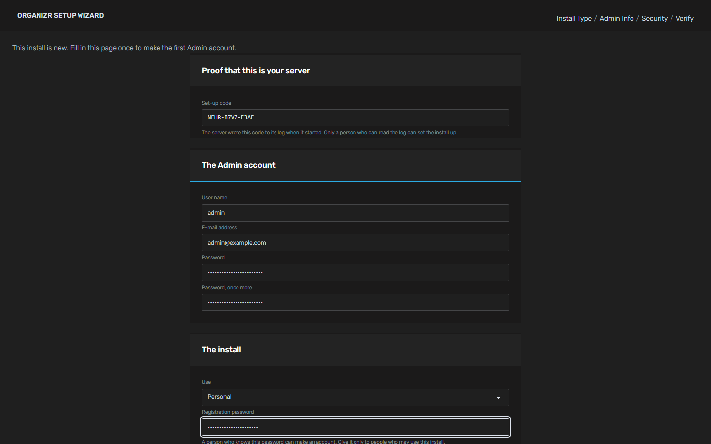
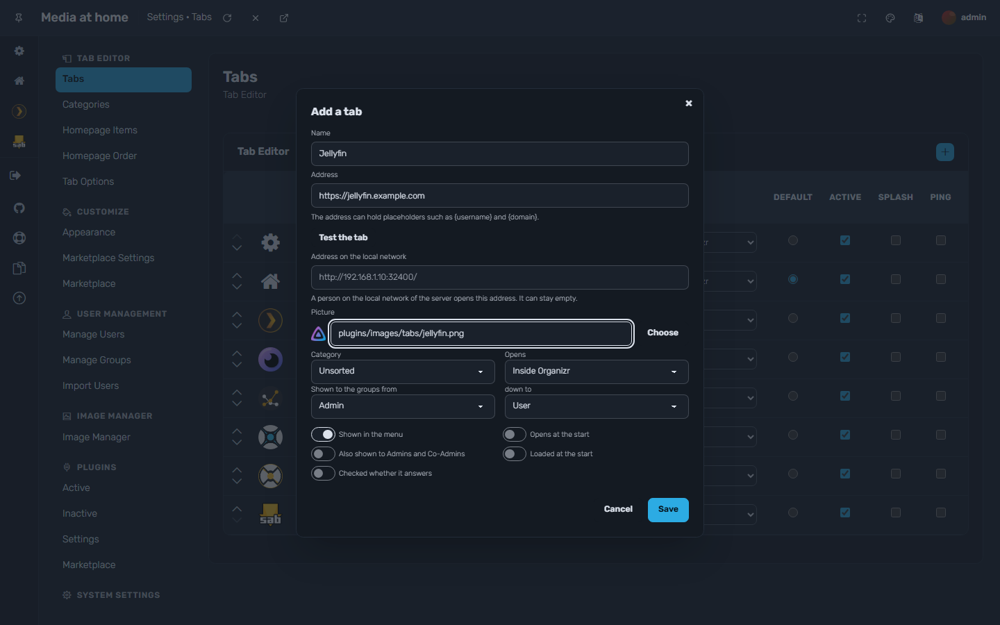

# 📦 Installation

[← All documentation](README.md)

This page gets Organizr running in Docker, walks you through the set-up wizard, adds your first tab, and shows how to update and roll back. Start here if you're new.

> [!IMPORTANT]
> **Coming from PHP Organizr?** Don't open the set-up wizard. The import builds the install for you, and it needs an empty database. Follow [Moving from PHP Organizr](moving-from-php.md) instead.

## 📋 Requirements

- 🐳 Docker with Docker Compose.
- 🚪 A free port for the web interface. The examples use `8080`.
- 🗄 A database. SQLite needs nothing: it's a file in the data folder. Want PostgreSQL? Read [Choosing a database](choosing-a-database.md) first, because you choose before the first start.
- 💻 An `amd64` or `arm64` machine. The image is `ghcr.io/tronyx/organizr-rust`.

The project has no release yet. The tag `develop` holds the newest state, and it can change at any time. [Configuration](configuration.md#-image-tags-and-architectures) lists the tags.

## 🚀 Start it with Docker Compose

1. Make a folder for Organizr and go into it:

   ```bash
   mkdir organizr && cd organizr
   ```

2. Save [compose.sqlite.yaml](../docker/examples/compose.sqlite.yaml) in that folder as `compose.yaml`. Its core looks like this:

   ```yaml
   services:
     organizr:
       image: ghcr.io/tronyx/organizr-rust:develop
       restart: unless-stopped
       ports:
         - "8080:8080"
       volumes:
         - organizr-data:/config

   volumes:
     organizr-data:
   ```

   For PostgreSQL, save [compose.postgres.yaml](../docker/examples/compose.postgres.yaml) as `compose.yaml` instead, and replace `change-me-database-password` in both places (make one with `openssl rand -hex 24`).

3. Start it:

   ```bash
   docker compose up -d
   ```

4. Read the set-up code from the log:

   ```bash
   docker compose logs organizr | grep "set-up code"
   ```

   You get a line that ends like this:

   ```text
   this install is not set up; the set-up wizard asks for the set-up code K7QM-2XWD-9RTB
   ```

5. Open `http://<your server>:8080` in a browser and fill in the [set-up wizard](#-the-set-up-wizard).

   `<your server>` is the address of the machine that runs Docker, for example `http://192.168.1.10:8080`, or `http://localhost:8080` on that machine itself.

The commands on these pages run in the folder that holds `compose.yaml`. Kept the file name `compose.sqlite.yaml`? Then add `-f compose.sqlite.yaml` after `docker compose`.

> [!WARNING]
> Port 8080 speaks plain HTTP: passwords, session cookies and the API key travel unencrypted. Do the set-up from your own network, and never forward the port from your router. To reach Organizr from outside, put a [reverse proxy](reverse-proxy.md) with HTTPS in front, then remove the `ports:` lines from `compose.yaml` (or publish only to the host: `"127.0.0.1:8080:8080"`). Docker opens published ports past firewalls such as ufw and firewalld.

## 🐳 Start it with docker run

```bash
docker run -d --name organizr --restart unless-stopped \
  -p 8080:8080 \
  -v organizr-data:/config \
  ghcr.io/tronyx/organizr-rust:develop
```

Then read the set-up code with `docker logs organizr 2>&1 | grep "set-up code"`. With `docker run`, the container is called `organizr` and the volume `organizr-data`, so use those names wherever the docs say `docker compose exec organizr` or `<project>_organizr-data`.

## 🧙 The set-up wizard

A new install shows the wizard to anyone who opens it. Only someone who can read the container's log knows the set-up code, so only you can finish it. The code changes each time the container starts; after a restart, read it again.



| Panel | Field | What to enter |
| --- | --- | --- |
| Proof that this is your server | **Set-up code** | The code from the log. Small letters and missing dashes are fine |
| The Admin account | **User name** | The name of your first account. It becomes an Admin |
| The Admin account | **E-mail address** | Your address. Password recovery sends mail here once [e-mail](email.md) is set up |
| The Admin account | **Password**, **Password, once more** | A strong password. Save it in your password manager |
| The install | **Use** | **Personal** for a home server. **Business** hides the media items of the homepage (Plex, Sonarr and the like) and the Invites plugin, as in PHP Organizr |
| The install | **Registration password** | A password that lets people make their own account. See below |
| The install | **API key** | Already filled in. **Make another** draws a new one. See below |

Under the form, the wizard shows which database the server uses: **SQLite** or **PostgreSQL**. The wizard can't change it; see [Choosing a database](choosing-a-database.md).

Select **Set up**. Organizr makes the Admin account and logs you in.

### 🔑 The registration password

Anyone who knows the registration password can make an account in the group for new users. Give it only to people who may use your install.

- Change it later in **Settings › System Settings › Login & Security**, field **Registration Password**.
- **Hide Registration** on the same page hides the **Register** button on the login page.
- Wrong tries count toward the login lockout.

### 🔑 The API key

A script that sends the API key has all the rights of an Admin.

- Send it in the header `token`. The query field `?apikey=` works too, but it ends up in proxy logs and browser history.
- Read it later in **Settings › System Settings › General**, field **Organizr API**. Only Admins see it; Co-Admins don't.
- If it leaks, select **Generate New API Key** on the same page. Scripts with the old key then get `401`.

## 📑 Your first tab

A tab is an application in Organizr's menu, for example Sonarr. Here's how to add one:

1. Open **Settings › Tab Editor › Tabs**.
2. Select the round ➕ button (**Add a tab**) at the top right of the list.

   

3. Fill in the dialog:

   | Field | What to enter |
   | --- | --- |
   | **Name** | The name in the menu, for example `Sonarr` |
   | **Address** | The full address of the application, for example `https://sonarr.example.com/`. It can hold placeholders such as `{username}` and `{domain}` |
   | **Address on the local network** | Optional. People on your server's local network open this one instead, for example `http://192.168.1.10:8989/` |
   | **Picture** | The icon in the menu. Pick one from the list, or upload your own in **Settings › Image Manager** |
   | **Category** | The group in the menu. Make categories in **Settings › Tab Editor › Categories** |
   | **Opens** | **Inside Organizr** (in a frame) or **In a new window** |
   | **Shown to the groups from** … **down to** | Who sees the tab, from the highest group to the lowest. Put **Guest** at the bottom to show it to everyone, even before login |
   | **Shown in the menu** | On, so the tab appears |
   | **Opens at the start** | On for the tab that opens first after login |
   | **Also shown to Admins and Co-Admins** | On to show the tab to Admins even when they're outside the groups above |
   | **Loaded at the start** | Loads the tab in the background, so it opens at once |
   | **Checked whether it answers** | Shows a dot in the menu when the application is up. Then enter the **Address to check**, for example `sonarr.example.com:8989` |

4. Select **Test the tab**. Organizr tells you whether the page can show inside Organizr. If it can't, set **Opens** to **In a new window**, or see [A tab in a frame](reverse-proxy.md#-a-tab-in-a-frame).
5. Select **Save**. The tab shows up in the menu.

A tab with a full address is the simple way. A tab with only a path, such as `/sonarr/`, needs a matching location in your reverse proxy; see [Tabs](reverse-proxy.md#-tabs).

## 📁 The data folder

Organizr keeps everything in the volume `/config`: the SQLite database, `secret.key`, the uploaded pictures, the logs and the backups. [Configuration](configuration.md#-the-data-folder) lists each file.

Compose names the volume `<project>_organizr-data`. `<project>` is the folder that holds `compose.yaml`, so with the steps above it's `organizr_organizr-data`. Keep this volume: without it, a new container starts as a brand-new install.

> [!CAUTION]
> `docker compose down -v` deletes the volume and your whole install. Plain `docker compose down` keeps it.

The container runs as the user and group `65532`, not as root. A named volume, as in the examples, needs nothing. If you mount a folder of the host instead, that user must be able to write to it:

```bash
sudo mkdir -p /srv/organizr
sudo chown 65532:65532 /srv/organizr
```

Logged in as root, for example on Unraid or Proxmox? Leave out `sudo`: the commands work the same without it.

Then mount it with `- /srv/organizr:/config` in `compose.yaml` (or `-v /srv/organizr:/config` with `docker run`). On a NAS such as Unraid or Synology, the simplest choice is the named volume from the example.

### 🔑 Back up secret.key

Organizr encrypts the passwords, tokens and API keys it stores (yours and those of your services) with the key in `/config/secret.key`. A backup from **Settings › System Settings › Backup** doesn't hold this file, on purpose. Without it, a restored install can't read those secrets, and accounts with a [second factor](second-factor.md) can't log in.

Copy it once, right after the set-up, to a safe place that isn't where your backups are (your password manager is a good spot):

```bash
docker compose cp organizr:/config/secret.key ./secret.key
chmod 600 ./secret.key
```

The key never changes, so one copy is enough. [Secrets](secrets.md) tells you more.

## 🔧 Settings of the container

Most settings live in the web interface. A few are environment variables, because Organizr needs them before it can open its database. You'll probably need only these:

| Variable | When you need it |
| --- | --- |
| `ORGANIZR_TRUSTED_PROXIES` | Behind a reverse proxy. See [Reverse proxy](reverse-proxy.md#-organizr_trusted_proxies) |
| `ORGANIZR_DATABASE_URL` | With PostgreSQL. See [Choosing a database](choosing-a-database.md) |
| `ORGANIZR_ALLOWED_HOSTS` | When service addresses are paths, such as `/sonarr`. See [Configuration](configuration.md) |
| `TZ` | When your schedules should follow your time zone, for example `America/New_York` |

[Configuration](configuration.md#-environment-variables) lists every variable, with its default and its security notes.

## 🩺 Health check

The image checks itself every 30 seconds, and Docker shows the container as `healthy` or `unhealthy`. Ask yourself:

```bash
docker compose exec organizr organizr healthcheck
```

No output means the server answers. [Configuration](configuration.md#-the-health-check) has the details and the probes for Kubernetes.

## 🔄 Update and roll back

Organizr updates its database by itself when a new version starts. That step goes one way: a database that a newer version opened doesn't open with an older one. So make a backup first, and note which image you ran.

### 🔄 Update

1. Make a backup in **Settings › System Settings › Backup** (select **Make a backup now**). With PostgreSQL, also save the database with `pg_dump`; see [Choosing a database](choosing-a-database.md#-back-up-postgresql).
2. Note the digest of the image you run now, so you can go back to it:

   ```bash
   docker image inspect --format '{{index .RepoDigests 0}}' ghcr.io/tronyx/organizr-rust:develop
   ```

   You get something like `ghcr.io/tronyx/organizr-rust@sha256:4f1c…`. Save that line.

3. Pull the new image and start a new container from it:

   ```bash
   docker compose pull
   docker compose up -d
   ```

4. Check the log for errors: `docker compose logs organizr`.

With `docker run`, do `docker pull ghcr.io/tronyx/organizr-rust:develop`, then `docker stop organizr`, `docker rm organizr`, and the same `docker run` command as before. The volume keeps your data. [Release notes](release-notes.md) tells you what changed.

### 📌 Stay on one version

To keep an exact build, put its digest in `compose.yaml` in place of the tag:

```yaml
    image: ghcr.io/tronyx/organizr-rust@sha256:<digest>
```

`<digest>` is the long hex value from step 2. Compose then never pulls anything newer until you change the line. [Releases](releases.md#-pin-one-exact-build) tells you more about pinning.

### ⏪ Roll back

If a new version misbehaves, go back to the old image **and** the backup you made before the update:

1. Stop Organizr: `docker compose stop organizr`.
2. Set `image:` in `compose.yaml` to the digest you saved in step 2 of the update.
3. Put the backup back (the file name is in **Settings › System Settings › Backup**, or in the `backups` folder of the volume):

   ```bash
   docker compose run --rm organizr restore --from "/config/backups/<backup file>.zip" --overwrite
   ```

   `<backup file>` is the name of the zip, for example `backup[2026-11-20_03-15 - ab][0.1.0]`. With PostgreSQL, also restore the dump you made before the update into an empty database (`dropdb`, `createdb`, then `pg_restore`); see [Choosing a database](choosing-a-database.md#-back-up-postgresql).

4. Start it: `docker compose up -d`.

[Backups](backups.md) explains the restore, and [Troubleshooting](troubleshooting.md#-recovery) has more ways out.

## 🧭 Next steps

- 🌐 [Reverse proxy](reverse-proxy.md): put Organizr behind nginx, Nginx Proxy Manager, SWAG, Traefik or Caddy, with HTTPS.
- 🏠 [Homepage](homepage.md): show Plex, Sonarr and friends on the homepage.
- ✉ [E-mail](email.md): set up the SMTP server, so people can ask for a new password.
- 💾 [Backups](backups.md): switch on backups on a schedule.
