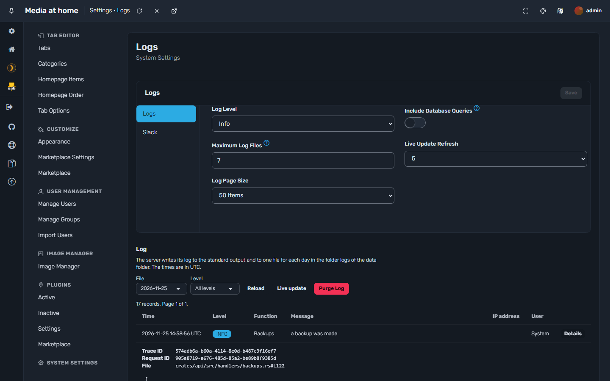

# 📜 The log

[← All documentation](README.md)

This page shows where Organizr writes its log, how to read it in the web page or on the command line, and how to follow one request from your proxy into Organizr. Read it when something misbehaves and you want to know why.

## 📍 Where the log goes

Organizr writes its log to two places, each with its own level:

| | Standard output | Log files |
|---|---|---|
| Where | `docker compose logs organizr` (or `docker logs <container>`) | One file per day in the folder `logs` of the data folder (`/config/logs` in the container), as PHP Organizr does |
| Format | Plain text lines | JSON, one record per line |
| Level set by | The environment variable `ORGANIZR_LOG` | The setting **Log Level** (`logLevel`) |
| Default level | `info` | `INFO` |
| Shown on the Logs page | No | Yes |
| Holds | Organizr's records, plus those of the libraries below it (for example the database driver) | Organizr's own records only |

The two levels are independent: `logLevel` doesn't change the standard output, and `ORGANIZR_LOG` doesn't change the files. A new `logLevel` counts at once. `ORGANIZR_LOG` is read when the server starts, so set it in the `environment:` of your Compose file and run `docker compose up -d`:

```yaml
services:
  organizr:
    environment:
      ORGANIZR_LOG: debug
```

`ORGANIZR_LOG` takes a level such as `debug`, or a list of filters such as `organizr_api=debug,info`. There's no option for JSON on the standard output.

## 👀 Read the log in the web page



An Admin or a Co-Admin can read the log on **Settings › System Settings › Logs**, below the settings:

| Control | What it does |
|---|---|
| **File** | Picks the file of one day, or **All** for all of them |
| **Level** | Shows the records of one level only |
| **Reload** | Loads the records again |
| **Live update** | Reloads again and again, every **Live Update Refresh** |
| **Details** | Shows the trace id, the request id, the place in the source code and the context of a record |
| **Purge Log** | Deletes the chosen file. The server starts a new file with the next record of the day |

> [!NOTE]
> A Co-Admin can delete log files too, as in PHP Organizr. The standard output of the container keeps its own copy.

## 📶 Levels

The setting **Log Level** has the eight levels of PHP Organizr. Organizr writes records at four of them:

| Level | Written? |
|---|---|
| `DEBUG` | ✅ Yes |
| `INFO` | ✅ Yes |
| `NOTICE` | No records at this level; as a setting it keeps `DEBUG` and `INFO` out |
| `WARNING` | ✅ Yes |
| `ERROR` | ✅ Yes |
| `CRITICAL`, `ALERT`, `EMERGENCY` | No records at these levels; as a setting they keep **every** record out of the file |

## 🔎 Follow one request

Every answer of the server has the header `X-Request-Id`: a random id the server makes for that request. Every log line that the request writes carries the same id:

- `request_id` in the log files,
- `request{request_id=...}` in the standard output.

The server never takes the id from a header of the client, so nobody can forge it.

1. Read the header of the answer, for example in the network tools of your browser, or with `curl -i`.
2. Search the log for it. In the standard output:

   ```bash
   docker compose logs organizr | grep 'request_id=<request-id>'
   ```

   In the log files (bare binary, data folder `data`):

   ```bash
   grep '"request_id":"<request-id>"' data/logs/organizr-*.log
   ```

   - `<request-id>`: the id from the header, for example `6f1c2b9e-4d0a-4f3e-8a71-2c5d9e0b3a64`.

3. Or open **Details** of a record on the Logs page: it shows the request id and the trace id.

The **trace id** is different: a random id of one record. The Logs page and the API find a record by it.

## 📄 The log files

The file of a day is called `organizr-<date>.log`, for example `organizr-2026-11-20.log`. The date and the times in the file are in UTC. Each line is one record, as a JSON object:

```json
{"log_level":"INFO","message":"a user logged in","channel":"Login","username":"robin","trace_id":"0b1f6a3e-7c1d-4a52-9d55-3f2a8c9e1b47","request_id":"6f1c2b9e-4d0a-4f3e-8a71-2c5d9e0b3a64","file":"crates/api/src/handlers/login.rs","line":117,"context":{},"remote_ip_address":"192.0.2.7","datetime":"2026-11-20 03:15:00.123456","timezone":"UTC"}
```

| Field | What it holds |
|---|---|
| `log_level` | The level: `DEBUG`, `INFO`, `WARNING` or `ERROR` |
| `message` | What happened |
| `channel` | The part of the server that wrote the record. The Logs page calls it the function |
| `username` | The user the record is about, or `System` |
| `trace_id` | A random id of the record |
| `request_id` | The id of the request that wrote the record, or `null` when no request wrote it, for example at the start of the server |
| `file`, `line` | The place in the source code that wrote the record |
| `context` | The other values of the record, for example the reason for an error |
| `remote_ip_address` | The client's address, when the record names one. Otherwise `null` |
| `datetime`, `timezone` | The time of the record, and `UTC` |

To read the files without the web page, copy them out of the container and use a tool for JSON lines, such as `jq`:

```bash
docker compose cp organizr:/config/logs ./logs
jq -r '[.datetime, .log_level, .message] | @tsv' ./logs/organizr-2026-11-20.log
```

### 🔒 What a record holds, and what it never holds

- A record never holds a password, a key or a token, and never an address of another service that could hold one.
- A record can hold a user name and a client address.
- On an install that isn't set up yet, a record holds the set-up code of the wizard (see [Installation](installation.md#-the-set-up-wizard)). The code is new at each start and works only until the set-up is done.
- A [backup](backups.md) holds the log files, because they're in the data folder.

## 🔧 Settings

Open **Settings › System Settings › Logs**. The settings are above the log, in the section **Logs**.

| Setting | Key | Default |
|---|---|---|
| Log Level | `logLevel` | `INFO` |
| Include Database Queries | `includeDatabaseQueriesInDebug` | Off. Kept from PHP; it changes nothing here. The database driver's records go to the standard output, so use `ORGANIZR_LOG` for them |
| Maximum Log Files | `maxLogFiles` | 7 |
| Live Update Refresh | `logLiveUpdateRefresh` | 5 seconds |
| Log Page Size | `logPageSize` | 50 |

- When there are more files than **Maximum Log Files**, Organizr deletes the oldest.
- A change of **Log Level** or **Maximum Log Files** counts from the next record on. No restart needed.
- PHP Organizr has the setting `logLocation` for another folder. Organizr doesn't use it: the log files are always in the folder `logs` of the data folder.
- When the server can't write to that folder, it says so once on its standard error, and the log goes on in the standard output.

The section **Slack** holds the settings of a webhook for the log and the button **Test Slack** (see [Tests of the settings](settings-tests.md#-the-webhook-for-the-logs)). Organizr doesn't send its log there yet (D-84). The webhook address is a secret: the field says that one is stored, and left empty it keeps that address.

## 🔍 Details

### 🔌 The API

The routes of PHP Organizr are kept. Both need a Co-Admin or higher.

| Route | What it does |
|---|---|
| `GET /api/v2/log[/{number}[/{trace_id}]]` | A page of records, newest first. `number` is the place of a file in the list of files, newest first, from 0. `all` or `combined-logs` reads all files. The query takes `pageSize` (default 1000), `offset` (default 0) and `filter` (a level, or `NONE` for all, the default). With a `trace_id`, the answer is the record with that id |
| `DELETE /api/v2/log[/{number}]` | Deletes a file. Without `number`, the newest file |

### 📈 Metrics and health

Organizr has no metrics endpoint (no Prometheus). For a health check, use `GET /api/v2/ping`; the `organizr healthcheck` command of the image asks that route.

[Deviations](deviations.md) lists the differences from PHP Organizr in row D-84.
