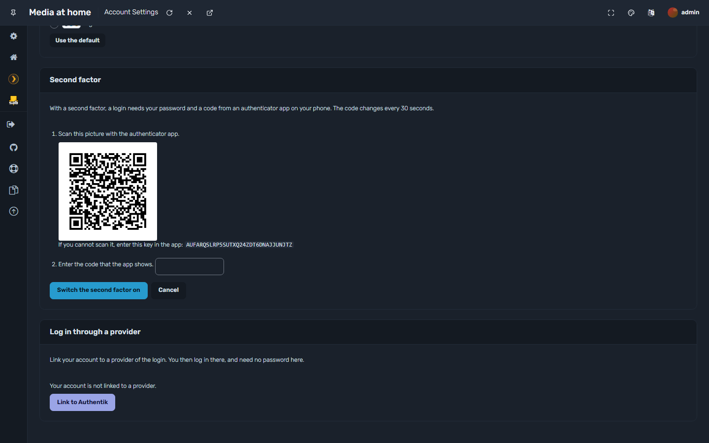

# 🪪 Logging in with OpenID Connect

[← All documentation](README.md)

Let people log in to Organizr with an account from your identity provider: **Authentik**, **Keycloak**, **PocketID** or **Zitadel**. The login page gets a button for each provider, for example **Log in with Keycloak**. The person logs in at the provider and comes back to Organizr, logged in. OpenID Connect (OIDC) is the standard way to "log in with another service" that all four speak.

## 🚀 Set it up

The short version: make a client at your provider, paste three values into Organizr, test.

1. **At your provider**, make a client for Organizr. Follow the section for [Authentik](#-authentik), [Keycloak](#-keycloak), [PocketID](#-pocketid) or [Zitadel](#-zitadel). Write down three values: the **client ID**, the **client secret** and the **discovery URL**.
2. Log in to Organizr as an Admin. Only an Admin can change these settings; a Co-Admin sees them but can't change them (D-133).
3. Open **Settings › System Settings › Sign-in**.
4. In the section **OpenID Connect**, switch on **Enable OIDC Authentication**.
5. In the section of your provider, for example **Keycloak**, switch on **Enable Keycloak**. Enter the **Discovery URL**, the **Client ID** and the **Client Secret**.
6. Select **Save**.
7. In the same section, next to **Test Connection**, select **Test**. Organizr reads the discovery document and the signing keys of the provider, and shows the issuer.
8. Log out, and try the new button on the login page.

Before you link anyone, read [Accounts and linking](#-accounts-and-linking): it decides who gets which Organizr account.

## 🔁 The redirect address

Your provider asks where to send people back after the login. Give it this address:

```text
https://organizr.example.com/api/v2/oidc/<provider>/callback
```

- Replace `organizr.example.com` with the address people use to open Organizr.
- Replace `<provider>` with `authentik`, `keycloak`, `pocketid` or `zitadel`.

For example, for Keycloak:

```text
https://organizr.example.com/api/v2/oidc/keycloak/callback
```

> [!IMPORTANT]
> **Behind a reverse proxy, list the proxy in [`ORGANIZR_TRUSTED_PROXIES`](reverse-proxy.md#-organizr_trusted_proxies).** Organizr builds the redirect address from the address the browser used, as PHP Organizr does. It only knows the browser used HTTPS when the proxy is trusted. Otherwise it sends `http://`, and the provider refuses the login because the address doesn't match.

## 🦊 Authentik

1. In the Authentik admin interface, open **Applications › Providers**, and create an **OAuth2/OpenID Provider**.
2. Set **Client type** to **Confidential**.
3. Under **Redirect URIs/Origins**, add the redirect address with `authentik`: `https://organizr.example.com/api/v2/oidc/authentik/callback`.
4. Choose a **Signing Key**, so that Authentik signs the ID tokens with a key of its own.
5. Copy the **Client ID** and **Client Secret**.
6. Create an **Application** for the provider. Its **slug** is part of the discovery URL.
7. Your discovery URL is `https://authentik.example.com/application/o/<slug>/.well-known/openid-configuration`.

Groups: Authentik puts the user's groups in the claim `groups` of the scope `profile`, so the default scopes are enough.

## 🔐 Keycloak

1. In the Keycloak admin console, choose the realm, open **Clients**, and select **Create client**.
2. Keep **OpenID Connect**, and enter a client ID, for example `organizr`.
3. Switch on **Client authentication**, and keep **Standard flow** on.
4. Under **Valid redirect URIs**, add the redirect address with `keycloak`: `https://organizr.example.com/api/v2/oidc/keycloak/callback`.
5. Under **Credentials**, copy the client secret.
6. For groups: open the **Client scopes** tab of the client, select the dedicated scope, and add the mapper **Group Membership** with the token claim name `groups`.
7. Your discovery URL is `https://keycloak.example.com/realms/<realm>/.well-known/openid-configuration`.

With **Full group path** on, Keycloak writes a group as `/parent/child`. A mapping in Organizr matches it by the full name, by the name without the first `/`, or by the last part, `child`.

## 🎒 PocketID

1. In PocketID, open **OIDC Clients**, and add a client.
2. Under **Callback URLs**, add the redirect address with `pocketid`: `https://organizr.example.com/api/v2/oidc/pocketid/callback`.
3. Copy the client ID and client secret that PocketID shows.
4. For groups: in Organizr, set **Scopes** of the **PocketID** section to `openid,profile,email,groups`.
5. Your discovery URL is `https://pocketid.example.com/.well-known/openid-configuration`.

## 🌐 Zitadel

1. In the Zitadel console, open your project, and add an application of the type **Web**.
2. Choose the authentication method **POST**, so that Zitadel takes the client secret in the body of the request.
3. Add the redirect address with `zitadel`: `https://organizr.example.com/api/v2/oidc/zitadel/callback`.
4. Copy the client ID and client secret.
5. For roles: in the project settings, switch on **Assert Roles on Authentication**.
6. Your discovery URL is `https://zitadel.example.com/.well-known/openid-configuration`, or the address of your instance.

Zitadel sends the roles in the claim `urn:zitadel:iam:org:project:roles`, as an object. Organizr takes the role names from it. The default scopes already ask for this claim.

## 📋 The provider settings

Each provider section (**Authentik**, **Keycloak**, **PocketID**, **Zitadel**) has the same fields:

| Field | Setting | What it does |
|---|---|---|
| **Enable …** (for example **Enable Keycloak**) | `oidc<Provider>Enabled` | Shows the button of the provider on the login page |
| **Display Name** | `oidc<Provider>Name` | The button text: **Log in with** plus this name |
| **Discovery URL** | `oidc<Provider>DiscoveryUrl` | The address of the provider's discovery document. It ends with `/.well-known/openid-configuration` |
| **Client ID** | `oidc<Provider>ClientId` | The ID of the Organizr client at the provider |
| **Client Secret** | `oidc<Provider>ClientSecret` | The secret of that client. Stored encrypted (see [Secrets](secrets.md)), and never shown again |
| **Scopes** | `oidc<Provider>Scopes` | What Organizr asks the provider for, separated by commas. `openid` is always asked for |
| **Group Claim Override** | `oidc<Provider>GroupClaim` | The claim that holds the groups. Empty: the global **Group Claim Name** |

`<Provider>` is `Authentik`, `Keycloak`, `Pocketid` or `Zitadel`. Organizr sends the client secret in the body of the token request (`client_secret_post`), as PHP Organizr does. The provider must allow that.

> [!WARNING]
> **Use the provider's host name in the Discovery URL, not an IP address.** Organizr doesn't check the certificate of an HTTPS address that is an IP address (no authority signs certificates for addresses). Someone who can pretend to be that IP on your network could then read the client secret and forge logins.

## 👥 Groups

A login can put the person in an Organizr group, based on the groups or roles the provider sends.

| Field | Setting | What it does |
|---|---|---|
| **Group Claim Name** | `oidcGroupClaimName` | The claim that holds the groups, when the provider has no override. Default: `groups` |
| **Group Mappings (JSON)** | `oidcGroupMappings` | From a provider group to the level of an Organizr group |
| **Group Mapping Mode** | `oidcGroupMappingMode` | **First Match**, **Highest Privilege (lowest ID)** (the most access) or **Lowest Privilege (highest ID)** (the least access) |
| **Default Group** | `oidcDefaultGroupId` | The group for a person with no mapped group |
| **Update Groups on Login** | `oidcUpdateGroupsOnLogin` | Off: only a new account gets the group from the mappings. On: every login updates it |

A mapping names **levels**, not group names: `0` Admin, `1` Co-Admin, `2` Super User, `3` Power User, `4` User, `999` Guest. For example:

```json
{"organizr-admins": 0, "organizr-family": 3, "organizr-users": 4}
```

A value that isn't a level from 0 to 999 doesn't count. When no Organizr group has the level, the person goes into the default group of Organizr.

> [!CAUTION]
> **A mapping to `0` or `1` makes every member of that provider group an Admin or Co-Admin** (when their account is made, or at every login with **Update Groups on Login**). Make sure only you can add people to that group at the provider.

## 🔗 Accounts and linking

| Field | Setting | What it does |
|---|---|---|
| **Auto-Create Users** | `oidcAutoCreateUsers` | A person with no account gets one, with a random password |
| **Link Existing Users** | `oidcLinkExistingUsers` | An Organizr account with the same user name, or e-mail address, becomes the person's account (never an Admin or Co-Admin account; see below). Only the claim `preferred_username` finds an account by its user name (D-184). A new account takes `preferred_username`, or else `name`, or else `sub` as its user name |

For each linked account, Organizr stores the person's **subject** (`sub`) at the provider: the provider's permanent ID for that account, taken from the checked ID token. At each login, Organizr looks for the account in this order:

1. **The account linked to this subject at this provider.** A new user name or e-mail address at the provider doesn't matter.
2. **Else, an account with the same user name** (any letter case) as `preferred_username`, **or else the same e-mail address**. The display name (`name`) never finds an account, because people can often change it at the provider (D-184). The e-mail address is skipped when the provider says it hasn't checked it (`email_verified` is `false`). Such an account is used only:
   - when it's linked to no provider yet, **Link Existing Users** is on, and it is **not** an Admin or Co-Admin account; or
   - when it's linked to this provider but has no subject yet: an account that PHP Organizr linked, or that an older version of this application linked.

   An account linked to another subject, or to another provider, is refused, even when the name and address match.
3. **Else, with Auto-Create Users on, a new account** in the group from the mappings, with the subject. Its picture is the claim `picture`, when that is a web address.

The first login of a linked account without a subject decides: that login's subject is stored, and from then on only that subject gets in. The Organizr log names the user, the provider and the subject each time a subject is stored, so you can check that the right person made that first login.

> [!IMPORTANT]
> **Linking never hands out an Admin or Co-Admin account by name or e-mail address.** Such an account logs in through a provider only after it was linked on purpose (see below), whatever the settings say. The level counts as stored at the time of the login.
>
> Switch **Link Existing Users** on only when the provider decides the user names and e-mail addresses, checks e-mail addresses, and doesn't let people sign themselves up. Some providers leave out `email_verified`; Organizr then treats the address as checked.

### 👑 Link an Admin account safely

To log in to your Admin (or any) account through a provider, link it yourself while you're logged in. This works for Admin and Co-Admin accounts too, and it's the only way they can use a provider.

1. Log in to Organizr with the account's password. (If **Auto-Redirect to OIDC** is on, open `https://organizr.example.com/#noredirect` to get the password form.)
2. Open the menu with your name, and select **Account Settings**.
3. Under **Log in through a provider**, select **Link to** next to the provider.
   
4. Log in at the provider **with the provider account that should own this Organizr account**. The browser comes back to the account page, which says the account is linked.
5. Log out, and log in with the provider button to check it.
6. Keep the account's Organizr password. You need it to unlink, and it's your way back in if the provider is down (use `#noredirect`).

What a link does:

- It stores the subject of that provider login. The user names and e-mail addresses may differ: you've proven you own both accounts.
- It's refused when another Organizr account is already linked to the same provider account.
- It only finishes in the session that started it. It makes no account and no new session.
- A link to another provider, or to another account at the same provider, replaces the old link.
- After the link, the account logs in through the provider by its subject, whatever **Link Existing Users** says.

**To unlink:** enter the account's password in **Password of this account**, and select **Unlink from** next to the provider. The account then logs in with its password again. An account that a provider made has a random password that nobody knows: get a new one by e-mail first ([Forgot your password?](email.md#-a-new-password)).

**Imported links:** an account that PHP Organizr had linked (`auth_service` `oidc::<provider>`) keeps its link after the import. PHP stored no subject, so the first login through the provider stores it, as above. An imported Admin or Co-Admin account is taken that way only by its own e-mail address, and only when the provider says it checked that address (`email_verified`). A match of the user name alone doesn't do, because anyone with that name at the provider would get the account. Otherwise, log in with the password once and link the account on purpose (see below) (D-148, D-156).

### 🎫 Second factor and session length

A login through a provider doesn't ask for the Organizr [second factor](second-factor.md), as in PHP Organizr: the provider checks the person (switch on the provider's own second factor). The session lasts **Remember Me Length** days (`rememberMeDays`, in **Settings › System Settings › Login & Security**).

## 🚪 The login page and logout

These are in the **OpenID Connect** section:

| Field | Setting | What it does |
|---|---|---|
| **Auto-Redirect to OIDC** | `oidcAutoRedirect` | The login page sends the browser straight to the provider |
| **Auto-Redirect Provider** | `oidcAutoRedirectProvider` | Which provider that is |
| **Custom Logout URL** | `oidcAutoRedirectLogoutUrl` | Where the browser goes after a logout, for example the provider's logout page |

To reach the normal login page while the redirect is on (for example, to log in with the Admin password), add `#noredirect` to the address: `https://organizr.example.com/#noredirect`. After a logout, the login page in that browser tab doesn't send you back to the provider, so you aren't logged straight in again.

## 🩺 When something fails

A failed login shows a **Login Failed** page with the reason and a link back to the login page. The Organizr log says more. It never holds a token, a code or the client secret.

| Text | Cause |
|---|---|
| Invalid or expired state parameter | The login took longer than 10 minutes, the browser lost the login cookie, or the answer belongs to another login |
| Failed to exchange authorization code | The provider refused the code or the client secret, or can't be reached |
| Invalid ID token | The signature, issuer, audience or time of the ID token is wrong |
| Invalid nonce | The ID token belongs to another login |
| Failed to create or link user | No account fits and the settings make none; the user name or e-mail address is taken; or the account with that name or address is linked to another provider account, or another provider |
| Another account is already linked to this account of the provider | A link names a provider account that another Organizr account is already linked to |
| The link must be finished in the session that started it | The browser came back from a link without the session that started it |
| The provider refused the login | The provider sent an error, for example `access_denied` |

## 🔧 How a login works

1. The person selects the provider's button. Organizr sends the browser to the provider's login page.
2. The person logs in there. The provider sends the browser back to the [redirect address](#-the-redirect-address), with a one-time code.
3. Organizr gives the code to the provider and gets an ID token. The ID token says who the person is.
4. Organizr checks the ID token: the signature (against the provider's keys), the issuer, the audience (the client ID), the expiry time and the nonce (a random value for this login). A token that fails any check gives no session.
5. Organizr finds, links or makes the account (see [Accounts and linking](#-accounts-and-linking)), and starts a session as after any other login. The browser goes to the start page.

The login uses PKCE, a check that only the browser that started a login can finish it. While the person is at the provider, Organizr keeps the login's values in its own cookie, `organizr_oidc_login`. The cookie is encrypted with the key of the install, so nobody can read or change it. It lasts 10 minutes, and Organizr deletes it when the browser comes back. Organizr also remembers each login that came back until its cookie expires, so a copy of the cookie doesn't work a second time. A login that takes longer than 10 minutes has to start again.

## 🐘 Differences from PHP Organizr

The differences are entries D-87 to D-90 of [Deviations](deviations.md).
