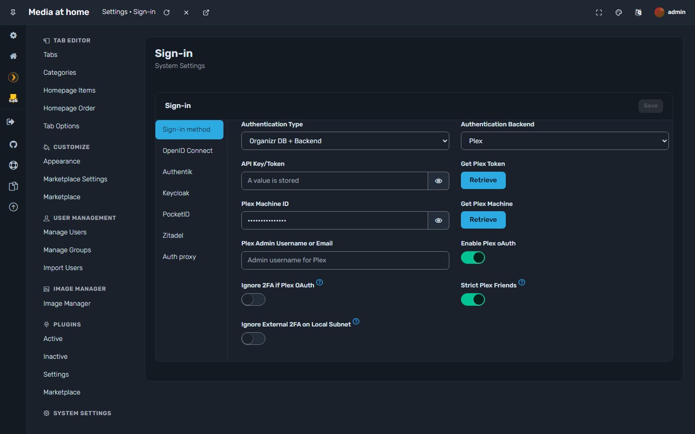
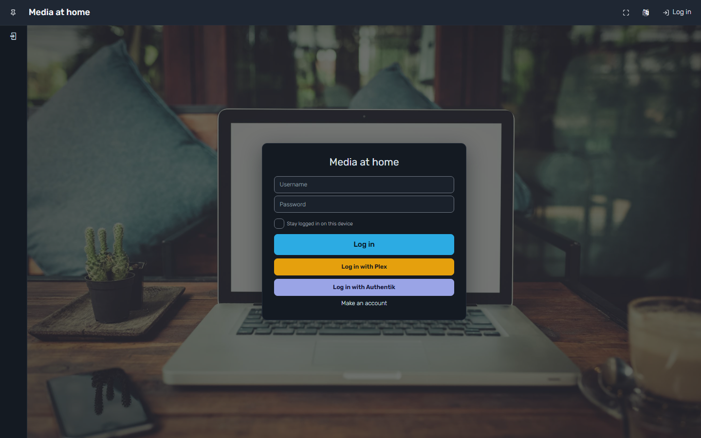

# 🎬 Logging in with a Plex account

[← All documentation](README.md)

Let the people you share your Plex server with log in to Organizr with their Plex account. They don't need a separate Organizr password. You need this page if your users already live in Plex and you'd rather not manage a second list of accounts.

## 🎫 Two ways to log in

You can use one or both:

| Way | What the user does | What Organizr sees |
|---|---|---|
| **Plex password** | Types their Plex user name (or e-mail) and Plex password on the Organizr login page | The password. Organizr asks plex.tv whether it's right |
| **"Log in with Plex" button** | Logs in at Plex itself, in a small pop-up window | Only a token from Plex, never the password |

Either way, only a Plex account that your server is shared with can log in, plus the server owner that you name in the settings.

## 🚀 Set it up

> [!WARNING]
> **Don't pick "Backend Only" for your first set-up.** With **Backend Only**, Organizr ignores the passwords it stores, so the Admin account you made in the set-up wizard can't log in with its Organizr password anymore. If plex.tv is down, nobody gets in. Start with **Organizr DB + Backend**, and switch to **Backend Only** only after you've logged in as the Plex owner and checked that it works.

1. Log in to Organizr as an Admin.
2. Open **Settings › System Settings › Sign-in**. The section **Sign-in method** opens.
3. Set **Authentication Type** to **Organizr DB + Backend**. (See [the choices](#-authentication-type-choices) below.)
4. Set **Authentication Backend** to **Plex**. The Plex fields appear.
   
5. Next to **Get Plex Token**, select **Retrieve**. A small Plex window opens. Log in there **as the owner of the Plex server**. The token fills in **API Key/Token**. Organizr uses it to read the list of accounts your server is shared with.
6. Select **Save**. The next step needs the saved token.
7. Next to **Get Plex Machine**, select **Retrieve**. If the owner has one server, its ID fills in **Plex Machine ID**. If there are several, choose the server from the list. The field shows the ID as dots; select the eye button to see it.
8. In **Plex Admin Username or Email**, enter the Plex user name or e-mail address of the server owner. The owner isn't on any share list, so this is what lets the owner in. It's also the only Plex account that may open an Admin or Co-Admin account (see [Who gets which account](#-who-gets-which-account)).
9. Optional: to show the **Log in with Plex** button, switch on **Enable Plex oAuth**.
10. Select **Save**.
11. Log out, and try it. With the button switched on, the login page shows **Log in with Plex**.
    

> [!TIP]
> The same **API Key/Token**, **Plex Machine ID** and **Plex Admin Username or Email** also appear on **Settings › System Settings › SSO**, section **Plex**. The Plex item of the [homepage](homepage.md) uses the same **API Key/Token** and **Plex Machine ID** too. They are the same settings everywhere, so you only fill them in once.

### 🔀 Authentication Type choices

| Choice | Which passwords work |
|---|---|
| **Organizr DB** | Only the passwords that Organizr stores. Plex isn't asked |
| **Organizr DB + Backend** | Plex first. When Plex says no, or can't be reached, the password that Organizr stores. **Recommended** |
| **Backend Only** | Only Plex. See the warning above |

The **Log in with Plex** button works with every choice, also **Organizr DB**: only **Enable Plex oAuth** switches it on or off. To stop Plex logins completely, also switch off **Enable Plex oAuth**.

### 🔘 The other Plex switches

| Setting | What it does |
|---|---|
| **Strict Plex Friends** | On: only accounts that have a share of the server in **Plex Machine ID** can log in. Off: every Plex friend of the owner passes, also one who only has a share of another server of the owner |
| **Ignore 2FA if Plex OAuth** | On: a login with the **Log in with Plex** button skips the Organizr [second factor](second-factor.md). Plex has its own second factor |

## 👤 Who gets which account

When Plex says yes, Organizr picks the Organizr account like this:

1. Organizr checks that the Plex account is on the share list (or is the owner).
2. It looks for an Organizr account with the same user name as the Plex account, or else the same e-mail address.
3. If there isn't one, it makes a new account in the group for new users.
4. It stores the user's Plex token, encrypted. [Single sign-on](single-sign-on.md) uses it.

> [!IMPORTANT]
> **Plex logins never take over an Admin or Co-Admin account**, except for the owner named in **Plex Admin Username or Email**. Anyone can create a Plex account with any free name, so a Plex login that matches the name or e-mail address of another Admin or Co-Admin fails. And no Plex login ever changes the password of an Admin or Co-Admin account: it stays the one set in Organizr.

### 🔐 What happens to passwords

- **After a login with the Plex password**, that password also becomes the password of the (non-Admin) Organizr account. So the user can still log in when plex.tv is down, as long as **Authentication Type** allows Organizr passwords.
- After a user changes their password at Plex, **the old one keeps working in Organizr** (with **Organizr DB + Backend**) until they log in once with the new one.
- **An account made by the button** gets a random password that nobody knows. The user can set their own with **Forgot your password?** on the login page, if your install sends [e-mail](email.md).
- An Organizr account with a [second factor](second-factor.md) asks for its code after Plex has said yes, unless **Ignore 2FA if Plex OAuth** applies.

## 🔑 Other login services

Organizr can also check passwords with LDAP, FTP, Emby, Emby Connect and Jellyfin. See [Logging in with LDAP, FTP, Emby or Jellyfin](login-services.md). For Authentik, Keycloak, PocketID or Zitadel, see [OpenID Connect](openid-connect.md).

## 🔧 Details

### 🔍 How it works

For the **Plex password** way, Organizr sends the name and password to plex.tv and reads the answer.

For the **button**, the user's browser talks to `plex.tv` directly:

1. It asks plex.tv for a PIN.
2. It opens the Plex login page in a small window.
3. It waits until the PIN has a token, and sends that token to Organizr.
4. Organizr asks plex.tv whose token it is.

The Organizr page may connect to `https://plex.tv` and to no other site.

### 📋 Setting keys (for scripts and the API)

| Setting | Key |
|---|---|
| Authentication Type | `authType`: `internal` (Organizr DB), `both` (Organizr DB + Backend) or `external` (Backend Only) |
| Authentication Backend | `authBackend`: `plex` |
| API Key/Token | `plexToken` |
| Plex Machine ID | `plexID` |
| Plex Admin Username or Email | `plexAdmin` |
| Strict Plex Friends | `plexStrictFriends` |
| Enable Plex oAuth | `plexoAuth` |
| Ignore 2FA if Plex OAuth | `ignoreTFAIfPlexOAuth` |

The rules for Admin and Co-Admin accounts differ from PHP Organizr; see D-127 in [Deviations](deviations.md).
