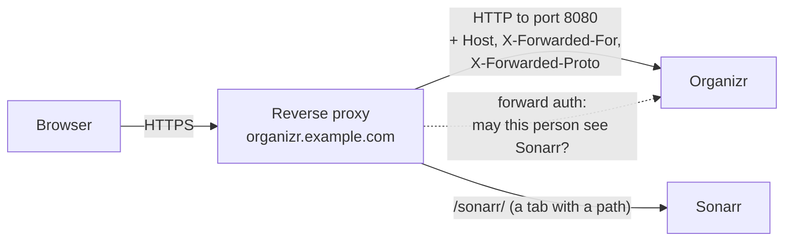

# 🌐 Reverse proxy

[← All documentation](README.md)

A reverse proxy is the web server in front of your applications, for example nginx, Nginx Proxy Manager, SWAG, Traefik or Caddy. It gives Organizr an address such as `https://organizr.example.com`, with HTTPS (the proxy gets and renews the certificate). This page puts Organizr behind one, tells Organizr to trust it, and makes your tabs work through it.

To protect your other applications with Organizr's login, read [Forward auth](forward-auth.md) too.

## 🧭 How a request travels



The browser only ever talks to the proxy, over HTTPS. The proxy passes each request on to Organizr over plain HTTP, and adds headers that tell Organizr who asked and how.

## 📋 What Organizr needs from the proxy

The proxy must send three headers with each request:

| Header | Why |
|---|---|
| `Host` | The name of Organizr that the browser used. Organizr completes the addresses of tabs with it |
| `X-Forwarded-Proto` | `https` when the browser used HTTPS. Organizr then makes `https://` addresses and secure cookies |
| `X-Forwarded-For` | The address of the browser. Organizr uses it for the log, the local network rules, the login lockout and forward auth |

Organizr believes `X-Forwarded-Proto` and `X-Forwarded-For` only from a proxy that you name in `ORGANIZR_TRUSTED_PROXIES`. So a caller can't simply claim another address. Other headers such as `X-Real-IP`, `Forwarded` or `CF-Connecting-IP` aren't read.

## 🔒 ORGANIZR_TRUSTED_PROXIES

`ORGANIZR_TRUSTED_PROXIES` holds the addresses or networks of your proxies, separated by commas. IPv4 and IPv6 both work, and so do networks such as `172.30.0.0/24`. Host names don't. A wrong entry stops Organizr at start with `the list of trusted proxies is not valid`.

```yaml
services:
  organizr:
    environment:
      ORGANIZR_TRUSTED_PROXIES: "172.30.0.10"
```

Organizr reads `X-Forwarded-For` from the right. Each address that belongs to a trusted proxy is skipped, and the first one that doesn't is the client. So a chain such as a CDN, then your proxy, then Organizr works when you list both proxies.

### 🎯 Keep the list narrow

> [!CAUTION]
> Every address in the list can claim to be any client. Trust only your proxy, ideally its one address. Never list a whole Docker range such as `172.16.0.0/12`, or your home network such as `192.168.0.0/16`, while port 8080 is published: every other container (and on some Docker setups every client of the published port, which then arrives from a Docker gateway address) could fake its address. A faked address passes forward-auth allow lists, counts as local for **Ignore External 2FA on Local Subnet**, and moves the login lockout onto someone else.

Once the proxy works, remove the `ports:` lines of Organizr from `compose.yaml`. Then nobody can reach Organizr around the proxy, and the proxy reaches it over the Docker network.

### 🔍 Find your proxy's address

When the proxy runs on another computer, use that computer's address.

When the proxy is a container, ask Docker for its address:

```bash
docker inspect -f '{{range .NetworkSettings.Networks}}{{.IPAddress}} {{end}}' <proxy container>
```

`<proxy container>` is the name that `docker ps` shows, for example `nginx-proxy-manager-app-1`.

A container's address can change when it's re-created. To make it stick, put Organizr and the proxy on a shared network with a fixed range, and give the proxy a fixed address:

1. Create the network once:

   ```bash
   docker network create --subnet 172.30.0.0/24 proxy
   ```

2. In the proxy's `compose.yaml`, join it with a fixed address:

   ```yaml
   services:
     proxy:
       networks:
         proxy:
           ipv4_address: 172.30.0.10

   networks:
     proxy:
       external: true
   ```

3. In Organizr's `compose.yaml`, join it too, and trust that one address:

   ```yaml
   services:
     organizr:
       networks:
         - default
         - proxy
       environment:
         ORGANIZR_TRUSTED_PROXIES: "172.30.0.10"

   networks:
     proxy:
       external: true
   ```

   `default` keeps Organizr on its own network too, where it reaches its PostgreSQL database.

4. Re-create both: `docker compose up -d` in each folder.

On the shared network, the proxy reaches Organizr by its service name: `http://organizr:8080`.

### ❓ What happens without it

Without `ORGANIZR_TRUSTED_PROXIES`, Organizr trusts no proxy, and every request seems to come from the proxy itself:

| You notice | Why |
| --- | --- |
| Tabs and links start with `http://`, even though the browser uses HTTPS | Organizr ignores `X-Forwarded-Proto` |
| The login cookie is sent without `Secure` | Same reason |
| The log shows the proxy's address for every caller | Organizr ignores `X-Forwarded-For` |
| A few wrong passwords lock **everybody** out | The lockout counts per address, and everyone shares the proxy's |
| The local network rules apply to nobody, or to everybody | A proxy that sends `X-Forwarded-For` makes nobody local. One that sends none makes the whole internet local, so **Ignore External 2FA on Local Subnet** would skip the second factor for everyone |

Organizr writes this warning to its log once, when a request with `X-Forwarded-For` comes from an address that isn't trusted:

```text
a request with an X-Forwarded-For header came from an address that is not a trusted proxy, so the header was ignored. If this address is your reverse proxy, add it to ORGANIZR_TRUSTED_PROXIES.
```

## 🟩 nginx

```nginx
server {
    listen 443 ssl;
    server_name organizr.example.com;
    # ssl_certificate and ssl_certificate_key of your certificate.

    # Picture uploads take up to 10 MB, and the speed test plugin sends large uploads.
    client_max_body_size 64m;

    location / {
        proxy_pass http://organizr:8080;
        proxy_set_header Host $host;
        proxy_set_header X-Forwarded-For $proxy_add_x_forwarded_for;
        proxy_set_header X-Forwarded-Proto $scheme;
    }

    # The chat plugin keeps this request open and sends each new message at once.
    location = /api/v2/plugins/chat/events {
        proxy_pass http://organizr:8080;
        proxy_set_header Host $host;
        proxy_set_header X-Forwarded-For $proxy_add_x_forwarded_for;
        proxy_set_header X-Forwarded-Proto $scheme;
        proxy_buffering off;
        proxy_read_timeout 1h;
    }
}

# Send plain HTTP to HTTPS, so no login ever crosses the network unencrypted.
server {
    listen 80;
    server_name organizr.example.com;
    return 301 https://$host$request_uri;
}
```

Keep `proxy_set_header Host $host`. Without it, nginx sends the name of the upstream, `organizr:8080`, and tabs get addresses such as `http://organizr:8080/sonarr/`.

## 🟥 Nginx Proxy Manager

In Nginx Proxy Manager (NPM), select **Hosts › Proxy Hosts › Add Proxy Host**, and fill in:

<!-- SCREENSHOT: npm-proxy-host.png | Nginx Proxy Manager, the "Add Proxy Host" dialog, Details tab filled in for organizr.example.com with forward host organizr and port 8080 -->

| Tab | Field | What to enter |
| --- | --- | --- |
| Details | **Domain Names** | `organizr.example.com` |
| Details | **Scheme** | `http` |
| Details | **Forward Hostname / IP** | `organizr` when NPM and Organizr share a Docker network (see [Find your proxy's address](#-find-your-proxys-address)), else the address of the Docker host |
| Details | **Forward Port** | `8080` |
| Details | **Block Common Exploits** | On |
| Details | **Websockets Support** | Not needed; Organizr doesn't use WebSockets |
| SSL | **SSL Certificate** | **Request a new SSL Certificate** (or pick yours) |
| SSL | **Force SSL** | On |
| SSL | **HTTP/2 Support** | On |

NPM sends `Host`, `X-Forwarded-For` and `X-Forwarded-Proto` by itself. For the chat plugin, paste this into **Advanced › Custom Nginx Configuration**:

```nginx
location = /api/v2/plugins/chat/events {
    proxy_pass http://organizr:8080;
    proxy_set_header Host $host;
    proxy_set_header X-Forwarded-For $proxy_add_x_forwarded_for;
    proxy_set_header X-Forwarded-Proto $scheme;
    proxy_buffering off;
    proxy_read_timeout 1h;
}
```

Use the same host and port as in **Forward Hostname / IP** and **Forward Port**. Then put NPM's address in `ORGANIZR_TRUSTED_PROXIES`.

## 🟦 SWAG

SWAG (from linuxserver.io) reads one file per application from `/config/nginx/proxy-confs/`. Save this as `organizr.subdomain.conf` there, and restart SWAG:

```nginx
server {
    listen 443 ssl;
    listen [::]:443 ssl;

    server_name organizr.*;

    include /config/nginx/ssl.conf;

    client_max_body_size 64m;

    location / {
        include /config/nginx/proxy.conf;
        include /config/nginx/resolver.conf;
        set $upstream_app organizr;
        set $upstream_port 8080;
        set $upstream_proto http;
        proxy_pass $upstream_proto://$upstream_app:$upstream_port;
    }

    location = /api/v2/plugins/chat/events {
        include /config/nginx/proxy.conf;
        include /config/nginx/resolver.conf;
        set $upstream_app organizr;
        set $upstream_port 8080;
        set $upstream_proto http;
        proxy_pass $upstream_proto://$upstream_app:$upstream_port;
        proxy_buffering off;
        proxy_read_timeout 1h;
    }
}
```

SWAG's `proxy.conf` sends the three headers. SWAG ships an `organizr.subdomain.conf.sample` for PHP Organizr, which listens on port 80; this version listens on `8080`, so the port is the line to change. `$upstream_app` is the name of the Organizr container on SWAG's Docker network.

## 🚦 Traefik

Traefik sends `Host`, `X-Forwarded-Proto` and `X-Forwarded-For` by itself. Labels for the Organizr container:

```yaml
services:
  organizr:
    labels:
      - traefik.enable=true
      - traefik.http.routers.organizr.rule=Host(`organizr.example.com`)
      - traefik.http.routers.organizr.entrypoints=websecure
      - traefik.http.routers.organizr.tls=true
      - traefik.http.routers.organizr.tls.certresolver=<your resolver>
      - traefik.docker.network=proxy
      - traefik.http.services.organizr.loadbalancer.server.port=8080
```

`<your resolver>` is the name of the certificate resolver in your Traefik configuration, for example `letsencrypt`. `traefik.docker.network` names the network that Traefik and Organizr share (here `proxy`, as in [Find your proxy's address](#-find-your-proxys-address)); without it, Traefik may pick Organizr's other network and fail to reach it.

Traefik streams the chat plugin's events without extra rules.

## 🔷 Caddy

Caddy sends the three headers by itself, and streams the chat plugin's events without extra rules:

```caddyfile
organizr.example.com {
    reverse_proxy organizr:8080
}
```

## 📑 Tabs

A tab opens an application in a frame inside Organizr, or in a new browser tab. The address of a tab comes in two forms:

| Address of the tab | What the browser opens | How hard |
|---|---|---|
| A full address, for example `https://sonarr.example.com/` | That address | Easy: each application has its own name at the proxy |
| A path, for example `/sonarr/` | The path on Organizr's host: `https://organizr.example.com/sonarr/` | Advanced: your proxy needs a location per application |

Start with full addresses. Use a path when you want everything under one name.

### 🔗 A tab with a path

The proxy in front of Organizr must send that path to the application. Without such a location, the proxy sends the request to Organizr, and the tab shows Organizr inside Organizr.

For nginx, add a location for each application to Organizr's server block. This example also protects Sonarr with Organizr's login, for the level 1 (Co-Admin): nginx asks Organizr first (`auth_request`), and lets the request through only when Organizr says yes. The `internal` location can't be called from outside.

```nginx
location /sonarr/ {
    auth_request /organizr-auth-1;
    proxy_pass http://sonarr:8989;
    proxy_set_header Host $host;
    proxy_set_header X-Forwarded-For $proxy_add_x_forwarded_for;
    proxy_set_header X-Forwarded-Proto $scheme;
}

# One such location for each level that your tabs use.
location = /organizr-auth-1 {
    internal;
    proxy_pass http://organizr:8080/api/v2/auth/1;
    proxy_pass_request_body off;
    proxy_set_header Content-Length "";
    proxy_set_header X-Forwarded-For $proxy_add_x_forwarded_for;
    proxy_set_header X-Forwarded-Proto $scheme;
}
```

The application must know that it runs under the path. In Sonarr, Radarr and the other *arr applications, enter `/sonarr` in **Settings › General › URL Base**.

[Forward auth](forward-auth.md) explains the levels, and shows the same for Traefik and Caddy.

### 🪟 A tab in a frame

A browser shows an application inside Organizr only when the application allows frames and the address uses HTTPS whenever Organizr does. These are the two usual problems:

| Problem | Why | Fix |
| --- | --- | --- |
| The application forbids frames | It sends `X-Frame-Options`, or a `Content-Security-Policy` with `frame-ancestors`. Both tell the browser which sites may show it in a frame | In nginx, add `proxy_hide_header X-Frame-Options;` to the application's location, together with `add_header Content-Security-Policy "frame-ancestors https://organizr.example.com";`, so that only Organizr can frame it. If the application sends its own `frame-ancestors`, open the tab in a new window instead |
| The tab uses `http://` while Organizr uses HTTPS | A page with HTTPS can't show an `http://` address in a frame | Use a path, or give the application an HTTPS address |

> [!WARNING]
> `proxy_hide_header X-Frame-Options;` alone lets **any** website show that application in a frame, which opens it to clickjacking. Always add the `frame-ancestors` line with your own Organizr address.

**Test the tab** in the tab's dialog tells you whether a page can show inside Organizr. Organizr itself doesn't let other sites show it in a frame.
