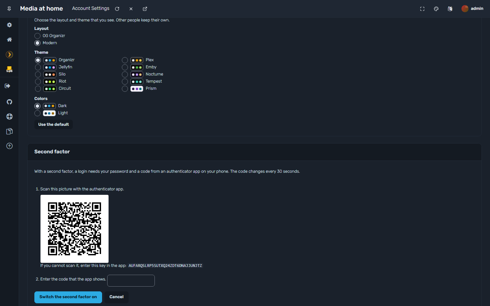

# 📱 Second factor (two-step login)

[← All documentation](README.md)

A second factor makes a login need two things: your password **and** a six-digit code from an app on your phone. Someone who learns your password still can't get in without the phone. Every user can switch it on for their own account; Admins especially should.

The code is a time-based one-time password (TOTP): six digits that change every 30 seconds. Any authenticator app that reads a QR code can make it, for example Aegis, Google Authenticator, or the one built into your password manager.

## 🔒 Switch it on

Each user does this for their own account.

1. Log in.
2. Open the menu with your name (top right), and select **Account Settings**.
3. In the **Second factor** card, select **Set a second factor up**. A QR code and a key appear.
   
4. Scan the QR code with your authenticator app. Can't scan it? Type the key shown below the picture into the app instead.
5. **Save that key in your password manager**, or somewhere else safe. With it, you can add the code to a new phone later. Without it, a lost phone means an Admin has to help (see [Lost your phone?](#-lost-your-phone)).
6. Type the code that the app shows, and the password of your account. Select **Switch the second factor on**. The page says: "The second factor is on. Your next login asks for a code."

Nothing is saved until Organizr has seen one correct code, so a set-up you abandon halfway changes nothing.

From now on, the login page asks for your password first, and then for the code.

## 🔓 Switch it off

1. Log in.
2. Open the menu with your name, and select **Account Settings**.
3. Enter the password of your account, or a code that the app shows now.
4. Select **Switch the second factor off**, and confirm. A login then needs only the password.

The password or the code proves that it's you, so somebody who got hold of your session in a browser can't switch the second factor off or replace it (D-186).

## 🆘 Lost your phone?

Without a code, you can't log in. A new password by e-mail doesn't help either: it doesn't remove the second factor.

1. **Do you have the key you saved at set-up?** Add it to the authenticator app on your new phone. The codes are the same as before. Done.
2. **No key?** Ask an Admin or a Co-Admin to remove your second factor in Manage Users, as below.
3. **Are you the Admin, and nobody else can log in to do it?** Remove it with the command on the server, as below.

After the removal, log in with the password only. Then set up a new second factor, and keep the key this time.

> [!TIP]
> If **Ignore External 2FA on Local Subnet** was already on before you lost the phone, you can still log in without a code from your home network. See [Logins from your own network](#-logins-from-your-own-network).

### 👥 Remove it in Manage Users

1. Log in as an Admin or a Co-Admin.
2. Open **Settings › User Management › Manage Users**, and select **Edit** in the row of the user (or click the row).
3. Under **Second factor**, select **Remove second factor**, and confirm.

The section shows only for a user who has a second factor. Only an Admin can remove the second factor of an Admin.

### 💻 Remove it with the command on the server

This works for any account, also when nobody can log in. In the folder with your compose file, run:

```bash
docker compose exec organizr organizr reset-second-factor --user "<user name>"
```

`<user name>` is the user name as **Settings › User Management › Manage Users** shows it; letter case doesn't matter. Organizr can keep running. The command says what it did: `The second factor of <user name> is removed.`, or that the user had none. With `docker run`, use `docker exec <container> organizr reset-second-factor --user "<user name>"`.

## 🏠 Logins from your own network

The setting **Ignore External 2FA on Local Subnet** (`ignoreTFALocal`, in **Settings › System Settings › Sign-in**) skips the code for logins from your local network. It's off in a new install.

"Local" always includes `10.0.0.0/8`, `172.16.0.0/12`, `192.168.0.0/16` and loopback, plus what you list in **Override Local IP or Subnet** (**Settings › System Settings › Login & Security**). Only an Admin can change the switch, and only an Admin can change that list while the switch is on (D-132).

> [!WARNING]
> Switch it on only when Organizr sees the real address of every visitor. That means: behind a reverse proxy that is listed in [`ORGANIZR_TRUSTED_PROXIES`](reverse-proxy.md#-organizr_trusted_proxies), with no direct port open to the outside. Otherwise a visitor from the internet can look "local" (for example, a trusted-proxy range wide enough to cover other containers, or a proxy that sends no `X-Forwarded-For`, so every request seems to come from the proxy or a Docker gateway address) and skip the code. After you switch it on, log in once from outside and check on **Settings › System Settings › Logs** that your outside address shows up.

## 🔧 Details

### 🧠 What the server does

- Organizr draws the QR code itself. The secret never leaves your server.
- The secret is stored encrypted with the key of your install, like every other secret. See [Secrets](secrets.md). No page and no API route ever shows a stored secret.
- **If that key is lost**, Organizr can't read the stored secret anymore, every code is refused, and the account can't log in until its second factor is removed as shown [above](#-lost-your-phone). This hits the Admin too. So keep [`secret.key`](secrets.md) safe.
- A code works for the 30 seconds in which the app shows it, and for five 30-second steps before and after. So a phone clock that's two minutes off still works. This is the same tolerance as PHP Organizr.
- A code can be used more than once within that window. Don't let anyone watch you type it.
- A wrong code counts as a failed login. After **Max Login Attempts** (**Settings › System Settings › Login & Security**, section **Lockout and sessions**), the account and the client address are locked for **Login Lockout Seconds**.
- A second factor imported from PHP Organizr keeps working with the same app entry.
- A login through [OpenID Connect](openid-connect.md) doesn't ask for the code: the provider checks the person. A login with the [Plex button](plex-login.md) skips it when **Ignore 2FA if Plex OAuth** is on.

### 🔌 The API

| Route | What it does |
|---|---|
| `POST /api/v2/2fa/google` | Makes a new secret. The answer has `secret`, and `url`, a `data:` address of the QR code. Nothing is stored |
| `POST /api/v2/2fa` | Checks `code` against `secret`. `type` is `google`. A wrong code gets status `401` |
| `PUT /api/v2/2fa` | Saves `secret` as the second factor of the caller. `type` is `google` |
| `DELETE /api/v2/2fa` | Removes the second factor of the caller |
| `DELETE /api/v2/users/2fa/{id}` | Removes the second factor of the user with the id. For an Admin or a Co-Admin; only an Admin for an Admin. Not in PHP Organizr ([D-129](deviations.md)) |
| `POST /api/v2/login` | Takes the code in the field `tfaCode`. Without it, an account with a second factor gets `422 "2FA Code Needed"` |
